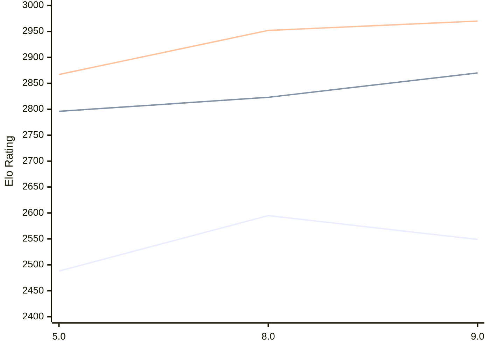

# Engine: 4kc

Author: Gediminas Masaitis

Home: https://github.com/GediminasMasaitis/4k-dot-c

## Elo Ratings E1 (Ultra 7 265T (1.50 GHz) - E-Core)

| Version | Published | STC 8.0+0.08s  | LTC 60.0+0.60s | VLTC 2m24s+1.12s | Comment |
| --- | --- | --- | --- | --- | --- |
| 9.0 | 2026-06-06 | 2549(+138) | 2928(+new) | 3009(+187) |  |
| 8.0 | 2026-03-10 | 2411 |  | 2822 |  |
 | | | cElo (∆ prev) | cElo (∆ prev) | cElo (∆ prev) | 

## Elo Ratings P1 (Ultra 7 265T (1.50 GHz) - P-Core)

| Version | Published | STC 8.0+0.08s  | LTC 60.0+0.60s | VLTC 2m24s+1.12s | Comment |
| --- | --- | --- | --- | --- | --- |
| 9.0 | 2026-06-06 | 2601(-69) | 2962(+new) | 3097(+207) |  |
| 8.0 | 2026-03-10 | 2670 |  | 2890 |  |
 | | | cElo (∆ prev) | cElo (∆ prev) | cElo (∆ prev) | 

## Elo Ratings T1 (i5-7500T 2.70GHz)

| Version | Published | STC 8.0+0.08s  | LTC 60.0+0.60s | VLTC 2m24s+1.12s | Comment |
| --- | --- | --- | --- | --- | --- |
| 9.0 | 2026-06-06 | 2549(-46) | 2870(+47) | 2970(+18) |  |
| 8.0 | 2026-03-10 | 2595(+107) | 2823(+27) | 2952(+85) |  |
| 5.0 | 2025-10-30 | 2488 | 2796 | 2867 |  |
 | | | cElo (∆ prev) | cElo (∆ prev) | cElo (∆ prev) | 

<a href="https://github.com/computer-chess-index/cci/issues/new?template=submit-version.yml&title=[VERSION]+4kc+<version>&body=###%20Engine%20name%0A4kc%0A%0A###%20Version%0A9.0" target="_blank">Submit new version</a>

 Test Conditions:

GUI/CLI: <a href=https://github.com/cutechess/cutechess target="_blank">Cute-Chess</a> 
Elo Calculation: <a href=https://www.remi-coulom.fr/Bayesian-Elo/ target="_blank">Bayesian-Elo</a> 
CPU for P1: Intel(R) Core(TM) Ultra 7 265T (1.50 GHz) - P-Core 
CPU for E1: Intel(R) Core(TM) Ultra 7 265T (1.50 GHz) - E-Core 
CPU for T1: Intel(R) Core(TM) i5-7500T 2.70GHz 
Opening book: 8_moves_v3 
\* STC: 8.0+0.08s, LTC: 60.0+0.60s, VLTC: 2m24s+1.12s

 Lists:
Ratings: <a href=https://github.com/computer-chess-index/cci/blob/main/lists/CCIRatings.csv target="_blank">Complete list</a>

Generated: 2026-11-12 05:35:10

## Ratings Verlauf T1

## Detailed Evaluation Results

| Version | Time Control | Variant | Elo  | Range +/- | Matches | Score | Average Opponent Elo | Draws |
| --- | --- |--- | --- | --- | --- | --- | --- | --- |
| 9.0 | VLTC (2m24s+1.12s) | T1 | 2970 | 27 | 436 | 49% | 2984 | 40% |
|  |  | P1 | 3097 | 34 | 280 | 49% | 3097 | 38% |
|  |  | E1 | 3009 | 28 | 418 | 50% | 3000 | 38% |
|  | LTC (60.0+0.60s) | T1 | 2870 | 26 | 450 | 51% | 2858 | 42% |
|  |  | P1 | 2962 | 31 | 352 | 50% | 2921 | 34% |
|  |  | E1 | 2928 | 29 | 392 | 54% | 2861 | 34% |
|  | STC (8.0+0.08s) | T1 | 2549 | 24 | 562 | 51% | 2545 | 33% |
|  |  | P1 | 2601 | 36 | 250 | 50% | 2603 | 34% |
|  |  | E1 | 2549 | 32 | 344 | 45% | 2612 | 28% |
| --- | --- |--- | --- | --- | --- | --- | --- | --- |
| 8.0 | VLTC (2m24s+1.12s) | E1 | 2822 | 229 | 4 | 88% | 2615 | 25% |
|  |  | T1 | 2952 | 28 | 402 | 52% | 2931 | 39% |
|  |  | P1 | 2890 | 262 | 4 | 100% | 2577 | 0% |
|  | LTC (60.0+0.60s) | T1 | 2823 | 29 | 374 | 51% | 2813 | 40% |
|  | STC (8.0+0.08s) | E1 | 2411 | 207 | 16 | 75% | 1968 | 0% |
|  |  | T1 | 2595 | 27 | 456 | 50% | 2588 | 33% |
|  |  | P1 | 2670 | 262 | 4 | 0% | 2985 | 0% |
| --- | --- |--- | --- | --- | --- | --- | --- | --- |
| 5.0 | VLTC (2m24s+1.12s) | T1 | 2867 | 32 | 296 | 49% | 2880 | 39% |
|  | LTC (60.0+0.60s) | T1 | 2796 | 31 | 324 | 48% | 2811 | 37% |
|  | STC (8.0+0.08s) | T1 | 2488 | 30 | 396 | 51% | 2483 | 25% |