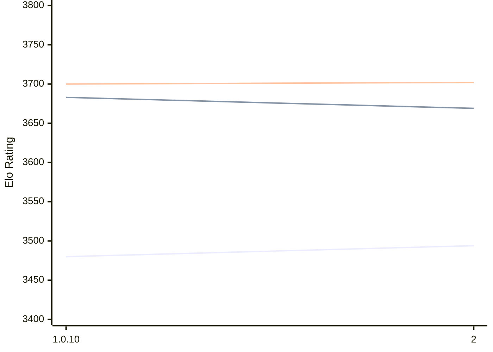

# Engine: 8Chess

Author: Hemesh Kasukurthy

Home: https://github.com/EightChess-Team/8chess

## Elo Ratings E1 (Ultra 7 265T (1.50 GHz) - E-Core)

| Version | Published | STC 8.0+0.08s  | LTC 60.0+0.60s | VLTC 2m24s+1.12s | Comment |
| --- | --- | --- | --- | --- | --- |
| 2 | 2026-11-17 | 3494(+14) | 3669(-14) | 3702(+2) |  |
| 1.0.10 | 2026-10-24 | 3480 | 3683 | 3700 |  |
 | | | cElo (∆ prev) | cElo (∆ prev) | cElo (∆ prev) | 

## Elo Ratings P1 (Ultra 7 265T (1.50 GHz) - P-Core)

| Version | Published | STC 8.0+0.08s  | LTC 60.0+0.60s | VLTC 2m24s+1.12s | Comment |
| --- | --- | --- | --- | --- | --- |
| 2 | 2026-11-17 | 3476 | 3613 | 3633 |  |
 | | | cElo (∆ prev) | cElo (∆ prev) | cElo (∆ prev) | 

## Elo Ratings T1 (i5-7500T 2.70GHz)

| Version | Published | STC 8.0+0.08s  | LTC 60.0+0.60s | VLTC 2m24s+1.12s | Comment |
| --- | --- | --- | --- | --- | --- |
| 2 | 2026-11-17 | 3476 | 3613 | 3633 |  |
 | | | cElo (∆ prev) | cElo (∆ prev) | cElo (∆ prev) | 

<a href="https://github.com/computer-chess-index/cci/issues/new?template=submit-version.yml&title=[VERSION]+8Chess+<version>&body=###%20Engine%20name%0A8Chess%0A%0A###%20Version%0A2" target="_blank">Submit new version</a>

 Test Conditions:

GUI/CLI: <a href=https://github.com/cutechess/cutechess target="_blank">Cute-Chess</a> 
Elo Calculation: <a href=https://www.remi-coulom.fr/Bayesian-Elo/ target="_blank">Bayesian-Elo</a> 
CPU for P1: Intel(R) Core(TM) Ultra 7 265T (1.50 GHz) - P-Core 
CPU for E1: Intel(R) Core(TM) Ultra 7 265T (1.50 GHz) - E-Core 
CPU for T1: Intel(R) Core(TM) i5-7500T 2.70GHz 
Opening book: 8_moves_v3 
\* STC: 8.0+0.08s, LTC: 60.0+0.60s, VLTC: 2m24s+1.12s

 Lists:
Ratings: <a href=https://github.com/computer-chess-index/cci/blob/main/lists/CCIRatings.csv target="_blank">Complete list</a>

Generated: 2026-11-22 05:35:14

## Ratings Verlauf E1 / P1

## Detailed Evaluation Results

| Version | Time Control | Variant | Elo  | Range +/- | Matches | Score | Average Opponent Elo | Draws |
| --- | --- |--- | --- | --- | --- | --- | --- | --- |
| 2 | VLTC (2m24s+1.12s) | P1 | 3633 | 52 | 100 | 64% | 3407 | 72% |
|  |  | E1 | 3702 | 27 | 350 | 56% | 3598 | 80% |
|  | LTC (60.0+0.60s) | P1 | 3613 | 47 | 124 | 65% | 3418 | 69% |
|  |  | E1 | 3669 | 37 | 202 | 61% | 3513 | 70% |
|  | STC (8.0+0.08s) | P1 | 3476 | 52 | 112 | 63% | 3236 | 59% |
|  |  | E1 | 3494 | 38 | 188 | 54% | 3382 | 69% |
| --- | --- |--- | --- | --- | --- | --- | --- | --- |
| 1.0.10 | VLTC (2m24s+1.12s) | E1 | 3700 | 53 | 80 | 50% | 3700 | 85% |
|  | LTC (60.0+0.60s) | E1 | 3683 | 52 | 84 | 50% | 3683 | 88% |
|  | STC (8.0+0.08s) | E1 | 3480 | 52 | 90 | 48% | 3497 | 78% |