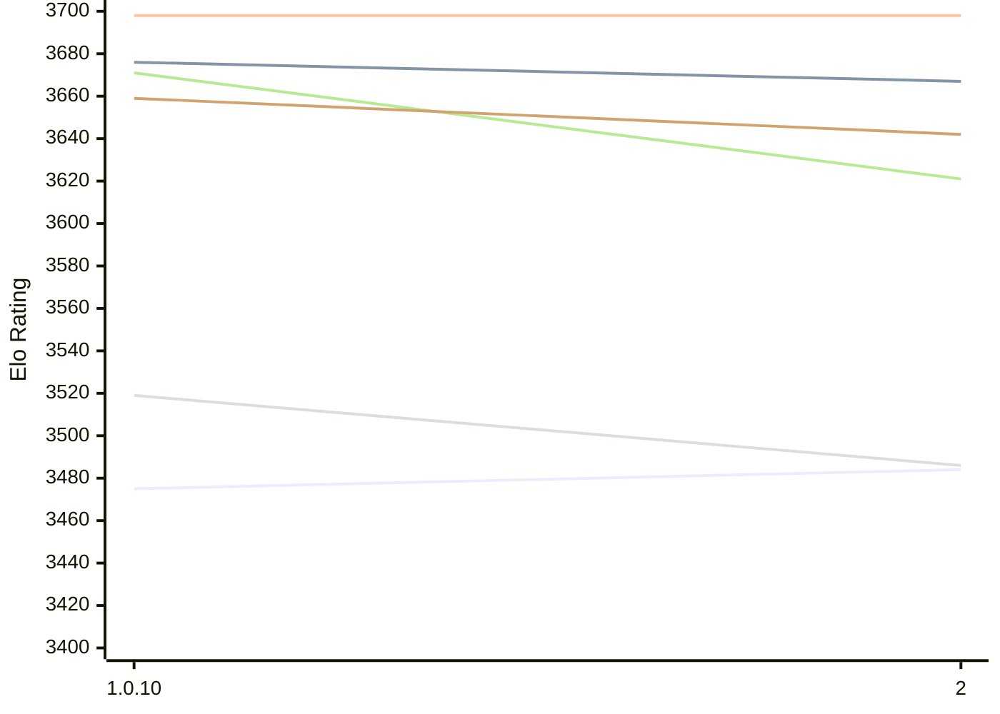

# Engine: 8Chess

Author: Hemesh Kasukurthy

Home: https://github.com/EightChess-Team/8chess

## Elo Ratings E1 (Ultra 7 265T (1.50 GHz) - E-Core)

| Version | Published | STC 8.0+0.08s  | LTC 60.0+0.60s | VLTC 2m24s+1.12s | Comment |
| --- | --- | --- | --- | --- | --- |
| 2 | 2026-11-17 | 3484(+9) | 3667(-9) | 3698(0) |  |
| 1.0.10 | 2026-10-24 | 3475 | 3676 | 3698 |  |
 | | | cElo (∆ prev) | cElo (∆ prev) | cElo (∆ prev) | 

## Elo Ratings P1 (Ultra 7 265T (1.50 GHz) - P-Core)

| Version | Published | STC 8.0+0.08s  | LTC 60.0+0.60s | VLTC 2m24s+1.12s | Comment |
| --- | --- | --- | --- | --- | --- |
| 2 | 2026-11-17 | 3486(-33) | 3621(-50) | 3642(-17) |  |
| 1.0.10 | 2026-10-24 | 3519 | 3671 | 3659 |  |
 | | | cElo (∆ prev) | cElo (∆ prev) | cElo (∆ prev) | 

## Elo Ratings T1 (i5-7500T 2.70GHz)

| Version | Published | STC 8.0+0.08s  | LTC 60.0+0.60s | VLTC 2m24s+1.12s | Comment |
| --- | --- | --- | --- | --- | --- |
| 1.0.10 | 2026-10-24 | 3519 | 3671 | 3659 |  |
 | | | cElo (∆ prev) | cElo (∆ prev) | cElo (∆ prev) | 

<a href="https://github.com/computer-chess-index/cci/issues/new?template=submit-version.yml&title=[VERSION]+8Chess+<version>&body=###%20Engine%20name%0A8Chess%0A%0A###%20Version%0A2" target="_blank">Submit new version</a>

 Test Conditions:

GUI/CLI: <a href=https://github.com/cutechess/cutechess target="_blank">Cute-Chess</a> 
Elo Calculation: <a href=https://www.remi-coulom.fr/Bayesian-Elo/ target="_blank">Bayesian-Elo</a> 
CPU for P1: Intel(R) Core(TM) Ultra 7 265T (1.50 GHz) - P-Core 
CPU for E1: Intel(R) Core(TM) Ultra 7 265T (1.50 GHz) - E-Core 
CPU for T1: Intel(R) Core(TM) i5-7500T 2.70GHz 
Opening book: 8_moves_v3 
\* STC: 8.0+0.08s, LTC: 60.0+0.60s, VLTC: 2m24s+1.12s

 Lists:
Ratings: <a href=https://github.com/computer-chess-index/cci/blob/main/lists/CCIRatings.csv target="_blank">Complete list</a>

Generated: 2026-11-24 05:35:13

## Ratings Verlauf E1 / P1

## Detailed Evaluation Results

| Version | Time Control | Variant | Elo  | Range +/- | Matches | Score | Average Opponent Elo | Draws |
| --- | --- |--- | --- | --- | --- | --- | --- | --- |
| 2 | VLTC (2m24s+1.12s) | E1 | 3698 | 27 | 350 | 56% | 3594 | 80% |
|  |  | P1 | 3642 | 50 | 108 | 63% | 3433 | 74% |
|  | LTC (60.0+0.60s) | P1 | 3621 | 47 | 124 | 65% | 3426 | 69% |
|  |  | E1 | 3667 | 36 | 210 | 60% | 3517 | 70% |
|  | STC (8.0+0.08s) | P1 | 3486 | 52 | 112 | 63% | 3244 | 59% |
|  |  | E1 | 3484 | 37 | 196 | 53% | 3384 | 68% |
| --- | --- |--- | --- | --- | --- | --- | --- | --- |
| 1.0.10 | VLTC (2m24s+1.12s) | P1 | 3659 | 79 | 36 | 51% | 3650 | 86% |
|  |  | E1 | 3698 | 34 | 196 | 50% | 3699 | 92% |
|  | LTC (60.0+0.60s) | P1 | 3671 | 63 | 56 | 51% | 3664 | 88% |
|  |  | E1 | 3676 | 46 | 108 | 50% | 3680 | 90% |
|  | STC (8.0+0.08s) | P1 | 3519 | 75 | 44 | 57% | 3474 | 68% |
|  |  | E1 | 3475 | 44 | 126 | 48% | 3488 | 77% |