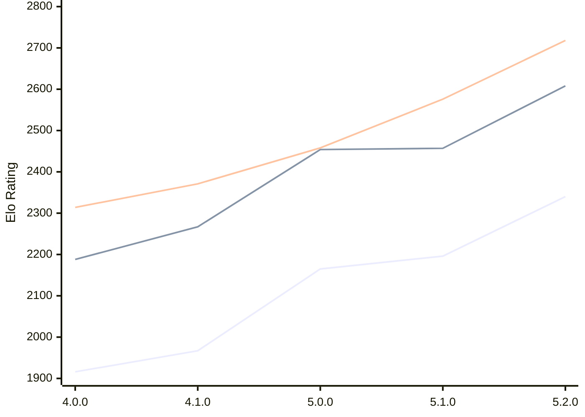

# Engine: Aconcagua

Author: Tarifa Gabriel

Home: https://github.com/gabtar/aconcagua

## Elo Ratings E1 (Ultra 7 265T (1.50 GHz) - E-Core)

| Version | Published | STC 8.0+0.08s  | LTC 60.0+0.60s | VLTC 2m24s+1.12s | Comment |
| --- | --- | --- | --- | --- | --- |
| 5.2.0 | 2026-05-31 | 2221 | 2565 | 2677 |  |
 | | | cElo (∆ prev) | cElo (∆ prev) | cElo (∆ prev) | 

## Elo Ratings P1 (Ultra 7 265T (1.50 GHz) - P-Core)

| Version | Published | STC 8.0+0.08s  | LTC 60.0+0.60s | VLTC 2m24s+1.12s | Comment |
| --- | --- | --- | --- | --- | --- |
| 5.2.0 | 2026-05-31 | 2299 | 2695 | 2741 |  |
 | | | cElo (∆ prev) | cElo (∆ prev) | cElo (∆ prev) | 

## Elo Ratings T1 (i5-7500T 2.70GHz)

| Version | Published | STC 8.0+0.08s  | LTC 60.0+0.60s | VLTC 2m24s+1.12s | Comment |
| --- | --- | --- | --- | --- | --- |
| 5.2.0 | 2026-05-31 | 2340(+144) | 2608(+151) | 2718(+142) |  |
| 5.1.0 | 2026-03-01 | 2196(+31) | 2457(+3) | 2576(+118) |  |
| 5.0.0 | 2026-01-25 | 2165(+198) | 2454(+187) | 2458(+87) |  |
| 4.1.0 | 2025-12-14 | 1967(+51) | 2267(+79) | 2371(+57) |  |
| 4.0.0 | 2025-11-09 | 1916 | 2188 | 2314 |  |
 | | | cElo (∆ prev) | cElo (∆ prev) | cElo (∆ prev) | 

<a href="https://github.com/computer-chess-index/cci/issues/new?template=submit-version.yml&title=[VERSION]+Aconcagua+<version>&body=###%20Engine%20name%0AAconcagua%0A%0A###%20Version%0A5.2.0" target="_blank">Submit new version</a>

 Test Conditions:

GUI/CLI: <a href=https://github.com/cutechess/cutechess target="_blank">Cute-Chess</a> 
Elo Calculation: <a href=https://www.remi-coulom.fr/Bayesian-Elo/ target="_blank">Bayesian-Elo</a> 
CPU for P1: Intel(R) Core(TM) Ultra 7 265T (1.50 GHz) - P-Core 
CPU for E1: Intel(R) Core(TM) Ultra 7 265T (1.50 GHz) - E-Core 
CPU for T1: Intel(R) Core(TM) i5-7500T 2.70GHz 
Opening book: 8_moves_v3 
\* STC: 8.0+0.08s, LTC: 60.0+0.60s, VLTC: 2m24s+1.12s

 Lists:
Ratings: <a href=https://github.com/computer-chess-index/cci/blob/main/lists/CCIRatings.csv target="_blank">Complete list</a>

Generated: 2026-10-18 04:35:14

## Ratings Verlauf T1

## Detailed Evaluation Results

| Version | Time Control | Variant | Elo  | Range +/- | Matches | Score | Average Opponent Elo | Draws |
| --- | --- |--- | --- | --- | --- | --- | --- | --- |
| 5.2.0 | VLTC (2m24s+1.12s) | T1 | 2718 | 29 | 366 | 53% | 2692 | 37% |
|  |  | P1 | 2741 | 41 | 190 | 52% | 2720 | 36% |
|  |  | E1 | 2677 | 33 | 312 | 53% | 2651 | 33% |
|  | LTC (60.0+0.60s) | T1 | 2608 | 26 | 482 | 53% | 2583 | 33% |
|  |  | P1 | 2695 | 41 | 200 | 54% | 2639 | 31% |
|  |  | E1 | 2565 | 41 | 214 | 51% | 2553 | 28% |
|  | STC (8.0+0.08s) | T1 | 2340 | 29 | 414 | 48% | 2364 | 27% |
|  |  | P1 | 2299 | 43 | 180 | 46% | 2349 | 27% |
|  |  | E1 | 2221 | 38 | 248 | 47% | 2246 | 26% |
| --- | --- |--- | --- | --- | --- | --- | --- | --- |
| 5.1.0 | VLTC (2m24s+1.12s) | T1 | 2576 | 27 | 428 | 50% | 2580 | 38% |
|  | LTC (60.0+0.60s) | T1 | 2457 | 29 | 376 | 51% | 2445 | 34% |
|  | STC (8.0+0.08s) | T1 | 2196 | 27 | 468 | 49% | 2198 | 27% |
| --- | --- |--- | --- | --- | --- | --- | --- | --- |
| 5.0.0 | VLTC (2m24s+1.12s) | T1 | 2458 | 42 | 196 | 51% | 2450 | 22% |
|  | LTC (60.0+0.60s) | T1 | 2454 | 37 | 246 | 49% | 2460 | 26% |
|  | STC (8.0+0.08s) | T1 | 2165 | 34 | 290 | 50% | 2168 | 25% |
| --- | --- |--- | --- | --- | --- | --- | --- | --- |
| 4.1.0 | VLTC (2m24s+1.12s) | T1 | 2371 | 40 | 214 | 50% | 2376 | 27% |
|  | LTC (60.0+0.60s) | T1 | 2267 | 40 | 222 | 51% | 2249 | 23% |
|  | STC (8.0+0.08s) | T1 | 1967 | 33 | 312 | 47% | 1993 | 23% |
| --- | --- |--- | --- | --- | --- | --- | --- | --- |
| 4.0.0 | VLTC (2m24s+1.12s) | T1 | 2314 | 46 | 172 | 41% | 2422 | 28% |
|  | LTC (60.0+0.60s) | T1 | 2188 | 55 | 116 | 47% | 2217 | 23% |
|  | STC (8.0+0.08s) | T1 | 1916 | 62 | 92 | 47% | 1941 | 21% |