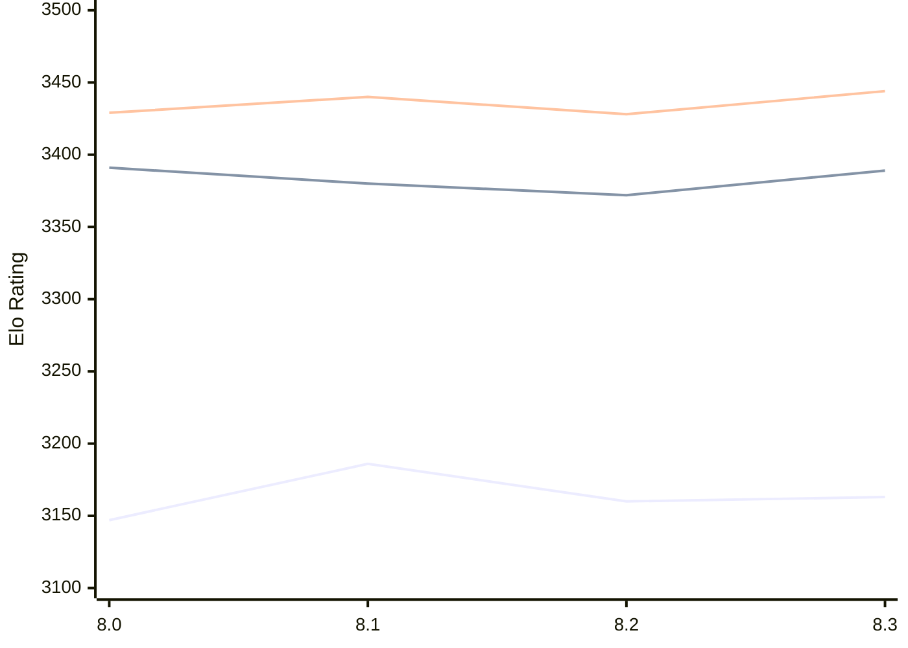

# Engine: Alexander

Author: Andrea Manzo

Home: https://github.com/amchess/Alexander

## Elo Ratings E1 (Ultra 7 265T (1.50 GHz) - E-Core)

| Version | Published | STC 8.0+0.08s  | LTC 60.0+0.60s | VLTC 2m24s+1.12s | Comment |
| --- | --- | --- | --- | --- | --- |
| 8.3 | 2026-04-01 | 2901 | 3167 | 3298 |  |
 | | | cElo (∆ prev) | cElo (∆ prev) | cElo (∆ prev) | 

## Elo Ratings P1 (Ultra 7 265T (1.50 GHz) - P-Core)

| Version | Published | STC 8.0+0.08s  | LTC 60.0+0.60s | VLTC 2m24s+1.12s | Comment |
| --- | --- | --- | --- | --- | --- |
| 8.3 | 2026-04-01 | 3043 | 3258 | 3293 |  |
 | | | cElo (∆ prev) | cElo (∆ prev) | cElo (∆ prev) | 

## Elo Ratings T1 (i5-7500T 2.70GHz)

| Version | Published | STC 8.0+0.08s  | LTC 60.0+0.60s | VLTC 2m24s+1.12s | Comment |
| --- | --- | --- | --- | --- | --- |
| 8.3 | 2026-04-01 | 3163(+3) | 3389(+17) | 3444(+16) |  |
| 8.2 | 2026-03-23 | 3160(-26) | 3372(-8) | 3428(-12) |  |
| 8.1 | 2026-03-16 | 3186(+39) | 3380(-11) | 3440(+11) |  |
| 8.0 | 2026-03-10 | 3147 | 3391 | 3429 |  |
 | | | cElo (∆ prev) | cElo (∆ prev) | cElo (∆ prev) | 

<a href="https://github.com/computer-chess-index/cci/issues/new?template=submit-version.yml&title=[VERSION]+Alexander+<version>&body=###%20Engine%20name%0AAlexander%0A%0A###%20Version%0A8.3" target="_blank">Submit new version</a>

 Test Conditions:

GUI/CLI: <a href=https://github.com/cutechess/cutechess target="_blank">Cute-Chess</a> 
Elo Calculation: <a href=https://www.remi-coulom.fr/Bayesian-Elo/ target="_blank">Bayesian-Elo</a> 
CPU for P1: Intel(R) Core(TM) Ultra 7 265T (1.50 GHz) - P-Core 
CPU for E1: Intel(R) Core(TM) Ultra 7 265T (1.50 GHz) - E-Core 
CPU for T1: Intel(R) Core(TM) i5-7500T 2.70GHz 
Opening book: 8_moves_v3 
\* STC: 8.0+0.08s, LTC: 60.0+0.60s, VLTC: 2m24s+1.12s

 Lists:
Ratings: <a href=https://github.com/computer-chess-index/cci/blob/main/lists/CCIRatings.csv target="_blank">Complete list</a>

Generated: 2026-10-19 04:35:25

## Ratings Verlauf T1

## Detailed Evaluation Results

| Version | Time Control | Variant | Elo  | Range +/- | Matches | Score | Average Opponent Elo | Draws |
| --- | --- |--- | --- | --- | --- | --- | --- | --- |
| 8.3 | VLTC (2m24s+1.12s) | T1 | 3444 | 22 | 534 | 50% | 3447 | 68% |
|  |  | P1 | 3293 | 29 | 382 | 59% | 3208 | 34% |
|  |  | E1 | 3298 | 37 | 246 | 53% | 3243 | 34% |
|  | LTC (60.0+0.60s) | T1 | 3389 | 22 | 514 | 48% | 3403 | 66% |
|  |  | P1 | 3258 | 39 | 226 | 56% | 3146 | 31% |
|  |  | E1 | 3167 | 32 | 328 | 54% | 3104 | 30% |
|  | STC (8.0+0.08s) | P1 | 3043 | 33 | 304 | 41% | 3129 | 31% |
|  |  | E1 | 2901 | 32 | 354 | 40% | 2996 | 28% |
|  |  | T1 | 3163 | 24 | 500 | 52% | 3148 | 48% |
| --- | --- |--- | --- | --- | --- | --- | --- | --- |
| 8.2 | VLTC (2m24s+1.12s) | T1 | 3428 | 26 | 380 | 49% | 3436 | 70% |
|  | LTC (60.0+0.60s) | T1 | 3372 | 31 | 284 | 50% | 3371 | 62% |
|  | STC (8.0+0.08s) | T1 | 3160 | 27 | 396 | 48% | 3174 | 44% |
| --- | --- |--- | --- | --- | --- | --- | --- | --- |
| 8.1 | VLTC (2m24s+1.12s) | T1 | 3440 | 28 | 324 | 49% | 3445 | 64% |
|  | LTC (60.0+0.60s) | T1 | 3380 | 30 | 290 | 51% | 3374 | 66% |
|  | STC (8.0+0.08s) | T1 | 3186 | 31 | 302 | 49% | 3194 | 44% |
| --- | --- |--- | --- | --- | --- | --- | --- | --- |
| 8.0 | VLTC (2m24s+1.12s) | T1 | 3429 | 28 | 308 | 50% | 3426 | 72% |
|  | LTC (60.0+0.60s) | T1 | 3391 | 28 | 332 | 50% | 3390 | 63% |
|  | STC (8.0+0.08s) | T1 | 3147 | 31 | 300 | 49% | 3152 | 47% |