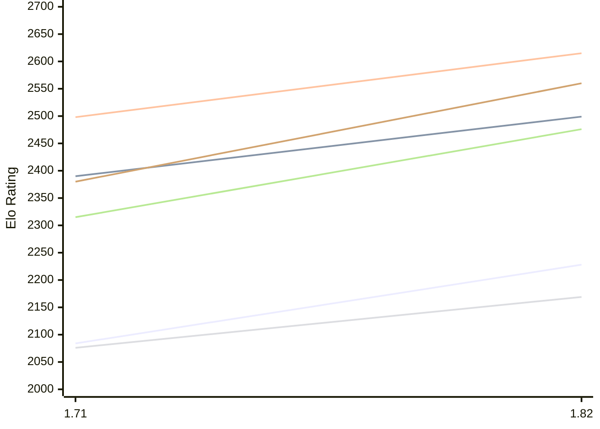
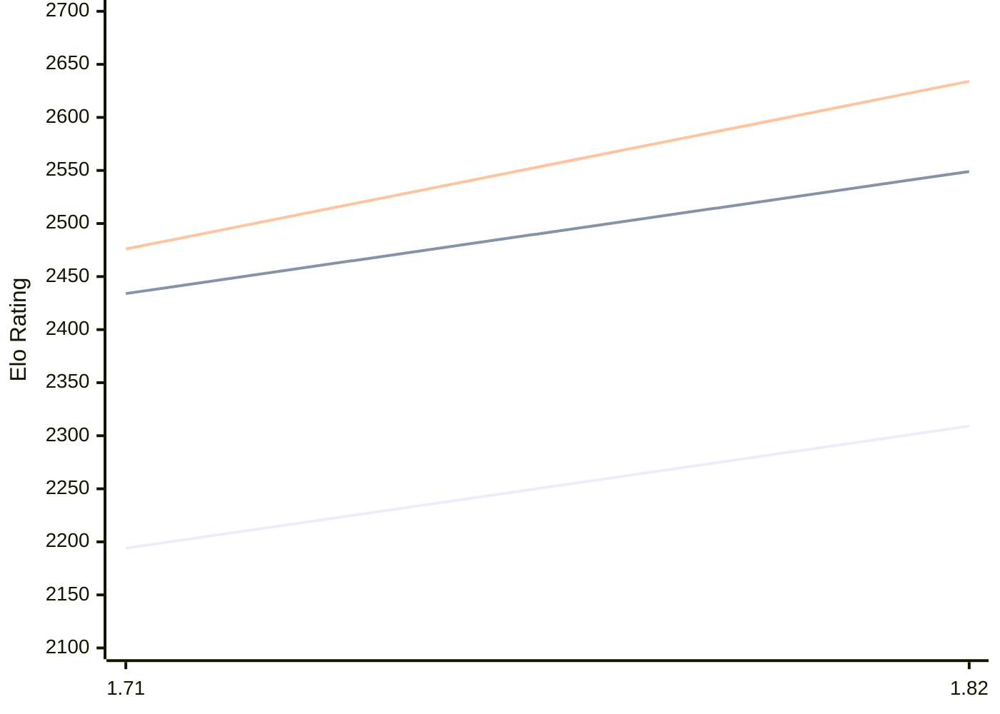

# Engine: Amira

Author: Fauzi Dabat Akram

Home: https://github.com/FauziAkram/amira

## Elo Ratings E1 (Ultra 7 265T (1.50 GHz) - E-Core)

| Version | Published | STC 8.0+0.08s  | LTC 60.0+0.60s | VLTC 2m24s+1.12s | Comment |
| --- | --- | --- | --- | --- | --- |
| 1.82 | 2026-01-02 | 2228(+144) | 2499(+109) | 2615(+117) |  |
| 1.71 | 2025-10-30 | 2084 | 2390 | 2498 |  |
 | | | cElo (∆ prev) | cElo (∆ prev) | cElo (∆ prev) | 

## Elo Ratings P1 (Ultra 7 265T (1.50 GHz) - P-Core)

| Version | Published | STC 8.0+0.08s  | LTC 60.0+0.60s | VLTC 2m24s+1.12s | Comment |
| --- | --- | --- | --- | --- | --- |
| 1.82 | 2026-01-02 | 2169(+93) | 2476(+161) | 2560(+180) |  |
| 1.71 | 2025-10-30 | 2076 | 2315 | 2380 |  |
 | | | cElo (∆ prev) | cElo (∆ prev) | cElo (∆ prev) | 

## Elo Ratings T1 (i5-7500T 2.70GHz)

| Version | Published | STC 8.0+0.08s  | LTC 60.0+0.60s | VLTC 2m24s+1.12s | Comment |
| --- | --- | --- | --- | --- | --- |
| 1.82 | 2026-01-02 | 2309(+115) | 2549(+115) | 2634(+158) |  |
| 1.71 | 2025-10-30 | 2194 | 2434 | 2476 |  |
 | | | cElo (∆ prev) | cElo (∆ prev) | cElo (∆ prev) | 

<a href="https://github.com/computer-chess-index/cci/issues/new?template=submit-version.yml&title=[VERSION]+Amira+<version>&body=###%20Engine%20name%0AAmira%0A%0A###%20Version%0A1.82" target="_blank">Submit new version</a>

 Test Conditions:

GUI/CLI: <a href=https://github.com/cutechess/cutechess target="_blank">Cute-Chess</a> 
Elo Calculation: <a href=https://www.remi-coulom.fr/Bayesian-Elo/ target="_blank">Bayesian-Elo</a> 
CPU for P1: Intel(R) Core(TM) Ultra 7 265T (1.50 GHz) - P-Core 
CPU for E1: Intel(R) Core(TM) Ultra 7 265T (1.50 GHz) - E-Core 
CPU for T1: Intel(R) Core(TM) i5-7500T 2.70GHz 
Opening book: 8_moves_v3 
\* STC: 8.0+0.08s, LTC: 60.0+0.60s, VLTC: 2m24s+1.12s

 Lists:
Ratings: <a href=https://github.com/computer-chess-index/cci/blob/main/lists/CCIRatings.csv target="_blank">Complete list</a>

Generated: 2026-11-15 05:35:37

## Ratings Verlauf E1 / P1

## Ratings Verlauf T1

## Detailed Evaluation Results

| Version | Time Control | Variant | Elo  | Range +/- | Matches | Score | Average Opponent Elo | Draws |
| --- | --- |--- | --- | --- | --- | --- | --- | --- |
| 1.82 | VLTC (2m24s+1.12s) | T1 | 2634 | 22 | 710 | 48% | 2649 | 29% |
|  |  | P1 | 2560 | 35 | 290 | 49% | 2574 | 25% |
|  |  | E1 | 2615 | 32 | 368 | 54% | 2570 | 24% |
|  | LTC (60.0+0.60s) | T1 | 2549 | 25 | 552 | 51% | 2535 | 24% |
|  |  | P1 | 2476 | 36 | 268 | 52% | 2465 | 27% |
|  |  | E1 | 2499 | 32 | 366 | 51% | 2480 | 25% |
|  | STC (8.0+0.08s) | T1 | 2309 | 23 | 694 | 51% | 2295 | 23% |
|  |  | P1 | 2169 | 37 | 268 | 51% | 2144 | 21% |
|  |  | E1 | 2228 | 32 | 364 | 50% | 2238 | 21% |
| --- | --- |--- | --- | --- | --- | --- | --- | --- |
| 1.71 | VLTC (2m24s+1.12s) | E1 | 2498 | 76 | 66 | 47% | 2499 | 21% |
|  |  | T1 | 2476 | 40 | 220 | 51% | 2466 | 21% |
|  |  | P1 | 2380 | 81 | 60 | 49% | 2357 | 22% |
|  | LTC (60.0+0.60s) | E1 | 2390 | 70 | 80 | 48% | 2398 | 19% |
|  |  | T1 | 2434 | 39 | 248 | 52% | 2425 | 17% |
|  |  | P1 | 2315 | 99 | 44 | 33% | 2537 | 16% |
|  | STC (8.0+0.08s) | E1 | 2084 | 66 | 106 | 39% | 2221 | 10% |
|  |  | T1 | 2194 | 43 | 206 | 51% | 2184 | 12% |
|  |  | P1 | 2076 | 75 | 76 | 45% | 2160 | 9% |