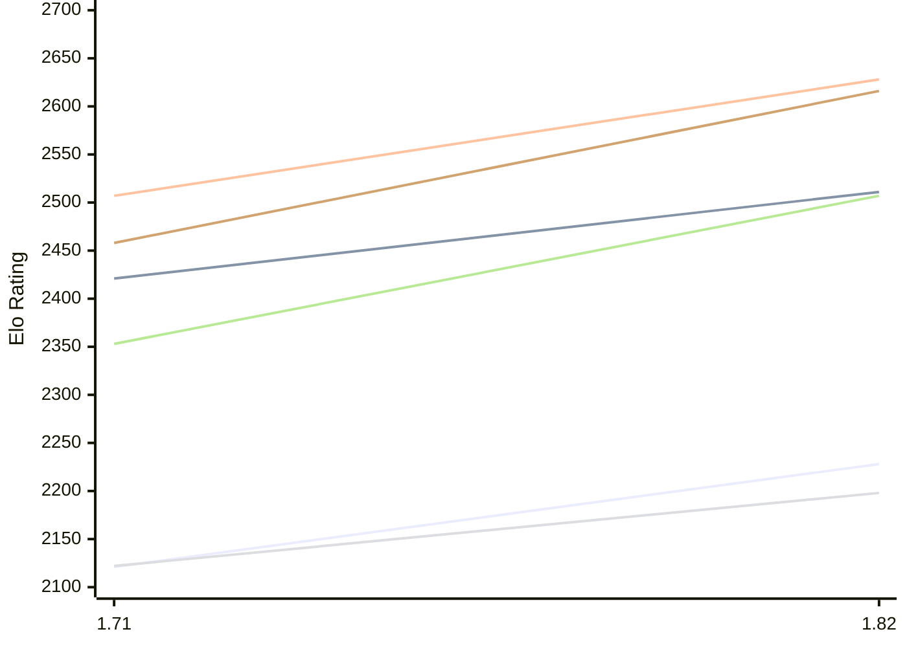
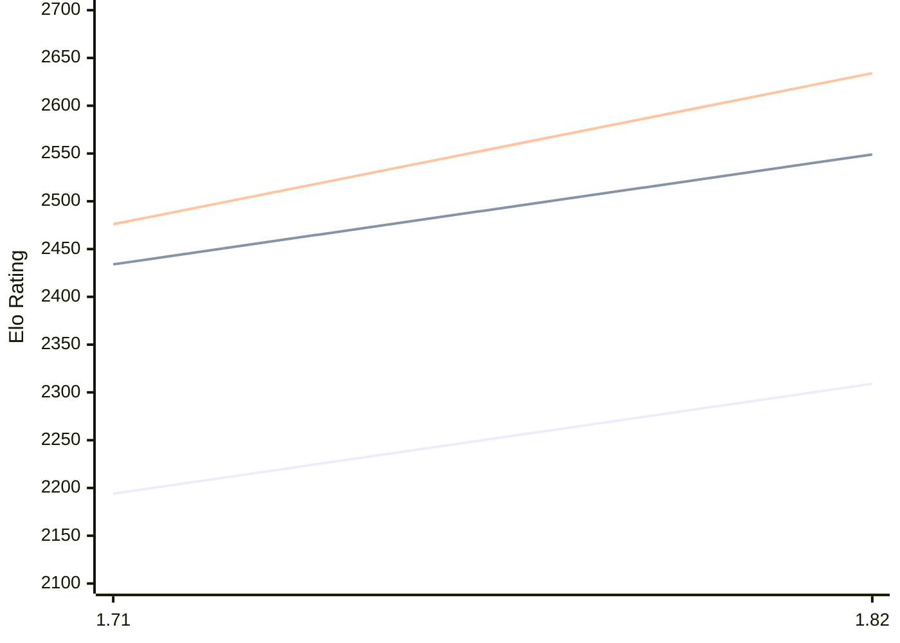

# Engine: Amira

Author: Fauzi Dabat Akram

Home: https://github.com/FauziAkram/amira

## Elo Ratings E1 (Ultra 7 265T (1.50 GHz) - E-Core)

| Version | Published | STC 8.0+0.08s  | LTC 60.0+0.60s | VLTC 2m24s+1.12s | Comment |
| --- | --- | --- | --- | --- | --- |
| 1.82 | 2026-01-02 | 2228(+107) | 2511(+90) | 2628(+121) |  |
| 1.71 | 2025-10-30 | 2121 | 2421 | 2507 |  |
 | | | cElo (∆ prev) | cElo (∆ prev) | cElo (∆ prev) | 

## Elo Ratings P1 (Ultra 7 265T (1.50 GHz) - P-Core)

| Version | Published | STC 8.0+0.08s  | LTC 60.0+0.60s | VLTC 2m24s+1.12s | Comment |
| --- | --- | --- | --- | --- | --- |
| 1.82 | 2026-01-02 | 2198(+76) | 2507(+154) | 2616(+158) |  |
| 1.71 | 2025-10-30 | 2122 | 2353 | 2458 |  |
 | | | cElo (∆ prev) | cElo (∆ prev) | cElo (∆ prev) | 

## Elo Ratings T1 (i5-7500T 2.70GHz)

| Version | Published | STC 8.0+0.08s  | LTC 60.0+0.60s | VLTC 2m24s+1.12s | Comment |
| --- | --- | --- | --- | --- | --- |
| 1.82 | 2026-01-02 | 2309(+115) | 2549(+115) | 2634(+158) |  |
| 1.71 | 2025-10-30 | 2194 | 2434 | 2476 |  |
 | | | cElo (∆ prev) | cElo (∆ prev) | cElo (∆ prev) | 

<a href="https://github.com/computer-chess-index/cci/issues/new?template=submit-version.yml&title=[VERSION]+Amira+<version>&body=###%20Engine%20name%0AAmira%0A%0A###%20Version%0A1.82" target="_blank">Submit new version</a>

 Test Conditions:

GUI/CLI: <a href=https://github.com/cutechess/cutechess target="_blank">Cute-Chess</a> 
Elo Calculation: <a href=https://www.remi-coulom.fr/Bayesian-Elo/ target="_blank">Bayesian-Elo</a> 
CPU for P1: Intel(R) Core(TM) Ultra 7 265T (1.50 GHz) - P-Core 
CPU for E1: Intel(R) Core(TM) Ultra 7 265T (1.50 GHz) - E-Core 
CPU for T1: Intel(R) Core(TM) i5-7500T 2.70GHz 
Opening book: 8_moves_v3 
\* STC: 8.0+0.08s, LTC: 60.0+0.60s, VLTC: 2m24s+1.12s

 Lists:
Ratings: <a href=https://github.com/computer-chess-index/cci/blob/main/lists/CCIRatings.csv target="_blank">Complete list</a>

Generated: 2026-11-25 05:35:40

## Ratings Verlauf E1 / P1

## Ratings Verlauf T1

## Detailed Evaluation Results

| Version | Time Control | Variant | Elo  | Range +/- | Matches | Score | Average Opponent Elo | Draws |
| --- | --- |--- | --- | --- | --- | --- | --- | --- |
| 1.82 | VLTC (2m24s+1.12s) | E1 | 2628 | 29 | 424 | 54% | 2583 | 25% |
|  |  | T1 | 2634 | 22 | 710 | 48% | 2649 | 29% |
|  |  | P1 | 2616 | 34 | 310 | 50% | 2623 | 25% |
|  | LTC (60.0+0.60s) | E1 | 2511 | 29 | 426 | 51% | 2489 | 26% |
|  |  | T1 | 2549 | 25 | 552 | 51% | 2535 | 24% |
|  |  | P1 | 2507 | 34 | 300 | 52% | 2496 | 27% |
|  | STC (8.0+0.08s) | T1 | 2309 | 23 | 694 | 51% | 2295 | 23% |
|  |  | P1 | 2198 | 34 | 316 | 51% | 2171 | 22% |
|  |  | E1 | 2228 | 31 | 388 | 50% | 2240 | 21% |
| --- | --- |--- | --- | --- | --- | --- | --- | --- |
| 1.71 | VLTC (2m24s+1.12s) | T1 | 2476 | 40 | 220 | 51% | 2466 | 21% |
|  |  | P1 | 2458 | 58 | 112 | 52% | 2411 | 21% |
|  |  | E1 | 2507 | 63 | 98 | 48% | 2503 | 17% |
|  | LTC (60.0+0.60s) | T1 | 2434 | 39 | 248 | 52% | 2425 | 17% |
|  |  | P1 | 2353 | 67 | 88 | 41% | 2476 | 19% |
|  |  | E1 | 2421 | 57 | 118 | 51% | 2400 | 19% |
|  | STC (8.0+0.08s) | T1 | 2194 | 43 | 206 | 51% | 2184 | 12% |
|  |  | P1 | 2122 | 56 | 126 | 49% | 2157 | 13% |
|  |  | E1 | 2121 | 50 | 162 | 45% | 2186 | 15% |