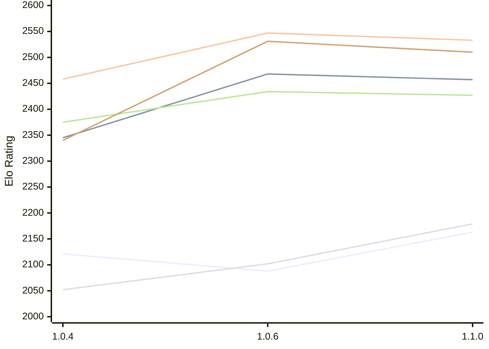

# Engine: Ankax

Author: Amrou Anka

Home: https://github.com/amrouanka/ankax-chess

## Elo Ratings E1 (Ultra 7 265T (1.50 GHz) - E-Core)

| Version | Published | STC 8.0+0.08s  | LTC 60.0+0.60s | VLTC 2m24s+1.12s | Comment |
| --- | --- | --- | --- | --- | --- |
| 1.1.0 | 2026-11-17 | 2163(+75) | 2457(-11) | 2533(-14) |  |
| 1.0.6 | 2026-11-12 | 2088(-33) | 2468(+123) | 2547(+89) |  |
| 1.0.4 | 2026-11-10 | 2121 | 2345 | 2458 |  |
 | | | cElo (∆ prev) | cElo (∆ prev) | cElo (∆ prev) | 

## Elo Ratings P1 (Ultra 7 265T (1.50 GHz) - P-Core)

| Version | Published | STC 8.0+0.08s  | LTC 60.0+0.60s | VLTC 2m24s+1.12s | Comment |
| --- | --- | --- | --- | --- | --- |
| 1.1.0 | 2026-11-17 | 2179(+77) | 2427(-7) | 2510(-21) |  |
| 1.0.6 | 2026-11-12 | 2102(+50) | 2434(+59) | 2531(+191) |  |
| 1.0.4 | 2026-11-10 | 2052 | 2375 | 2340 |  |
 | | | cElo (∆ prev) | cElo (∆ prev) | cElo (∆ prev) | 

## Elo Ratings T1 (i5-7500T 2.70GHz)

| Version | Published | STC 8.0+0.08s  | LTC 60.0+0.60s | VLTC 2m24s+1.12s | Comment |
| --- | --- | --- | --- | --- | --- |
| 1.0.4 | 2026-11-10 | 2052 | 2375 | 2340 |  |
 | | | cElo (∆ prev) | cElo (∆ prev) | cElo (∆ prev) | 

<a href="https://github.com/computer-chess-index/cci/issues/new?template=submit-version.yml&title=[VERSION]+Ankax+<version>&body=###%20Engine%20name%0AAnkax%0A%0A###%20Version%0A1.1.0" target="_blank">Submit new version</a>

 Test Conditions:

GUI/CLI: <a href=https://github.com/cutechess/cutechess target="_blank">Cute-Chess</a> 
Elo Calculation: <a href=https://www.remi-coulom.fr/Bayesian-Elo/ target="_blank">Bayesian-Elo</a> 
CPU for P1: Intel(R) Core(TM) Ultra 7 265T (1.50 GHz) - P-Core 
CPU for E1: Intel(R) Core(TM) Ultra 7 265T (1.50 GHz) - E-Core 
CPU for T1: Intel(R) Core(TM) i5-7500T 2.70GHz 
Opening book: 8_moves_v3 
\* STC: 8.0+0.08s, LTC: 60.0+0.60s, VLTC: 2m24s+1.12s

 Lists:
Ratings: <a href=https://github.com/computer-chess-index/cci/blob/main/lists/CCIRatings.csv target="_blank">Complete list</a>

Generated: 2026-11-25 05:35:42

## Ratings Verlauf E1 / P1

## Detailed Evaluation Results

| Version | Time Control | Variant | Elo  | Range +/- | Matches | Score | Average Opponent Elo | Draws |
| --- | --- |--- | --- | --- | --- | --- | --- | --- |
| 1.1.0 | VLTC (2m24s+1.12s) | P1 | 2510 | 49 | 132 | 51% | 2503 | 35% |
|  |  | E1 | 2533 | 40 | 204 | 48% | 2550 | 28% |
|  | LTC (60.0+0.60s) | P1 | 2427 | 51 | 128 | 48% | 2446 | 28% |
|  |  | E1 | 2457 | 39 | 216 | 51% | 2448 | 31% |
|  | STC (8.0+0.08s) | P1 | 2179 | 46 | 160 | 49% | 2198 | 24% |
|  |  | E1 | 2163 | 41 | 232 | 51% | 2199 | 21% |
| --- | --- |--- | --- | --- | --- | --- | --- | --- |
| 1.0.6 | VLTC (2m24s+1.12s) | P1 | 2531 | 52 | 124 | 43% | 2599 | 31% |
|  |  | E1 | 2547 | 49 | 136 | 53% | 2519 | 30% |
|  | LTC (60.0+0.60s) | P1 | 2434 | 47 | 152 | 47% | 2464 | 29% |
|  |  | E1 | 2468 | 47 | 156 | 53% | 2442 | 26% |
|  | STC (8.0+0.08s) | P1 | 2102 | 44 | 178 | 46% | 2140 | 22% |
|  |  | E1 | 2088 | 43 | 192 | 44% | 2151 | 24% |
| --- | --- |--- | --- | --- | --- | --- | --- | --- |
| 1.0.4 | VLTC (2m24s+1.12s) | P1 | 2340 | 43 | 186 | 49% | 2346 | 24% |
|  |  | E1 | 2458 | 41 | 204 | 52% | 2445 | 29% |
|  | LTC (60.0+0.60s) | P1 | 2375 | 49 | 150 | 58% | 2306 | 28% |
|  |  | E1 | 2345 | 41 | 204 | 50% | 2331 | 29% |
|  | STC (8.0+0.08s) | P1 | 2052 | 47 | 172 | 51% | 2005 | 18% |
|  |  | E1 | 2121 | 42 | 208 | 56% | 2043 | 22% |