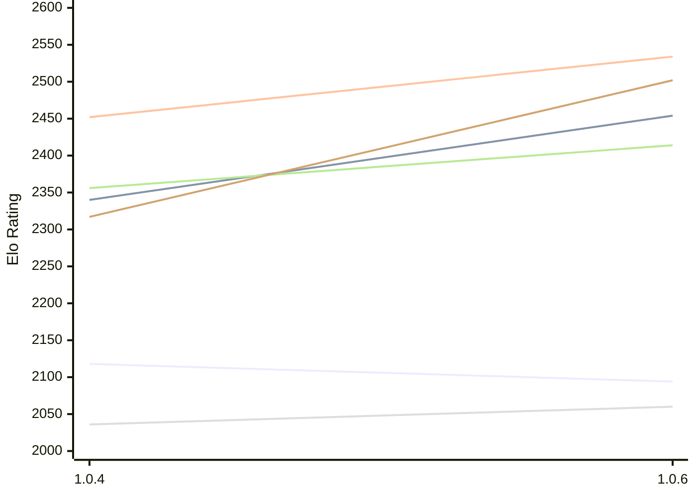

# Engine: Ankax

Author: Amrou Anka

Home: https://github.com/amrouanka/ankax-chess

## Elo Ratings E1 (Ultra 7 265T (1.50 GHz) - E-Core)

| Version | Published | STC 8.0+0.08s  | LTC 60.0+0.60s | VLTC 2m24s+1.12s | Comment |
| --- | --- | --- | --- | --- | --- |
| 1.0.6 | 2026-11-12 | 2094(-24) | 2454(+114) | 2534(+82) |  |
| 1.0.4 | 2026-11-10 | 2118 | 2340 | 2452 |  |
 | | | cElo (∆ prev) | cElo (∆ prev) | cElo (∆ prev) | 

## Elo Ratings P1 (Ultra 7 265T (1.50 GHz) - P-Core)

| Version | Published | STC 8.0+0.08s  | LTC 60.0+0.60s | VLTC 2m24s+1.12s | Comment |
| --- | --- | --- | --- | --- | --- |
| 1.0.6 | 2026-11-12 | 2060(+24) | 2414(+58) | 2502(+185) |  |
| 1.0.4 | 2026-11-10 | 2036 | 2356 | 2317 |  |
 | | | cElo (∆ prev) | cElo (∆ prev) | cElo (∆ prev) | 

## Elo Ratings T1 (i5-7500T 2.70GHz)

| Version | Published | STC 8.0+0.08s  | LTC 60.0+0.60s | VLTC 2m24s+1.12s | Comment |
| --- | --- | --- | --- | --- | --- |
| 1.0.4 | 2026-11-10 | 2036 | 2356 | 2317 |  |
 | | | cElo (∆ prev) | cElo (∆ prev) | cElo (∆ prev) | 

<a href="https://github.com/computer-chess-index/cci/issues/new?template=submit-version.yml&title=[VERSION]+Ankax+<version>&body=###%20Engine%20name%0AAnkax%0A%0A###%20Version%0A1.0.6" target="_blank">Submit new version</a>

 Test Conditions:

GUI/CLI: <a href=https://github.com/cutechess/cutechess target="_blank">Cute-Chess</a> 
Elo Calculation: <a href=https://www.remi-coulom.fr/Bayesian-Elo/ target="_blank">Bayesian-Elo</a> 
CPU for P1: Intel(R) Core(TM) Ultra 7 265T (1.50 GHz) - P-Core 
CPU for E1: Intel(R) Core(TM) Ultra 7 265T (1.50 GHz) - E-Core 
CPU for T1: Intel(R) Core(TM) i5-7500T 2.70GHz 
Opening book: 8_moves_v3 
\* STC: 8.0+0.08s, LTC: 60.0+0.60s, VLTC: 2m24s+1.12s

 Lists:
Ratings: <a href=https://github.com/computer-chess-index/cci/blob/main/lists/CCIRatings.csv target="_blank">Complete list</a>

Generated: 2026-11-18 05:35:39

## Ratings Verlauf E1 / P1

## Detailed Evaluation Results

| Version | Time Control | Variant | Elo  | Range +/- | Matches | Score | Average Opponent Elo | Draws |
| --- | --- |--- | --- | --- | --- | --- | --- | --- |
| 1.0.6 | VLTC (2m24s+1.12s) | P1 | 2502 | 52 | 120 | 43% | 2573 | 31% |
|  |  | E1 | 2534 | 56 | 100 | 54% | 2499 | 34% |
|  | LTC (60.0+0.60s) | E1 | 2454 | 58 | 104 | 53% | 2425 | 21% |
|  |  | P1 | 2414 | 51 | 128 | 46% | 2445 | 29% |
|  | STC (8.0+0.08s) | E1 | 2094 | 48 | 160 | 44% | 2159 | 23% |
|  |  | P1 | 2060 | 52 | 128 | 43% | 2130 | 21% |
| --- | --- |--- | --- | --- | --- | --- | --- | --- |
| 1.0.4 | VLTC (2m24s+1.12s) | P1 | 2317 | 43 | 186 | 49% | 2323 | 24% |
|  |  | E1 | 2452 | 41 | 204 | 52% | 2438 | 29% |
|  | LTC (60.0+0.60s) | P1 | 2356 | 49 | 150 | 58% | 2286 | 28% |
|  |  | E1 | 2340 | 41 | 204 | 50% | 2326 | 29% |
|  | STC (8.0+0.08s) | P1 | 2036 | 47 | 172 | 51% | 1989 | 18% |
|  |  | E1 | 2118 | 42 | 208 | 56% | 2040 | 22% |