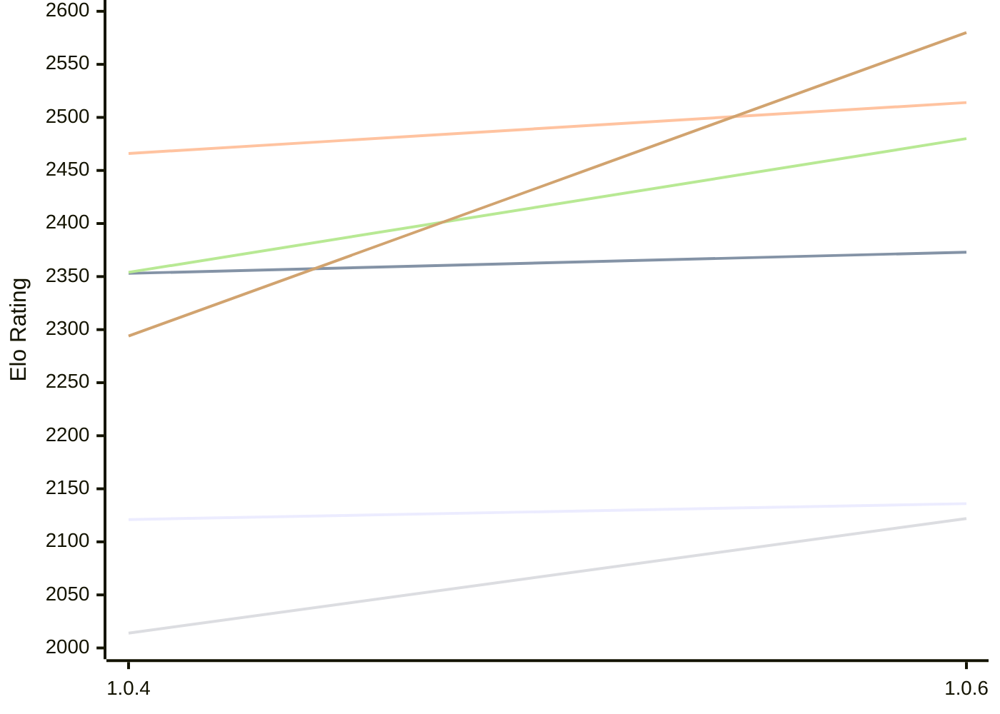

# Engine: Ankax

Author: Amrou Anka

Home: https://github.com/amrouanka/ankax-chess

## Elo Ratings E1 (Ultra 7 265T (1.50 GHz) - E-Core)

| Version | Published | STC 8.0+0.08s  | LTC 60.0+0.60s | VLTC 2m24s+1.12s | Comment |
| --- | --- | --- | --- | --- | --- |
| 1.0.6 | 2026-11-12 | 2136(+15) | 2373(+20) | 2514(+48) |  |
| 1.0.4 | 2026-11-10 | 2121 | 2353 | 2466 |  |
 | | | cElo (∆ prev) | cElo (∆ prev) | cElo (∆ prev) | 

## Elo Ratings P1 (Ultra 7 265T (1.50 GHz) - P-Core)

| Version | Published | STC 8.0+0.08s  | LTC 60.0+0.60s | VLTC 2m24s+1.12s | Comment |
| --- | --- | --- | --- | --- | --- |
| 1.0.6 | 2026-11-12 | 2122(+108) | 2480(+126) | 2580(+286) |  |
| 1.0.4 | 2026-11-10 | 2014 | 2354 | 2294 |  |
 | | | cElo (∆ prev) | cElo (∆ prev) | cElo (∆ prev) | 

## Elo Ratings T1 (i5-7500T 2.70GHz)

| Version | Published | STC 8.0+0.08s  | LTC 60.0+0.60s | VLTC 2m24s+1.12s | Comment |
| --- | --- | --- | --- | --- | --- |
| 1.0.4 | 2026-11-10 | 2014 | 2354 | 2294 |  |
 | | | cElo (∆ prev) | cElo (∆ prev) | cElo (∆ prev) | 

<a href="https://github.com/computer-chess-index/cci/issues/new?template=submit-version.yml&title=[VERSION]+Ankax+<version>&body=###%20Engine%20name%0AAnkax%0A%0A###%20Version%0A1.0.6" target="_blank">Submit new version</a>

 Test Conditions:

GUI/CLI: <a href=https://github.com/cutechess/cutechess target="_blank">Cute-Chess</a> 
Elo Calculation: <a href=https://www.remi-coulom.fr/Bayesian-Elo/ target="_blank">Bayesian-Elo</a> 
CPU for P1: Intel(R) Core(TM) Ultra 7 265T (1.50 GHz) - P-Core 
CPU for E1: Intel(R) Core(TM) Ultra 7 265T (1.50 GHz) - E-Core 
CPU for T1: Intel(R) Core(TM) i5-7500T 2.70GHz 
Opening book: 8_moves_v3 
\* STC: 8.0+0.08s, LTC: 60.0+0.60s, VLTC: 2m24s+1.12s

 Lists:
Ratings: <a href=https://github.com/computer-chess-index/cci/blob/main/lists/CCIRatings.csv target="_blank">Complete list</a>

Generated: 2026-11-16 05:35:38

## Ratings Verlauf E1 / P1

## Detailed Evaluation Results

| Version | Time Control | Variant | Elo  | Range +/- | Matches | Score | Average Opponent Elo | Draws |
| --- | --- |--- | --- | --- | --- | --- | --- | --- |
| 1.0.6 | VLTC (2m24s+1.12s) | P1 | 2580 | 120 | 20 | 55% | 2539 | 40% |
|  |  | E1 | 2514 | 82 | 48 | 54% | 2475 | 29% |
|  | LTC (60.0+0.60s) | E1 | 2373 | 96 | 36 | 42% | 2453 | 28% |
|  |  | P1 | 2480 | 132 | 16 | 41% | 2545 | 44% |
|  | STC (8.0+0.08s) | E1 | 2136 | 90 | 52 | 31% | 2334 | 15% |
|  |  | P1 | 2122 | 130 | 20 | 48% | 2156 | 15% |
| --- | --- |--- | --- | --- | --- | --- | --- | --- |
| 1.0.4 | VLTC (2m24s+1.12s) | P1 | 2294 | 45 | 174 | 48% | 2313 | 23% |
|  |  | E1 | 2466 | 42 | 196 | 53% | 2444 | 30% |
|  | LTC (60.0+0.60s) | P1 | 2354 | 50 | 142 | 58% | 2280 | 28% |
|  |  | E1 | 2353 | 41 | 200 | 51% | 2333 | 29% |
|  | STC (8.0+0.08s) | P1 | 2014 | 48 | 164 | 51% | 1976 | 18% |
|  |  | E1 | 2121 | 42 | 208 | 56% | 2044 | 22% |