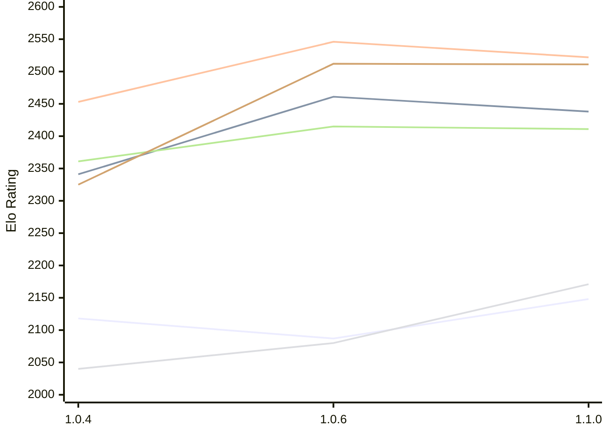

# Engine: Ankax

Author: Amrou Anka

Home: https://github.com/amrouanka/ankax-chess

## Elo Ratings E1 (Ultra 7 265T (1.50 GHz) - E-Core)

| Version | Published | STC 8.0+0.08s  | LTC 60.0+0.60s | VLTC 2m24s+1.12s | Comment |
| --- | --- | --- | --- | --- | --- |
| 1.1.0 | 2026-11-17 | 2148(+61) | 2438(-23) | 2522(-24) |  |
| 1.0.6 | 2026-11-12 | 2087(-31) | 2461(+120) | 2546(+93) |  |
| 1.0.4 | 2026-11-10 | 2118 | 2341 | 2453 |  |
 | | | cElo (∆ prev) | cElo (∆ prev) | cElo (∆ prev) | 

## Elo Ratings P1 (Ultra 7 265T (1.50 GHz) - P-Core)

| Version | Published | STC 8.0+0.08s  | LTC 60.0+0.60s | VLTC 2m24s+1.12s | Comment |
| --- | --- | --- | --- | --- | --- |
| 1.1.0 | 2026-11-17 | 2171(+91) | 2411(-4) | 2511(-1) |  |
| 1.0.6 | 2026-11-12 | 2080(+40) | 2415(+54) | 2512(+187) |  |
| 1.0.4 | 2026-11-10 | 2040 | 2361 | 2325 |  |
 | | | cElo (∆ prev) | cElo (∆ prev) | cElo (∆ prev) | 

## Elo Ratings T1 (i5-7500T 2.70GHz)

| Version | Published | STC 8.0+0.08s  | LTC 60.0+0.60s | VLTC 2m24s+1.12s | Comment |
| --- | --- | --- | --- | --- | --- |
| 1.0.4 | 2026-11-10 | 2040 | 2361 | 2325 |  |
 | | | cElo (∆ prev) | cElo (∆ prev) | cElo (∆ prev) | 

<a href="https://github.com/computer-chess-index/cci/issues/new?template=submit-version.yml&title=[VERSION]+Ankax+<version>&body=###%20Engine%20name%0AAnkax%0A%0A###%20Version%0A1.1.0" target="_blank">Submit new version</a>

 Test Conditions:

GUI/CLI: <a href=https://github.com/cutechess/cutechess target="_blank">Cute-Chess</a> 
Elo Calculation: <a href=https://www.remi-coulom.fr/Bayesian-Elo/ target="_blank">Bayesian-Elo</a> 
CPU for P1: Intel(R) Core(TM) Ultra 7 265T (1.50 GHz) - P-Core 
CPU for E1: Intel(R) Core(TM) Ultra 7 265T (1.50 GHz) - E-Core 
CPU for T1: Intel(R) Core(TM) i5-7500T 2.70GHz 
Opening book: 8_moves_v3 
\* STC: 8.0+0.08s, LTC: 60.0+0.60s, VLTC: 2m24s+1.12s

 Lists:
Ratings: <a href=https://github.com/computer-chess-index/cci/blob/main/lists/CCIRatings.csv target="_blank">Complete list</a>

Generated: 2026-11-21 05:35:41

## Ratings Verlauf E1 / P1

## Detailed Evaluation Results

| Version | Time Control | Variant | Elo  | Range +/- | Matches | Score | Average Opponent Elo | Draws |
| --- | --- |--- | --- | --- | --- | --- | --- | --- |
| 1.1.0 | VLTC (2m24s+1.12s) | P1 | 2511 | 54 | 108 | 53% | 2481 | 36% |
|  |  | E1 | 2522 | 41 | 196 | 47% | 2547 | 28% |
|  | LTC (60.0+0.60s) | P1 | 2411 | 66 | 76 | 47% | 2445 | 28% |
|  |  | E1 | 2438 | 47 | 148 | 50% | 2441 | 31% |
|  | STC (8.0+0.08s) | P1 | 2171 | 54 | 116 | 48% | 2194 | 24% |
|  |  | E1 | 2148 | 43 | 212 | 50% | 2196 | 20% |
| --- | --- |--- | --- | --- | --- | --- | --- | --- |
| 1.0.6 | VLTC (2m24s+1.12s) | P1 | 2512 | 51 | 124 | 43% | 2581 | 31% |
|  |  | E1 | 2546 | 50 | 132 | 54% | 2512 | 30% |
|  | LTC (60.0+0.60s) | P1 | 2415 | 49 | 136 | 46% | 2453 | 29% |
|  |  | E1 | 2461 | 48 | 148 | 53% | 2435 | 24% |
|  | STC (8.0+0.08s) | P1 | 2080 | 47 | 158 | 46% | 2128 | 22% |
|  |  | E1 | 2087 | 45 | 180 | 44% | 2151 | 24% |
| --- | --- |--- | --- | --- | --- | --- | --- | --- |
| 1.0.4 | VLTC (2m24s+1.12s) | P1 | 2325 | 43 | 186 | 49% | 2331 | 24% |
|  |  | E1 | 2453 | 41 | 204 | 52% | 2439 | 29% |
|  | LTC (60.0+0.60s) | P1 | 2361 | 49 | 150 | 58% | 2291 | 28% |
|  |  | E1 | 2341 | 41 | 204 | 50% | 2327 | 29% |
|  | STC (8.0+0.08s) | P1 | 2040 | 47 | 172 | 51% | 1994 | 18% |
|  |  | E1 | 2118 | 42 | 208 | 56% | 2040 | 22% |