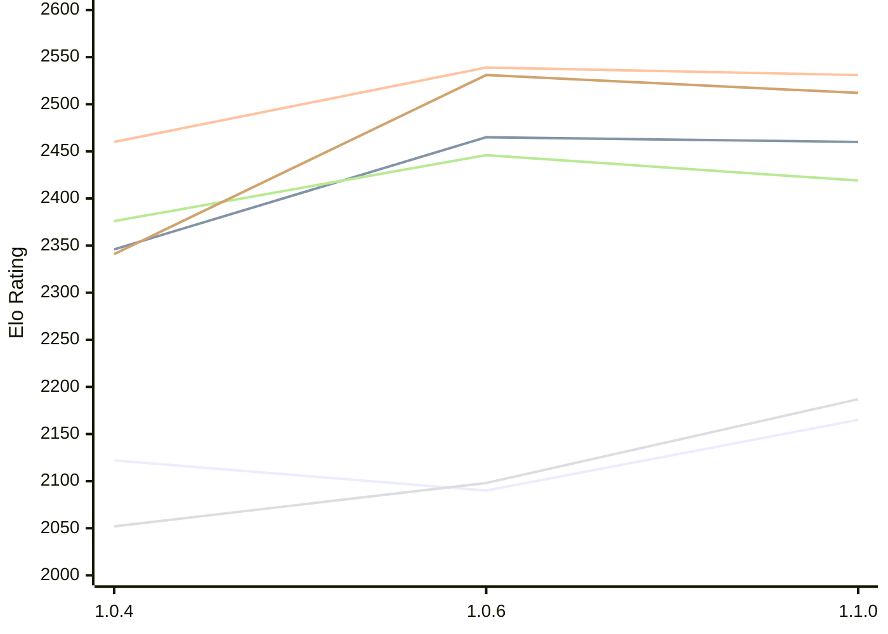

# Engine: Ankax

Author: Amrou Anka

Home: https://github.com/amrouanka/ankax-chess

## Elo Ratings E1 (Ultra 7 265T (1.50 GHz) - E-Core)

| Version | Published | STC 8.0+0.08s  | LTC 60.0+0.60s | VLTC 2m24s+1.12s | Comment |
| --- | --- | --- | --- | --- | --- |
| 1.1.0 | 2026-11-17 | 2165(+75) | 2460(-5) | 2531(-8) |  |
| 1.0.6 | 2026-11-12 | 2090(-32) | 2465(+119) | 2539(+79) |  |
| 1.0.4 | 2026-11-10 | 2122 | 2346 | 2460 |  |
 | | | cElo (∆ prev) | cElo (∆ prev) | cElo (∆ prev) | 

## Elo Ratings P1 (Ultra 7 265T (1.50 GHz) - P-Core)

| Version | Published | STC 8.0+0.08s  | LTC 60.0+0.60s | VLTC 2m24s+1.12s | Comment |
| --- | --- | --- | --- | --- | --- |
| 1.1.0 | 2026-11-17 | 2187(+89) | 2419(-27) | 2512(-19) |  |
| 1.0.6 | 2026-11-12 | 2098(+46) | 2446(+70) | 2531(+190) |  |
| 1.0.4 | 2026-11-10 | 2052 | 2376 | 2341 |  |
 | | | cElo (∆ prev) | cElo (∆ prev) | cElo (∆ prev) | 

## Elo Ratings T1 (i5-7500T 2.70GHz)

| Version | Published | STC 8.0+0.08s  | LTC 60.0+0.60s | VLTC 2m24s+1.12s | Comment |
| --- | --- | --- | --- | --- | --- |
| 1.0.4 | 2026-11-10 | 2052 | 2376 | 2341 |  |
 | | | cElo (∆ prev) | cElo (∆ prev) | cElo (∆ prev) | 

<a href="https://github.com/computer-chess-index/cci/issues/new?template=submit-version.yml&title=[VERSION]+Ankax+<version>&body=###%20Engine%20name%0AAnkax%0A%0A###%20Version%0A1.1.0" target="_blank">Submit new version</a>

 Test Conditions:

GUI/CLI: <a href=https://github.com/cutechess/cutechess target="_blank">Cute-Chess</a> 
Elo Calculation: <a href=https://www.remi-coulom.fr/Bayesian-Elo/ target="_blank">Bayesian-Elo</a> 
CPU for P1: Intel(R) Core(TM) Ultra 7 265T (1.50 GHz) - P-Core 
CPU for E1: Intel(R) Core(TM) Ultra 7 265T (1.50 GHz) - E-Core 
CPU for T1: Intel(R) Core(TM) i5-7500T 2.70GHz 
Opening book: 8_moves_v3 
\* STC: 8.0+0.08s, LTC: 60.0+0.60s, VLTC: 2m24s+1.12s

 Lists:
Ratings: <a href=https://github.com/computer-chess-index/cci/blob/main/lists/CCIRatings.csv target="_blank">Complete list</a>

Generated: 2026-11-26 05:35:43

## Ratings Verlauf E1 / P1

## Detailed Evaluation Results

| Version | Time Control | Variant | Elo  | Range +/- | Matches | Score | Average Opponent Elo | Draws |
| --- | --- |--- | --- | --- | --- | --- | --- | --- |
| 1.1.0 | VLTC (2m24s+1.12s) | E1 | 2531 | 40 | 204 | 48% | 2549 | 28% |
|  |  | P1 | 2512 | 47 | 140 | 51% | 2502 | 35% |
|  | LTC (60.0+0.60s) | P1 | 2419 | 50 | 132 | 48% | 2445 | 29% |
|  |  | E1 | 2460 | 38 | 224 | 52% | 2449 | 31% |
|  | STC (8.0+0.08s) | P1 | 2187 | 46 | 164 | 50% | 2196 | 24% |
|  |  | E1 | 2165 | 41 | 232 | 51% | 2201 | 21% |
| --- | --- |--- | --- | --- | --- | --- | --- | --- |
| 1.0.6 | VLTC (2m24s+1.12s) | P1 | 2531 | 52 | 124 | 43% | 2600 | 31% |
|  |  | E1 | 2539 | 48 | 140 | 53% | 2518 | 31% |
|  | LTC (60.0+0.60s) | P1 | 2446 | 46 | 156 | 48% | 2464 | 28% |
|  |  | E1 | 2465 | 46 | 164 | 52% | 2444 | 26% |
|  | STC (8.0+0.08s) | P1 | 2098 | 44 | 178 | 46% | 2137 | 22% |
|  |  | E1 | 2090 | 43 | 192 | 44% | 2152 | 24% |
| --- | --- |--- | --- | --- | --- | --- | --- | --- |
| 1.0.4 | VLTC (2m24s+1.12s) | P1 | 2341 | 43 | 186 | 49% | 2348 | 24% |
|  |  | E1 | 2460 | 41 | 204 | 52% | 2445 | 29% |
|  | LTC (60.0+0.60s) | P1 | 2376 | 49 | 150 | 58% | 2307 | 28% |
|  |  | E1 | 2346 | 41 | 204 | 50% | 2333 | 29% |
|  | STC (8.0+0.08s) | P1 | 2052 | 47 | 172 | 51% | 2005 | 18% |
|  |  | E1 | 2122 | 42 | 208 | 56% | 2044 | 22% |