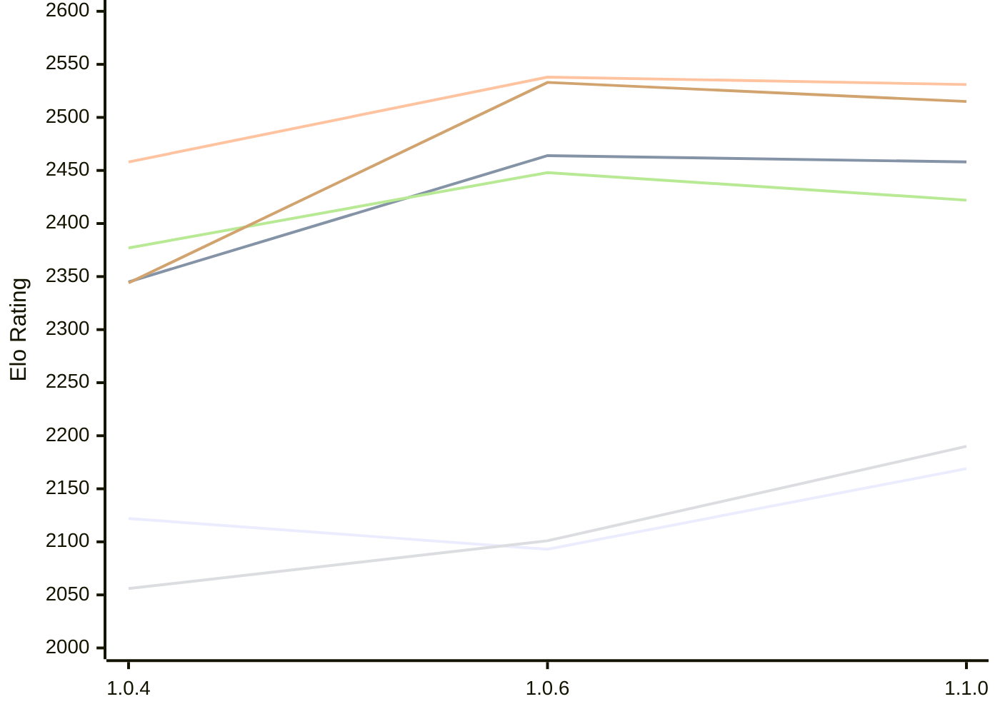

# Engine: Ankax

Author: Amrou Anka

Home: https://github.com/amrouanka/ankax-chess

## Elo Ratings E1 (Ultra 7 265T (1.50 GHz) - E-Core)

| Version | Published | STC 8.0+0.08s  | LTC 60.0+0.60s | VLTC 2m24s+1.12s | Comment |
| --- | --- | --- | --- | --- | --- |
| 1.1.0 | 2026-11-17 | 2169(+76) | 2458(-6) | 2531(-7) |  |
| 1.0.6 | 2026-11-12 | 2093(-29) | 2464(+119) | 2538(+80) |  |
| 1.0.4 | 2026-11-10 | 2122 | 2345 | 2458 |  |
 | | | cElo (∆ prev) | cElo (∆ prev) | cElo (∆ prev) | 

## Elo Ratings P1 (Ultra 7 265T (1.50 GHz) - P-Core)

| Version | Published | STC 8.0+0.08s  | LTC 60.0+0.60s | VLTC 2m24s+1.12s | Comment |
| --- | --- | --- | --- | --- | --- |
| 1.1.0 | 2026-11-17 | 2190(+89) | 2422(-26) | 2515(-18) |  |
| 1.0.6 | 2026-11-12 | 2101(+45) | 2448(+71) | 2533(+189) |  |
| 1.0.4 | 2026-11-10 | 2056 | 2377 | 2344 |  |
 | | | cElo (∆ prev) | cElo (∆ prev) | cElo (∆ prev) | 

## Elo Ratings T1 (i5-7500T 2.70GHz)

| Version | Published | STC 8.0+0.08s  | LTC 60.0+0.60s | VLTC 2m24s+1.12s | Comment |
| --- | --- | --- | --- | --- | --- |
| 1.0.4 | 2026-11-10 | 2056 | 2377 | 2344 |  |
 | | | cElo (∆ prev) | cElo (∆ prev) | cElo (∆ prev) | 

<a href="https://github.com/computer-chess-index/cci/issues/new?template=submit-version.yml&title=[VERSION]+Ankax+<version>&body=###%20Engine%20name%0AAnkax%0A%0A###%20Version%0A1.1.0" target="_blank">Submit new version</a>

 Test Conditions:

GUI/CLI: <a href=https://github.com/cutechess/cutechess target="_blank">Cute-Chess</a> 
Elo Calculation: <a href=https://www.remi-coulom.fr/Bayesian-Elo/ target="_blank">Bayesian-Elo</a> 
CPU for P1: Intel(R) Core(TM) Ultra 7 265T (1.50 GHz) - P-Core 
CPU for E1: Intel(R) Core(TM) Ultra 7 265T (1.50 GHz) - E-Core 
CPU for T1: Intel(R) Core(TM) i5-7500T 2.70GHz 
Opening book: 8_moves_v3 
\* STC: 8.0+0.08s, LTC: 60.0+0.60s, VLTC: 2m24s+1.12s

 Lists:
Ratings: <a href=https://github.com/computer-chess-index/cci/blob/main/lists/CCIRatings.csv target="_blank">Complete list</a>

Generated: 2026-11-28 05:35:44

## Ratings Verlauf E1 / P1

## Detailed Evaluation Results

| Version | Time Control | Variant | Elo  | Range +/- | Matches | Score | Average Opponent Elo | Draws |
| --- | --- |--- | --- | --- | --- | --- | --- | --- |
| 1.1.0 | VLTC (2m24s+1.12s) | P1 | 2515 | 47 | 140 | 51% | 2504 | 35% |
|  |  | E1 | 2531 | 40 | 204 | 48% | 2549 | 28% |
|  | LTC (60.0+0.60s) | P1 | 2422 | 50 | 132 | 48% | 2446 | 29% |
|  |  | E1 | 2458 | 38 | 224 | 52% | 2448 | 31% |
|  | STC (8.0+0.08s) | P1 | 2190 | 46 | 164 | 50% | 2198 | 24% |
|  |  | E1 | 2169 | 40 | 236 | 51% | 2201 | 21% |
| --- | --- |--- | --- | --- | --- | --- | --- | --- |
| 1.0.6 | VLTC (2m24s+1.12s) | P1 | 2533 | 52 | 124 | 43% | 2600 | 31% |
|  |  | E1 | 2538 | 48 | 140 | 53% | 2518 | 31% |
|  | LTC (60.0+0.60s) | P1 | 2448 | 46 | 156 | 48% | 2465 | 28% |
|  |  | E1 | 2464 | 46 | 164 | 52% | 2442 | 26% |
|  | STC (8.0+0.08s) | P1 | 2101 | 44 | 178 | 46% | 2140 | 22% |
|  |  | E1 | 2093 | 42 | 200 | 45% | 2148 | 24% |
| --- | --- |--- | --- | --- | --- | --- | --- | --- |
| 1.0.4 | VLTC (2m24s+1.12s) | P1 | 2344 | 43 | 186 | 49% | 2350 | 24% |
|  |  | E1 | 2458 | 41 | 204 | 52% | 2445 | 29% |
|  | LTC (60.0+0.60s) | P1 | 2377 | 49 | 150 | 58% | 2309 | 28% |
|  |  | E1 | 2345 | 41 | 204 | 50% | 2331 | 29% |
|  | STC (8.0+0.08s) | P1 | 2056 | 47 | 172 | 51% | 2009 | 18% |
|  |  | E1 | 2122 | 42 | 208 | 56% | 2044 | 22% |