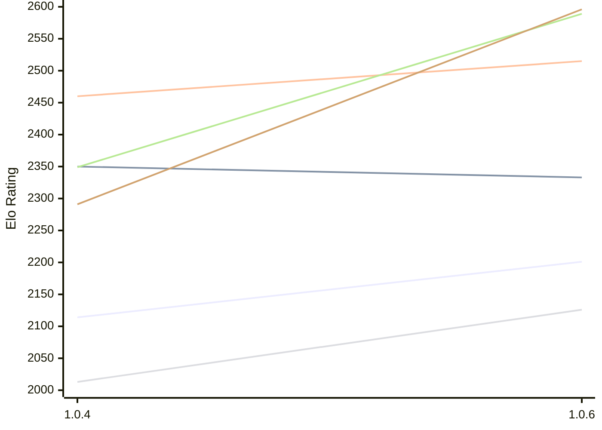

# Engine: Ankax

Author: Amrou Anka

Home: https://github.com/amrouanka/ankax-chess

## Elo Ratings E1 (Ultra 7 265T (1.50 GHz) - E-Core)

| Version | Published | STC 8.0+0.08s  | LTC 60.0+0.60s | VLTC 2m24s+1.12s | Comment |
| --- | --- | --- | --- | --- | --- |
| 1.0.6 | 2026-11-12 | 2201(+87) | 2333(-17) | 2515(+55) |  |
| 1.0.4 | 2026-11-10 | 2114 | 2350 | 2460 |  |
 | | | cElo (∆ prev) | cElo (∆ prev) | cElo (∆ prev) | 

## Elo Ratings P1 (Ultra 7 265T (1.50 GHz) - P-Core)

| Version | Published | STC 8.0+0.08s  | LTC 60.0+0.60s | VLTC 2m24s+1.12s | Comment |
| --- | --- | --- | --- | --- | --- |
| 1.0.6 | 2026-11-12 | 2126(+113) | 2589(+240) | 2596(+305) |  |
| 1.0.4 | 2026-11-10 | 2013 | 2349 | 2291 |  |
 | | | cElo (∆ prev) | cElo (∆ prev) | cElo (∆ prev) | 

## Elo Ratings T1 (i5-7500T 2.70GHz)

| Version | Published | STC 8.0+0.08s  | LTC 60.0+0.60s | VLTC 2m24s+1.12s | Comment |
| --- | --- | --- | --- | --- | --- |
| 1.0.4 | 2026-11-10 | 2013 | 2349 | 2291 |  |
 | | | cElo (∆ prev) | cElo (∆ prev) | cElo (∆ prev) | 

<a href="https://github.com/computer-chess-index/cci/issues/new?template=submit-version.yml&title=[VERSION]+Ankax+<version>&body=###%20Engine%20name%0AAnkax%0A%0A###%20Version%0A1.0.6" target="_blank">Submit new version</a>

 Test Conditions:

GUI/CLI: <a href=https://github.com/cutechess/cutechess target="_blank">Cute-Chess</a> 
Elo Calculation: <a href=https://www.remi-coulom.fr/Bayesian-Elo/ target="_blank">Bayesian-Elo</a> 
CPU for P1: Intel(R) Core(TM) Ultra 7 265T (1.50 GHz) - P-Core 
CPU for E1: Intel(R) Core(TM) Ultra 7 265T (1.50 GHz) - E-Core 
CPU for T1: Intel(R) Core(TM) i5-7500T 2.70GHz 
Opening book: 8_moves_v3 
\* STC: 8.0+0.08s, LTC: 60.0+0.60s, VLTC: 2m24s+1.12s

 Lists:
Ratings: <a href=https://github.com/computer-chess-index/cci/blob/main/lists/CCIRatings.csv target="_blank">Complete list</a>

Generated: 2026-11-15 05:35:40

## Ratings Verlauf E1 / P1

## Detailed Evaluation Results

| Version | Time Control | Variant | Elo  | Range +/- | Matches | Score | Average Opponent Elo | Draws |
| --- | --- |--- | --- | --- | --- | --- | --- | --- |
| 1.0.6 | VLTC (2m24s+1.12s) | P1 | 2596 | 156 | 12 | 67% | 2466 | 33% |
|  |  | E1 | 2515 | 98 | 32 | 58% | 2445 | 34% |
|  | LTC (60.0+0.60s) | P1 | 2589 | 178 | 8 | 63% | 2485 | 50% |
|  |  | E1 | 2333 | 122 | 24 | 29% | 2520 | 25% |
|  | STC (8.0+0.08s) | P1 | 2126 | 169 | 12 | 46% | 2176 | 8% |
|  |  | E1 | 2201 | 104 | 36 | 29% | 2403 | 19% |
| --- | --- |--- | --- | --- | --- | --- | --- | --- |
| 1.0.4 | VLTC (2m24s+1.12s) | P1 | 2291 | 46 | 166 | 48% | 2310 | 23% |
|  |  | E1 | 2460 | 42 | 196 | 53% | 2438 | 30% |
|  | LTC (60.0+0.60s) | P1 | 2349 | 50 | 142 | 58% | 2273 | 28% |
|  |  | E1 | 2350 | 41 | 200 | 51% | 2330 | 29% |
|  | STC (8.0+0.08s) | P1 | 2013 | 49 | 160 | 51% | 1974 | 18% |
|  |  | E1 | 2114 | 43 | 204 | 55% | 2041 | 21% |