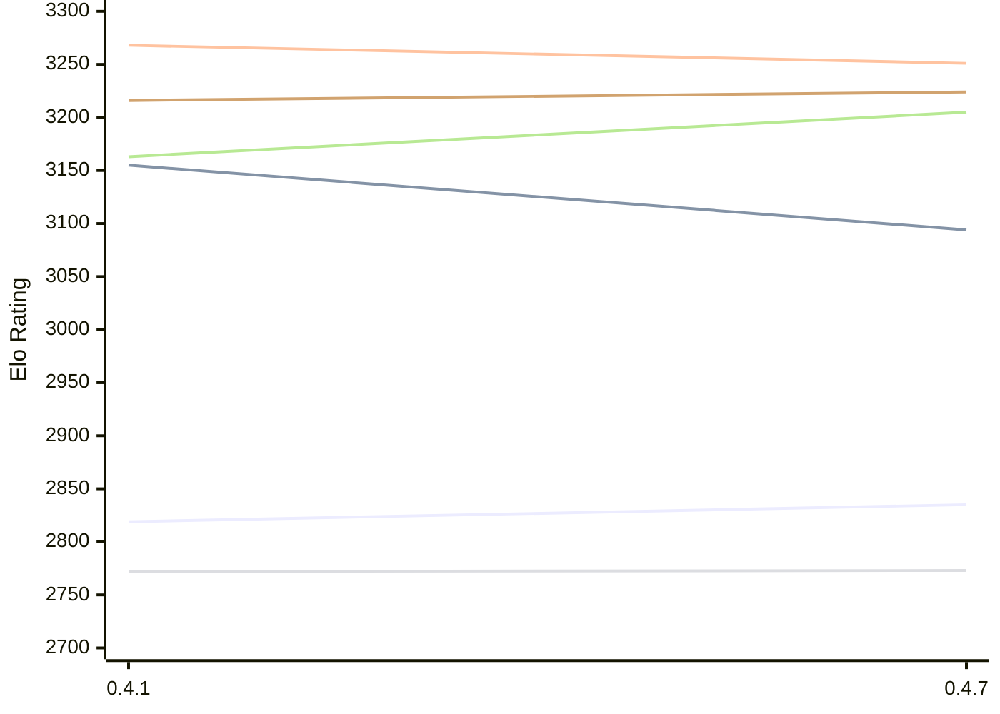

# Engine: Arabica

Author: Genio Mo

Home: https://github.com/geniomdev/arabica-chess

## Elo Ratings E1 (Ultra 7 265T (1.50 GHz) - E-Core)

| Version | Published | STC 8.0+0.08s  | LTC 60.0+0.60s | VLTC 2m24s+1.12s | Comment |
| --- | --- | --- | --- | --- | --- |
| 0.4.7 | 2026-11-11 | 2835(+16) | 3094(-61) | 3251(-17) |  |
| 0.4.1 | 2026-11-01 | 2819 | 3155 | 3268 |  |
 | | | cElo (∆ prev) | cElo (∆ prev) | cElo (∆ prev) | 

## Elo Ratings P1 (Ultra 7 265T (1.50 GHz) - P-Core)

| Version | Published | STC 8.0+0.08s  | LTC 60.0+0.60s | VLTC 2m24s+1.12s | Comment |
| --- | --- | --- | --- | --- | --- |
| 0.4.7 | 2026-11-11 | 2773(+1) | 3205(+42) | 3224(+8) |  |
| 0.4.1 | 2026-11-01 | 2772 | 3163 | 3216 |  |
 | | | cElo (∆ prev) | cElo (∆ prev) | cElo (∆ prev) | 

## Elo Ratings T1 (i5-7500T 2.70GHz)

| Version | Published | STC 8.0+0.08s  | LTC 60.0+0.60s | VLTC 2m24s+1.12s | Comment |
| --- | --- | --- | --- | --- | --- |
| 0.4.1 | 2026-11-01 | 2772 | 3163 | 3216 |  |
 | | | cElo (∆ prev) | cElo (∆ prev) | cElo (∆ prev) | 

<a href="https://github.com/computer-chess-index/cci/issues/new?template=submit-version.yml&title=[VERSION]+Arabica+<version>&body=###%20Engine%20name%0AArabica%0A%0A###%20Version%0A0.4.7" target="_blank">Submit new version</a>

 Test Conditions:

GUI/CLI: <a href=https://github.com/cutechess/cutechess target="_blank">Cute-Chess</a> 
Elo Calculation: <a href=https://www.remi-coulom.fr/Bayesian-Elo/ target="_blank">Bayesian-Elo</a> 
CPU for P1: Intel(R) Core(TM) Ultra 7 265T (1.50 GHz) - P-Core 
CPU for E1: Intel(R) Core(TM) Ultra 7 265T (1.50 GHz) - E-Core 
CPU for T1: Intel(R) Core(TM) i5-7500T 2.70GHz 
Opening book: 8_moves_v3 
\* STC: 8.0+0.08s, LTC: 60.0+0.60s, VLTC: 2m24s+1.12s

 Lists:
Ratings: <a href=https://github.com/computer-chess-index/cci/blob/main/lists/CCIRatings.csv target="_blank">Complete list</a>

Generated: 2026-11-15 05:35:50

## Ratings Verlauf E1 / P1

## Detailed Evaluation Results

| Version | Time Control | Variant | Elo  | Range +/- | Matches | Score | Average Opponent Elo | Draws |
| --- | --- |--- | --- | --- | --- | --- | --- | --- |
| 0.4.7 | VLTC (2m24s+1.12s) | P1 | 3224 | 263 | 4 | 13% | 3482 | 25% |
|  |  | E1 | 3251 | 105 | 24 | 44% | 3299 | 54% |
|  | LTC (60.0+0.60s) | P1 | 3205 | 169 | 8 | 56% | 3162 | 63% |
|  |  | E1 | 3094 | 97 | 28 | 39% | 3174 | 57% |
|  | STC (8.0+0.08s) | P1 | 2773 | 121 | 16 | 47% | 2789 | 69% |
|  |  | E1 | 2835 | 104 | 28 | 48% | 2850 | 32% |
| --- | --- |--- | --- | --- | --- | --- | --- | --- |
| 0.4.1 | VLTC (2m24s+1.12s) | P1 | 3216 | 35 | 232 | 52% | 3186 | 56% |
|  |  | E1 | 3268 | 32 | 266 | 51% | 3249 | 57% |
|  | LTC (60.0+0.60s) | P1 | 3163 | 36 | 228 | 54% | 3096 | 54% |
|  |  | E1 | 3155 | 29 | 350 | 56% | 3079 | 54% |
|  | STC (8.0+0.08s) | P1 | 2772 | 39 | 216 | 53% | 2716 | 37% |
|  |  | E1 | 2819 | 30 | 380 | 57% | 2718 | 33% |