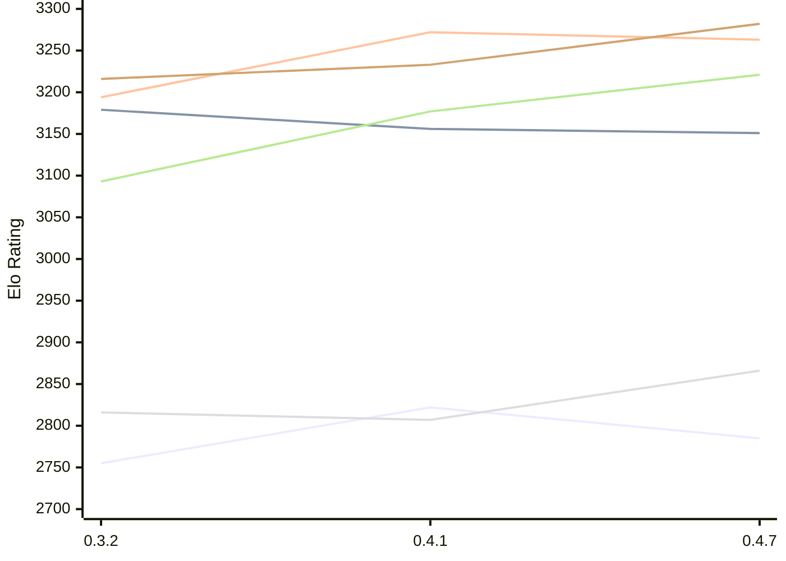

# Engine: Arabica

Author: Genio Mo

Home: https://github.com/geniomdev/arabica-chess

## Elo Ratings E1 (Ultra 7 265T (1.50 GHz) - E-Core)

| Version | Published | STC 8.0+0.08s  | LTC 60.0+0.60s | VLTC 2m24s+1.12s | Comment |
| --- | --- | --- | --- | --- | --- |
| 0.4.7 | 2026-11-11 | 2785(-37) | 3151(-5) | 3263(-9) |  |
| 0.4.1 | 2026-11-01 | 2822(+67) | 3156(-23) | 3272(+78) |  |
| 0.3.2 | 2026-10-27 | 2755 | 3179 | 3194 |  |
 | | | cElo (∆ prev) | cElo (∆ prev) | cElo (∆ prev) | 

## Elo Ratings P1 (Ultra 7 265T (1.50 GHz) - P-Core)

| Version | Published | STC 8.0+0.08s  | LTC 60.0+0.60s | VLTC 2m24s+1.12s | Comment |
| --- | --- | --- | --- | --- | --- |
| 0.4.7 | 2026-11-11 | 2866(+59) | 3221(+44) | 3282(+49) |  |
| 0.4.1 | 2026-11-01 | 2807(-9) | 3177(+84) | 3233(+17) |  |
| 0.3.2 | 2026-10-27 | 2816 | 3093 | 3216 |  |
 | | | cElo (∆ prev) | cElo (∆ prev) | cElo (∆ prev) | 

## Elo Ratings T1 (i5-7500T 2.70GHz)

| Version | Published | STC 8.0+0.08s  | LTC 60.0+0.60s | VLTC 2m24s+1.12s | Comment |
| --- | --- | --- | --- | --- | --- |
| 0.3.2 | 2026-10-27 | 2816 | 3093 | 3216 |  |
 | | | cElo (∆ prev) | cElo (∆ prev) | cElo (∆ prev) | 

<a href="https://github.com/computer-chess-index/cci/issues/new?template=submit-version.yml&title=[VERSION]+Arabica+<version>&body=###%20Engine%20name%0AArabica%0A%0A###%20Version%0A0.4.7" target="_blank">Submit new version</a>

 Test Conditions:

GUI/CLI: <a href=https://github.com/cutechess/cutechess target="_blank">Cute-Chess</a> 
Elo Calculation: <a href=https://www.remi-coulom.fr/Bayesian-Elo/ target="_blank">Bayesian-Elo</a> 
CPU for P1: Intel(R) Core(TM) Ultra 7 265T (1.50 GHz) - P-Core 
CPU for E1: Intel(R) Core(TM) Ultra 7 265T (1.50 GHz) - E-Core 
CPU for T1: Intel(R) Core(TM) i5-7500T 2.70GHz 
Opening book: 8_moves_v3 
\* STC: 8.0+0.08s, LTC: 60.0+0.60s, VLTC: 2m24s+1.12s

 Lists:
Ratings: <a href=https://github.com/computer-chess-index/cci/blob/main/lists/CCIRatings.csv target="_blank">Complete list</a>

Generated: 2026-11-23 05:35:49

## Ratings Verlauf E1 / P1

## Detailed Evaluation Results

| Version | Time Control | Variant | Elo  | Range +/- | Matches | Score | Average Opponent Elo | Draws |
| --- | --- |--- | --- | --- | --- | --- | --- | --- |
| 0.4.7 | VLTC (2m24s+1.12s) | P1 | 3282 | 39 | 182 | 51% | 3274 | 58% |
|  |  | E1 | 3263 | 33 | 248 | 49% | 3276 | 56% |
|  | LTC (60.0+0.60s) | P1 | 3221 | 48 | 116 | 52% | 3209 | 55% |
|  |  | E1 | 3151 | 41 | 176 | 50% | 3154 | 47% |
|  | STC (8.0+0.08s) | E1 | 2785 | 34 | 270 | 45% | 2831 | 41% |
|  |  | P1 | 2866 | 40 | 180 | 53% | 2842 | 47% |
| --- | --- |--- | --- | --- | --- | --- | --- | --- |
| 0.4.1 | VLTC (2m24s+1.12s) | P1 | 3233 | 34 | 240 | 51% | 3210 | 57% |
|  |  | E1 | 3272 | 32 | 270 | 51% | 3255 | 56% |
|  | LTC (60.0+0.60s) | P1 | 3177 | 34 | 252 | 52% | 3128 | 53% |
|  |  | E1 | 3156 | 29 | 358 | 56% | 3083 | 54% |
|  | STC (8.0+0.08s) | P1 | 2807 | 37 | 232 | 52% | 2759 | 39% |
|  |  | E1 | 2822 | 30 | 384 | 57% | 2720 | 33% |
| --- | --- |--- | --- | --- | --- | --- | --- | --- |
| 0.3.2 | VLTC (2m24s+1.12s) | P1 | 3216 | 56 | 84 | 57% | 3170 | 61% |
|  |  | E1 | 3194 | 33 | 248 | 48% | 3208 | 57% |
|  | LTC (60.0+0.60s) | P1 | 3093 | 84 | 40 | 43% | 3156 | 50% |
|  |  | E1 | 3179 | 46 | 132 | 52% | 3163 | 49% |
|  | STC (8.0+0.08s) | P1 | 2816 | 147 | 12 | 42% | 2871 | 50% |
|  |  | E1 | 2755 | 36 | 250 | 45% | 2799 | 36% |