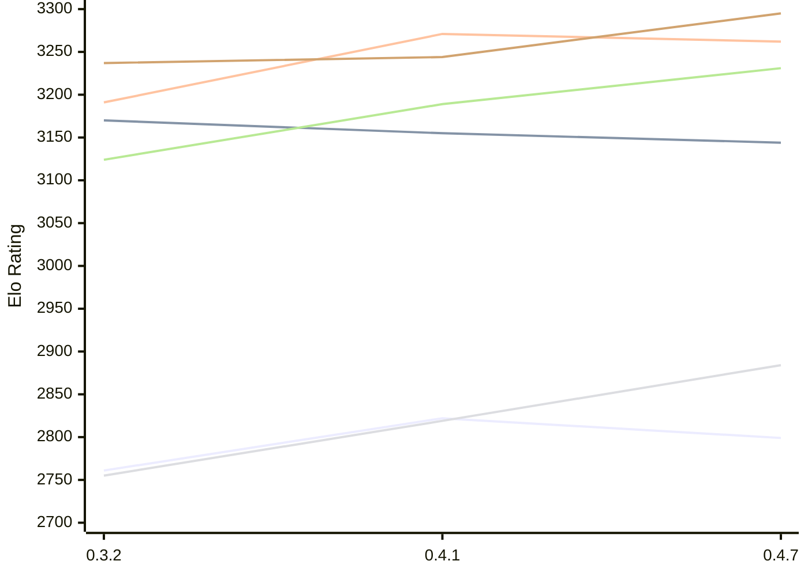

# Engine: Arabica

Author: Genio Mo

Home: https://github.com/geniomdev/arabica-chess

## Elo Ratings E1 (Ultra 7 265T (1.50 GHz) - E-Core)

| Version | Published | STC 8.0+0.08s  | LTC 60.0+0.60s | VLTC 2m24s+1.12s | Comment |
| --- | --- | --- | --- | --- | --- |
| 0.4.7 | 2026-11-11 | 2799(-23) | 3144(-11) | 3262(-9) |  |
| 0.4.1 | 2026-11-01 | 2822(+61) | 3155(-15) | 3271(+80) |  |
| 0.3.2 | 2026-10-27 | 2761 | 3170 | 3191 |  |
 | | | cElo (∆ prev) | cElo (∆ prev) | cElo (∆ prev) | 

## Elo Ratings P1 (Ultra 7 265T (1.50 GHz) - P-Core)

| Version | Published | STC 8.0+0.08s  | LTC 60.0+0.60s | VLTC 2m24s+1.12s | Comment |
| --- | --- | --- | --- | --- | --- |
| 0.4.7 | 2026-11-11 | 2884(+65) | 3231(+42) | 3295(+51) |  |
| 0.4.1 | 2026-11-01 | 2819(+64) | 3189(+65) | 3244(+7) |  |
| 0.3.2 | 2026-10-27 | 2755 | 3124 | 3237 |  |
 | | | cElo (∆ prev) | cElo (∆ prev) | cElo (∆ prev) | 

## Elo Ratings T1 (i5-7500T 2.70GHz)

| Version | Published | STC 8.0+0.08s  | LTC 60.0+0.60s | VLTC 2m24s+1.12s | Comment |
| --- | --- | --- | --- | --- | --- |
| 0.3.2 | 2026-10-27 | 2755 | 3124 | 3237 |  |
 | | | cElo (∆ prev) | cElo (∆ prev) | cElo (∆ prev) | 

<a href="https://github.com/computer-chess-index/cci/issues/new?template=submit-version.yml&title=[VERSION]+Arabica+<version>&body=###%20Engine%20name%0AArabica%0A%0A###%20Version%0A0.4.7" target="_blank">Submit new version</a>

 Test Conditions:

GUI/CLI: <a href=https://github.com/cutechess/cutechess target="_blank">Cute-Chess</a> 
Elo Calculation: <a href=https://www.remi-coulom.fr/Bayesian-Elo/ target="_blank">Bayesian-Elo</a> 
CPU for P1: Intel(R) Core(TM) Ultra 7 265T (1.50 GHz) - P-Core 
CPU for E1: Intel(R) Core(TM) Ultra 7 265T (1.50 GHz) - E-Core 
CPU for T1: Intel(R) Core(TM) i5-7500T 2.70GHz 
Opening book: 8_moves_v3 
\* STC: 8.0+0.08s, LTC: 60.0+0.60s, VLTC: 2m24s+1.12s

 Lists:
Ratings: <a href=https://github.com/computer-chess-index/cci/blob/main/lists/CCIRatings.csv target="_blank">Complete list</a>

Generated: 2026-11-27 05:35:52

## Ratings Verlauf E1 / P1

## Detailed Evaluation Results

| Version | Time Control | Variant | Elo  | Range +/- | Matches | Score | Average Opponent Elo | Draws |
| --- | --- |--- | --- | --- | --- | --- | --- | --- |
| 0.4.7 | VLTC (2m24s+1.12s) | P1 | 3295 | 38 | 190 | 51% | 3286 | 58% |
|  |  | E1 | 3262 | 32 | 264 | 49% | 3274 | 57% |
|  | LTC (60.0+0.60s) | P1 | 3231 | 46 | 128 | 51% | 3222 | 54% |
|  |  | E1 | 3144 | 39 | 192 | 49% | 3151 | 47% |
|  | STC (8.0+0.08s) | P1 | 2884 | 39 | 188 | 53% | 2857 | 47% |
|  |  | E1 | 2799 | 32 | 290 | 47% | 2827 | 41% |
| --- | --- |--- | --- | --- | --- | --- | --- | --- |
| 0.4.1 | VLTC (2m24s+1.12s) | E1 | 3271 | 32 | 270 | 51% | 3254 | 56% |
|  |  | P1 | 3244 | 34 | 240 | 51% | 3222 | 57% |
|  | LTC (60.0+0.60s) | P1 | 3189 | 34 | 252 | 52% | 3140 | 53% |
|  |  | E1 | 3155 | 29 | 358 | 56% | 3083 | 54% |
|  | STC (8.0+0.08s) | P1 | 2819 | 37 | 232 | 52% | 2772 | 39% |
|  |  | E1 | 2822 | 30 | 384 | 57% | 2720 | 33% |
| --- | --- |--- | --- | --- | --- | --- | --- | --- |
| 0.3.2 | VLTC (2m24s+1.12s) | P1 | 3237 | 41 | 164 | 54% | 3209 | 57% |
|  |  | E1 | 3191 | 32 | 272 | 48% | 3204 | 57% |
|  | LTC (60.0+0.60s) | P1 | 3124 | 44 | 140 | 50% | 3127 | 55% |
|  |  | E1 | 3170 | 39 | 188 | 50% | 3166 | 51% |
|  | STC (8.0+0.08s) | P1 | 2755 | 43 | 164 | 50% | 2757 | 39% |
|  |  | E1 | 2761 | 33 | 290 | 46% | 2796 | 37% |