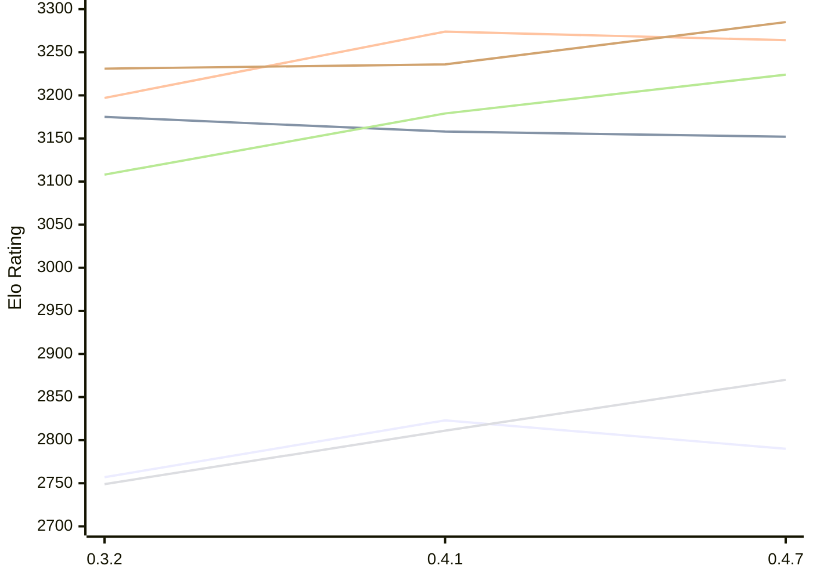

# Engine: Arabica

Author: Genio Mo

Home: https://github.com/geniomdev/arabica-chess

## Elo Ratings E1 (Ultra 7 265T (1.50 GHz) - E-Core)

| Version | Published | STC 8.0+0.08s  | LTC 60.0+0.60s | VLTC 2m24s+1.12s | Comment |
| --- | --- | --- | --- | --- | --- |
| 0.4.7 | 2026-11-11 | 2790(-33) | 3152(-6) | 3264(-10) |  |
| 0.4.1 | 2026-11-01 | 2823(+66) | 3158(-17) | 3274(+77) |  |
| 0.3.2 | 2026-10-27 | 2757 | 3175 | 3197 |  |
 | | | cElo (∆ prev) | cElo (∆ prev) | cElo (∆ prev) | 

## Elo Ratings P1 (Ultra 7 265T (1.50 GHz) - P-Core)

| Version | Published | STC 8.0+0.08s  | LTC 60.0+0.60s | VLTC 2m24s+1.12s | Comment |
| --- | --- | --- | --- | --- | --- |
| 0.4.7 | 2026-11-11 | 2870(+59) | 3224(+45) | 3285(+49) |  |
| 0.4.1 | 2026-11-01 | 2811(+62) | 3179(+71) | 3236(+5) |  |
| 0.3.2 | 2026-10-27 | 2749 | 3108 | 3231 |  |
 | | | cElo (∆ prev) | cElo (∆ prev) | cElo (∆ prev) | 

## Elo Ratings T1 (i5-7500T 2.70GHz)

| Version | Published | STC 8.0+0.08s  | LTC 60.0+0.60s | VLTC 2m24s+1.12s | Comment |
| --- | --- | --- | --- | --- | --- |
| 0.3.2 | 2026-10-27 | 2749 | 3108 | 3231 |  |
 | | | cElo (∆ prev) | cElo (∆ prev) | cElo (∆ prev) | 

<a href="https://github.com/computer-chess-index/cci/issues/new?template=submit-version.yml&title=[VERSION]+Arabica+<version>&body=###%20Engine%20name%0AArabica%0A%0A###%20Version%0A0.4.7" target="_blank">Submit new version</a>

 Test Conditions:

GUI/CLI: <a href=https://github.com/cutechess/cutechess target="_blank">Cute-Chess</a> 
Elo Calculation: <a href=https://www.remi-coulom.fr/Bayesian-Elo/ target="_blank">Bayesian-Elo</a> 
CPU for P1: Intel(R) Core(TM) Ultra 7 265T (1.50 GHz) - P-Core 
CPU for E1: Intel(R) Core(TM) Ultra 7 265T (1.50 GHz) - E-Core 
CPU for T1: Intel(R) Core(TM) i5-7500T 2.70GHz 
Opening book: 8_moves_v3 
\* STC: 8.0+0.08s, LTC: 60.0+0.60s, VLTC: 2m24s+1.12s

 Lists:
Ratings: <a href=https://github.com/computer-chess-index/cci/blob/main/lists/CCIRatings.csv target="_blank">Complete list</a>

Generated: 2026-11-24 05:35:49

## Ratings Verlauf E1 / P1

## Detailed Evaluation Results

| Version | Time Control | Variant | Elo  | Range +/- | Matches | Score | Average Opponent Elo | Draws |
| --- | --- |--- | --- | --- | --- | --- | --- | --- |
| 0.4.7 | VLTC (2m24s+1.12s) | P1 | 3285 | 39 | 182 | 51% | 3276 | 58% |
|  |  | E1 | 3264 | 33 | 252 | 49% | 3276 | 57% |
|  | LTC (60.0+0.60s) | P1 | 3224 | 48 | 116 | 52% | 3212 | 55% |
|  |  | E1 | 3152 | 40 | 180 | 50% | 3152 | 48% |
|  | STC (8.0+0.08s) | P1 | 2870 | 40 | 180 | 53% | 2846 | 47% |
|  |  | E1 | 2790 | 33 | 278 | 46% | 2830 | 41% |
| --- | --- |--- | --- | --- | --- | --- | --- | --- |
| 0.4.1 | VLTC (2m24s+1.12s) | P1 | 3236 | 34 | 240 | 51% | 3213 | 57% |
|  |  | E1 | 3274 | 32 | 270 | 51% | 3256 | 56% |
|  | LTC (60.0+0.60s) | P1 | 3179 | 34 | 252 | 52% | 3131 | 53% |
|  |  | E1 | 3158 | 29 | 358 | 56% | 3085 | 54% |
|  | STC (8.0+0.08s) | P1 | 2811 | 37 | 232 | 52% | 2763 | 39% |
|  |  | E1 | 2823 | 30 | 384 | 57% | 2720 | 33% |
| --- | --- |--- | --- | --- | --- | --- | --- | --- |
| 0.3.2 | VLTC (2m24s+1.12s) | P1 | 3231 | 41 | 160 | 54% | 3200 | 58% |
|  |  | E1 | 3197 | 32 | 264 | 49% | 3206 | 57% |
|  | LTC (60.0+0.60s) | P1 | 3108 | 51 | 106 | 48% | 3125 | 55% |
|  |  | E1 | 3175 | 43 | 152 | 51% | 3166 | 52% |
|  | STC (8.0+0.08s) | P1 | 2749 | 48 | 136 | 50% | 2749 | 36% |
|  |  | E1 | 2757 | 34 | 274 | 46% | 2796 | 35% |