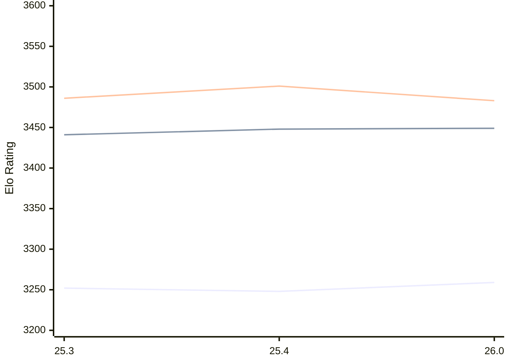

# Engine: Arasan

Author: Jon Dart

Home: https://github.com/jdart1/arasan-chess

## Elo Ratings E1 (Ultra 7 265T (1.50 GHz) - E-Core)

| Version | Published | STC 8.0+0.08s  | LTC 60.0+0.60s | VLTC 2m24s+1.12s | Comment |
| --- | --- | --- | --- | --- | --- |
| 26.0 | 2026-07-24 | 3163 | 3432 | 3468 |  |
 | | | cElo (∆ prev) | cElo (∆ prev) | cElo (∆ prev) | 

## Elo Ratings P1 (Ultra 7 265T (1.50 GHz) - P-Core)

| Version | Published | STC 8.0+0.08s  | LTC 60.0+0.60s | VLTC 2m24s+1.12s | Comment |
| --- | --- | --- | --- | --- | --- |
| 26.0 | 2026-07-24 | 3406 | 3611 | 3641 |  |
 | | | cElo (∆ prev) | cElo (∆ prev) | cElo (∆ prev) | 

## Elo Ratings T1 (i5-7500T 2.70GHz)

| Version | Published | STC 8.0+0.08s  | LTC 60.0+0.60s | VLTC 2m24s+1.12s | Comment |
| --- | --- | --- | --- | --- | --- |
| 26.0 | 2026-07-24 | 3259(+11) | 3449(+1) | 3483(-18) |  |
| 25.4 | 2026-04-15 | 3248(-4) | 3448(+7) | 3501(+15) |  |
| 25.3 | 2025-12-28 | 3252 | 3441 | 3486 |  |
 | | | cElo (∆ prev) | cElo (∆ prev) | cElo (∆ prev) | 

<a href="https://github.com/computer-chess-index/cci/issues/new?template=submit-version.yml&title=[VERSION]+Arasan+<version>&body=###%20Engine%20name%0AArasan%0A%0A###%20Version%0A26.0" target="_blank">Submit new version</a>

 Test Conditions:

GUI/CLI: <a href=https://github.com/cutechess/cutechess target="_blank">Cute-Chess</a> 
Elo Calculation: <a href=https://www.remi-coulom.fr/Bayesian-Elo/ target="_blank">Bayesian-Elo</a> 
CPU for P1: Intel(R) Core(TM) Ultra 7 265T (1.50 GHz) - P-Core 
CPU for E1: Intel(R) Core(TM) Ultra 7 265T (1.50 GHz) - E-Core 
CPU for T1: Intel(R) Core(TM) i5-7500T 2.70GHz 
Opening book: 8_moves_v3 
\* STC: 8.0+0.08s, LTC: 60.0+0.60s, VLTC: 2m24s+1.12s

 Lists:
Ratings: <a href=https://github.com/computer-chess-index/cci/blob/main/lists/CCIRatings.csv target="_blank">Complete list</a>

Generated: 2026-10-14 04:35:50

## Ratings Verlauf T1

## Detailed Evaluation Results

| Version | Time Control | Variant | Elo  | Range +/- | Matches | Score | Average Opponent Elo | Draws |
| --- | --- |--- | --- | --- | --- | --- | --- | --- |
| 26.0 | VLTC (2m24s+1.12s) | T1 | 3483 | 27 | 308 | 50% | 3484 | 85% |
|  |  | P1 | 3641 | 38 | 164 | 49% | 3646 | 82% |
|  |  | E1 | 3468 | 32 | 236 | 50% | 3472 | 78% |
|  | LTC (60.0+0.60s) | T1 | 3449 | 26 | 348 | 50% | 3447 | 80% |
|  |  | P1 | 3611 | 36 | 182 | 51% | 3603 | 79% |
|  |  | E1 | 3432 | 32 | 240 | 49% | 3441 | 75% |
|  | STC (8.0+0.08s) | T1 | 3259 | 26 | 384 | 49% | 3264 | 65% |
|  |  | P1 | 3406 | 37 | 190 | 50% | 3409 | 68% |
|  |  | E1 | 3163 | 29 | 330 | 48% | 3174 | 59% |
| --- | --- |--- | --- | --- | --- | --- | --- | --- |
| 25.4 | VLTC (2m24s+1.12s) | T1 | 3501 | 24 | 408 | 49% | 3505 | 86% |
|  | LTC (60.0+0.60s) | T1 | 3448 | 24 | 404 | 50% | 3449 | 78% |
|  | STC (8.0+0.08s) | T1 | 3248 | 24 | 450 | 51% | 3233 | 63% |
| --- | --- |--- | --- | --- | --- | --- | --- | --- |
| 25.3 | VLTC (2m24s+1.12s) | T1 | 3486 | 26 | 356 | 51% | 3480 | 82% |
|  | LTC (60.0+0.60s) | T1 | 3441 | 26 | 360 | 51% | 3434 | 78% |
|  | STC (8.0+0.08s) | T1 | 3252 | 24 | 488 | 52% | 3236 | 59% |