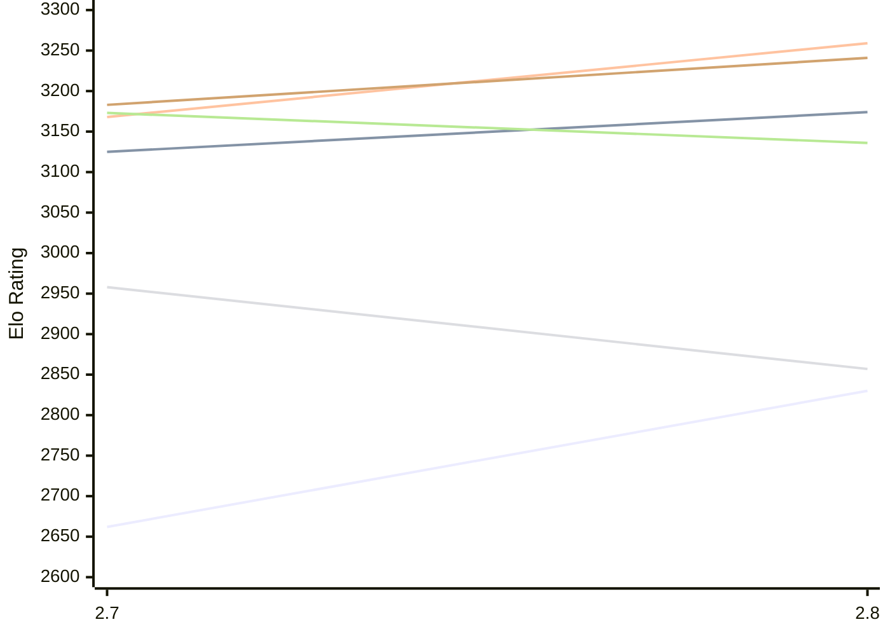
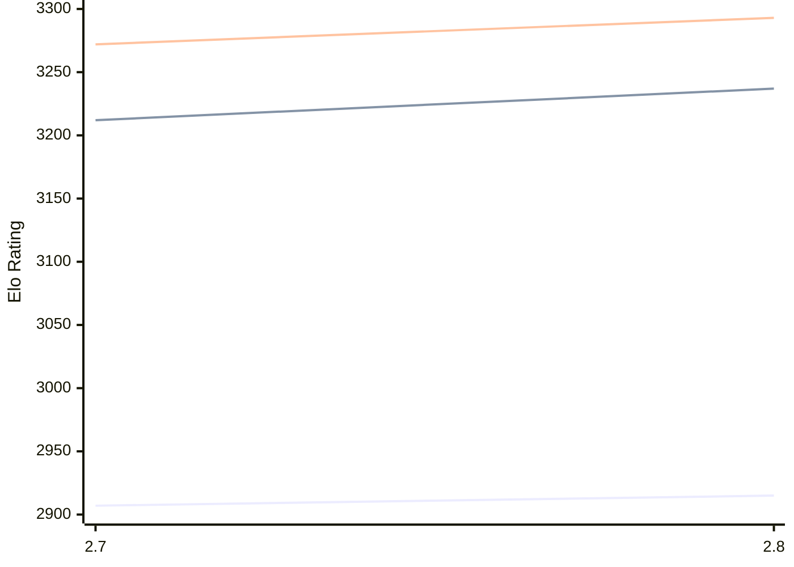

# Engine: Arcanum

Author: Lars Aurud

Home: https://github.com/LarsAur/Arcanum

## Elo Ratings E1 (Ultra 7 265T (1.50 GHz) - E-Core)

| Version | Published | STC 8.0+0.08s  | LTC 60.0+0.60s | VLTC 2m24s+1.12s | Comment |
| --- | --- | --- | --- | --- | --- |
| 2.8 | 2026-05-16 | 2830(+168) | 3174(+49) | 3259(+91) |  |
| 2.7 | 2025-10-18 | 2662 | 3125 | 3168 |  |
 | | | cElo (∆ prev) | cElo (∆ prev) | cElo (∆ prev) | 

## Elo Ratings P1 (Ultra 7 265T (1.50 GHz) - P-Core)

| Version | Published | STC 8.0+0.08s  | LTC 60.0+0.60s | VLTC 2m24s+1.12s | Comment |
| --- | --- | --- | --- | --- | --- |
| 2.8 | 2026-05-16 | 2857(-101) | 3136(-37) | 3241(+58) |  |
| 2.7 | 2025-10-18 | 2958 | 3173 | 3183 |  |
 | | | cElo (∆ prev) | cElo (∆ prev) | cElo (∆ prev) | 

## Elo Ratings T1 (i5-7500T 2.70GHz)

| Version | Published | STC 8.0+0.08s  | LTC 60.0+0.60s | VLTC 2m24s+1.12s | Comment |
| --- | --- | --- | --- | --- | --- |
| 2.8 | 2026-05-16 | 2915(+8) | 3237(+25) | 3293(+21) |  |
| 2.7 | 2025-10-18 | 2907 | 3212 | 3272 |  |
 | | | cElo (∆ prev) | cElo (∆ prev) | cElo (∆ prev) | 

<a href="https://github.com/computer-chess-index/cci/issues/new?template=submit-version.yml&title=[VERSION]+Arcanum+<version>&body=###%20Engine%20name%0AArcanum%0A%0A###%20Version%0A2.8" target="_blank">Submit new version</a>

 Test Conditions:

GUI/CLI: <a href=https://github.com/cutechess/cutechess target="_blank">Cute-Chess</a> 
Elo Calculation: <a href=https://www.remi-coulom.fr/Bayesian-Elo/ target="_blank">Bayesian-Elo</a> 
CPU for P1: Intel(R) Core(TM) Ultra 7 265T (1.50 GHz) - P-Core 
CPU for E1: Intel(R) Core(TM) Ultra 7 265T (1.50 GHz) - E-Core 
CPU for T1: Intel(R) Core(TM) i5-7500T 2.70GHz 
Opening book: 8_moves_v3 
\* STC: 8.0+0.08s, LTC: 60.0+0.60s, VLTC: 2m24s+1.12s

 Lists:
Ratings: <a href=https://github.com/computer-chess-index/cci/blob/main/lists/CCIRatings.csv target="_blank">Complete list</a>

Generated: 2026-11-15 05:35:55

## Ratings Verlauf E1 / P1

## Ratings Verlauf T1

## Detailed Evaluation Results

| Version | Time Control | Variant | Elo  | Range +/- | Matches | Score | Average Opponent Elo | Draws |
| --- | --- |--- | --- | --- | --- | --- | --- | --- |
| 2.8 | VLTC (2m24s+1.12s) | T1 | 3293 | 24 | 448 | 50% | 3295 | 66% |
|  |  | P1 | 3241 | 34 | 222 | 52% | 3209 | 66% |
|  |  | E1 | 3259 | 28 | 346 | 52% | 3209 | 60% |
|  | LTC (60.0+0.60s) | T1 | 3237 | 26 | 416 | 50% | 3233 | 57% |
|  |  | P1 | 3136 | 36 | 214 | 50% | 3124 | 59% |
|  |  | E1 | 3174 | 29 | 320 | 53% | 3128 | 63% |
|  | STC (8.0+0.08s) | T1 | 2915 | 24 | 504 | 49% | 2928 | 44% |
|  |  | P1 | 2857 | 34 | 252 | 49% | 2865 | 48% |
|  |  | E1 | 2830 | 29 | 338 | 45% | 2869 | 49% |
| --- | --- |--- | --- | --- | --- | --- | --- | --- |
| 2.7 | VLTC (2m24s+1.12s) | E1 | 3168 | 102 | 32 | 66% | 3004 | 44% |
|  |  | T1 | 3272 | 27 | 394 | 54% | 3237 | 56% |
|  |  | P1 | 3183 | 147 | 18 | 78% | 2871 | 33% |
|  | LTC (60.0+0.60s) | E1 | 3125 | 133 | 18 | 67% | 2966 | 33% |
|  |  | T1 | 3212 | 26 | 424 | 50% | 3193 | 57% |
|  |  | P1 | 3173 | 214 | 6 | 33% | 3302 | 33% |
|  | STC (8.0+0.08s) | T1 | 2907 | 23 | 554 | 49% | 2905 | 44% |
|  |  | P1 | 2958 | 184 | 12 | 67% | 2739 | 17% |
|  |  | E1 | 2662 | 118 | 22 | 57% | 2611 | 32% |