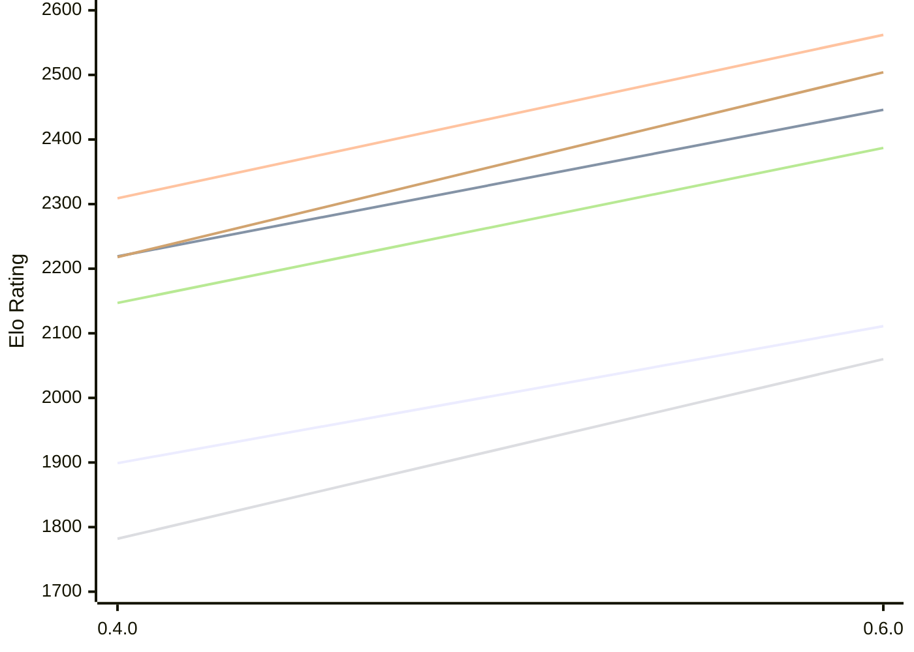
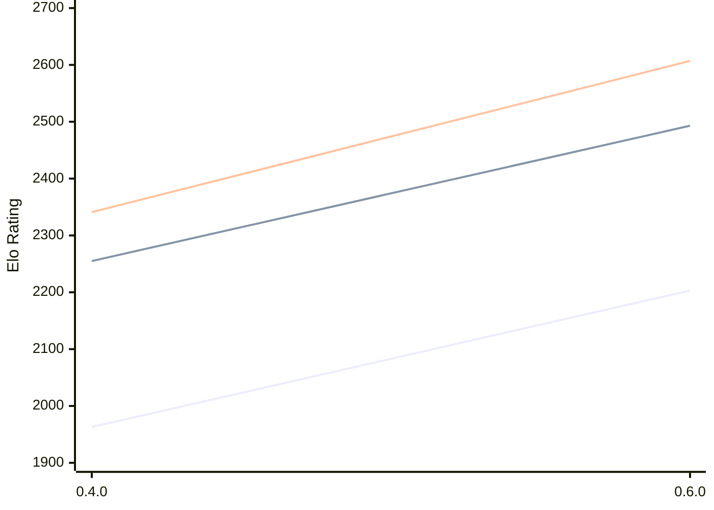

# Engine: Ariadne

Author: Liam Galvin

Home: https://github.com/liamg/ariadne

## Elo Ratings E1 (Ultra 7 265T (1.50 GHz) - E-Core)

| Version | Published | STC 8.0+0.08s  | LTC 60.0+0.60s | VLTC 2m24s+1.12s | Comment |
| --- | --- | --- | --- | --- | --- |
| 0.6.0 | 2026-08-29 | 2111(+212) | 2446(+227) | 2562(+253) |  |
| 0.4.0 | 2026-08-16 | 1899 | 2219 | 2309 |  |
 | | | cElo (∆ prev) | cElo (∆ prev) | cElo (∆ prev) | 

## Elo Ratings P1 (Ultra 7 265T (1.50 GHz) - P-Core)

| Version | Published | STC 8.0+0.08s  | LTC 60.0+0.60s | VLTC 2m24s+1.12s | Comment |
| --- | --- | --- | --- | --- | --- |
| 0.6.0 | 2026-08-29 | 2060(+278) | 2387(+240) | 2504(+286) |  |
| 0.4.0 | 2026-08-16 | 1782 | 2147 | 2218 |  |
 | | | cElo (∆ prev) | cElo (∆ prev) | cElo (∆ prev) | 

## Elo Ratings T1 (i5-7500T 2.70GHz)

| Version | Published | STC 8.0+0.08s  | LTC 60.0+0.60s | VLTC 2m24s+1.12s | Comment |
| --- | --- | --- | --- | --- | --- |
| 0.6.0 | 2026-08-29 | 2203(+240) | 2493(+238) | 2607(+266) |  |
| 0.4.0 | 2026-08-16 | 1963 | 2255 | 2341 |  |
 | | | cElo (∆ prev) | cElo (∆ prev) | cElo (∆ prev) | 

<a href="https://github.com/computer-chess-index/cci/issues/new?template=submit-version.yml&title=[VERSION]+Ariadne+<version>&body=###%20Engine%20name%0AAriadne%0A%0A###%20Version%0A0.6.0" target="_blank">Submit new version</a>

 Test Conditions:

GUI/CLI: <a href=https://github.com/cutechess/cutechess target="_blank">Cute-Chess</a> 
Elo Calculation: <a href=https://www.remi-coulom.fr/Bayesian-Elo/ target="_blank">Bayesian-Elo</a> 
CPU for P1: Intel(R) Core(TM) Ultra 7 265T (1.50 GHz) - P-Core 
CPU for E1: Intel(R) Core(TM) Ultra 7 265T (1.50 GHz) - E-Core 
CPU for T1: Intel(R) Core(TM) i5-7500T 2.70GHz 
Opening book: 8_moves_v3 
\* STC: 8.0+0.08s, LTC: 60.0+0.60s, VLTC: 2m24s+1.12s

 Lists:
Ratings: <a href=https://github.com/computer-chess-index/cci/blob/main/lists/CCIRatings.csv target="_blank">Complete list</a>

Generated: 2026-11-16 05:36:03

## Ratings Verlauf E1 / P1

## Ratings Verlauf T1

## Detailed Evaluation Results

| Version | Time Control | Variant | Elo  | Range +/- | Matches | Score | Average Opponent Elo | Draws |
| --- | --- |--- | --- | --- | --- | --- | --- | --- |
| 0.6.0 | VLTC (2m24s+1.12s) | T1 | 2607 | 35 | 264 | 51% | 2593 | 34% |
|  |  | P1 | 2504 | 35 | 290 | 45% | 2569 | 27% |
|  |  | E1 | 2562 | 27 | 464 | 47% | 2603 | 27% |
|  | LTC (60.0+0.60s) | P1 | 2387 | 38 | 230 | 48% | 2404 | 33% |
|  |  | E1 | 2446 | 32 | 350 | 47% | 2487 | 27% |
|  |  | T1 | 2493 | 35 | 264 | 48% | 2515 | 31% |
|  | STC (8.0+0.08s) | P1 | 2060 | 38 | 244 | 48% | 2102 | 24% |
|  |  | E1 | 2111 | 29 | 424 | 48% | 2140 | 27% |
|  |  | T1 | 2203 | 34 | 308 | 46% | 2237 | 24% |
| --- | --- |--- | --- | --- | --- | --- | --- | --- |
| 0.4.0 | VLTC (2m24s+1.12s) | P1 | 2218 | 81 | 64 | 34% | 2338 | 25% |
|  |  | E1 | 2309 | 61 | 96 | 47% | 2318 | 27% |
|  |  | T1 | 2341 | 34 | 296 | 51% | 2333 | 25% |
|  | LTC (60.0+0.60s) | P1 | 2147 | 76 | 88 | 56% | 2032 | 10% |
|  |  | E1 | 2219 | 65 | 96 | 55% | 2109 | 17% |
|  |  | T1 | 2255 | 35 | 280 | 50% | 2253 | 23% |
|  | STC (8.0+0.08s) | E1 | 1899 | 55 | 136 | 54% | 1856 | 18% |
|  |  | T1 | 1963 | 37 | 256 | 50% | 1962 | 21% |
|  |  | P1 | 1782 | 80 | 76 | 38% | 1987 | 12% |