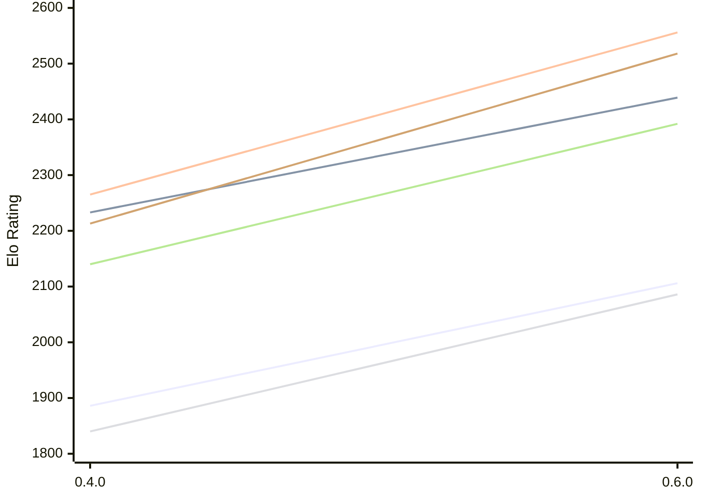
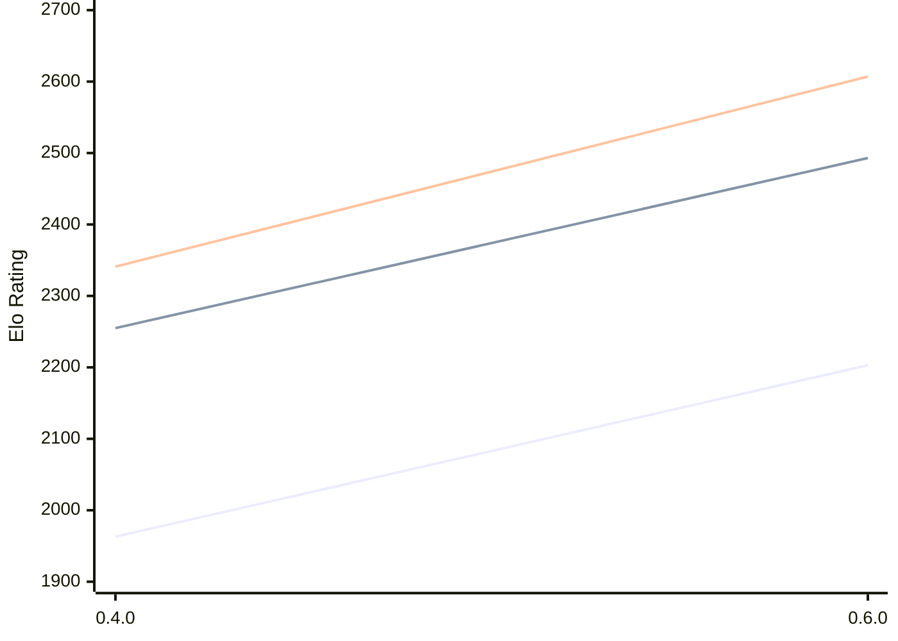

# Engine: Ariadne

Author: Liam Galvin

Home: https://github.com/liamg/ariadne

## Elo Ratings E1 (Ultra 7 265T (1.50 GHz) - E-Core)

| Version | Published | STC 8.0+0.08s  | LTC 60.0+0.60s | VLTC 2m24s+1.12s | Comment |
| --- | --- | --- | --- | --- | --- |
| 0.6.0 | 2026-08-29 | 2106(+220) | 2439(+206) | 2556(+291) |  |
| 0.4.0 | 2026-08-16 | 1886 | 2233 | 2265 |  |
 | | | cElo (∆ prev) | cElo (∆ prev) | cElo (∆ prev) | 

## Elo Ratings P1 (Ultra 7 265T (1.50 GHz) - P-Core)

| Version | Published | STC 8.0+0.08s  | LTC 60.0+0.60s | VLTC 2m24s+1.12s | Comment |
| --- | --- | --- | --- | --- | --- |
| 0.6.0 | 2026-08-29 | 2086(+246) | 2392(+252) | 2518(+305) |  |
| 0.4.0 | 2026-08-16 | 1840 | 2140 | 2213 |  |
 | | | cElo (∆ prev) | cElo (∆ prev) | cElo (∆ prev) | 

## Elo Ratings T1 (i5-7500T 2.70GHz)

| Version | Published | STC 8.0+0.08s  | LTC 60.0+0.60s | VLTC 2m24s+1.12s | Comment |
| --- | --- | --- | --- | --- | --- |
| 0.6.0 | 2026-08-29 | 2203(+240) | 2493(+238) | 2607(+266) |  |
| 0.4.0 | 2026-08-16 | 1963 | 2255 | 2341 |  |
 | | | cElo (∆ prev) | cElo (∆ prev) | cElo (∆ prev) | 

<a href="https://github.com/computer-chess-index/cci/issues/new?template=submit-version.yml&title=[VERSION]+Ariadne+<version>&body=###%20Engine%20name%0AAriadne%0A%0A###%20Version%0A0.6.0" target="_blank">Submit new version</a>

 Test Conditions:

GUI/CLI: <a href=https://github.com/cutechess/cutechess target="_blank">Cute-Chess</a> 
Elo Calculation: <a href=https://www.remi-coulom.fr/Bayesian-Elo/ target="_blank">Bayesian-Elo</a> 
CPU for P1: Intel(R) Core(TM) Ultra 7 265T (1.50 GHz) - P-Core 
CPU for E1: Intel(R) Core(TM) Ultra 7 265T (1.50 GHz) - E-Core 
CPU for T1: Intel(R) Core(TM) i5-7500T 2.70GHz 
Opening book: 8_moves_v3 
\* STC: 8.0+0.08s, LTC: 60.0+0.60s, VLTC: 2m24s+1.12s

 Lists:
Ratings: <a href=https://github.com/computer-chess-index/cci/blob/main/lists/CCIRatings.csv target="_blank">Complete list</a>

Generated: 2026-11-18 05:36:07

## Ratings Verlauf E1 / P1

## Ratings Verlauf T1

## Detailed Evaluation Results

| Version | Time Control | Variant | Elo  | Range +/- | Matches | Score | Average Opponent Elo | Draws |
| --- | --- |--- | --- | --- | --- | --- | --- | --- |
| 0.6.0 | VLTC (2m24s+1.12s) | T1 | 2607 | 35 | 264 | 51% | 2593 | 34% |
|  |  | P1 | 2518 | 34 | 302 | 46% | 2577 | 27% |
|  |  | E1 | 2556 | 27 | 468 | 46% | 2597 | 27% |
|  | LTC (60.0+0.60s) | P1 | 2392 | 37 | 242 | 48% | 2411 | 33% |
|  |  | E1 | 2439 | 32 | 350 | 47% | 2481 | 27% |
|  |  | T1 | 2493 | 35 | 264 | 48% | 2515 | 31% |
|  | STC (8.0+0.08s) | P1 | 2086 | 37 | 256 | 49% | 2111 | 23% |
|  |  | E1 | 2106 | 28 | 440 | 48% | 2132 | 27% |
|  |  | T1 | 2203 | 34 | 308 | 46% | 2237 | 24% |
| --- | --- |--- | --- | --- | --- | --- | --- | --- |
| 0.4.0 | VLTC (2m24s+1.12s) | P1 | 2213 | 71 | 80 | 36% | 2330 | 26% |
|  |  | E1 | 2265 | 54 | 124 | 44% | 2306 | 24% |
|  |  | T1 | 2341 | 34 | 296 | 51% | 2333 | 25% |
|  | LTC (60.0+0.60s) | P1 | 2140 | 69 | 100 | 55% | 2045 | 12% |
|  |  | E1 | 2233 | 62 | 106 | 56% | 2114 | 16% |
|  |  | T1 | 2255 | 35 | 280 | 50% | 2253 | 23% |
|  | STC (8.0+0.08s) | E1 | 1886 | 51 | 152 | 54% | 1851 | 19% |
|  |  | T1 | 1963 | 37 | 256 | 50% | 1962 | 21% |
|  |  | P1 | 1840 | 69 | 92 | 43% | 1962 | 15% |