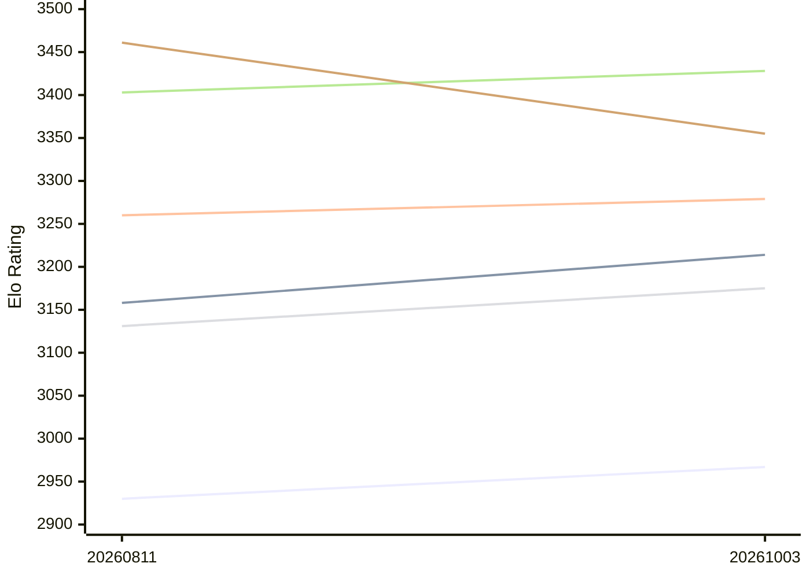
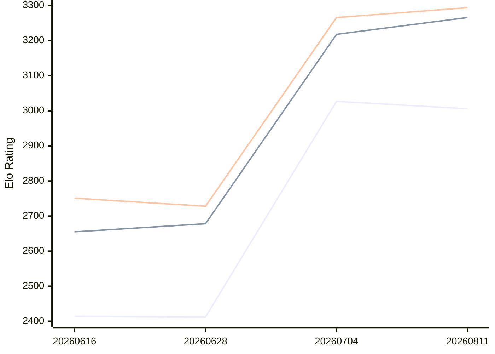

# Engine: Askaig

Author: Nguyen Van Thang

Home: https://github.com/sophiathedev/askaig

## Elo Ratings E1

| Version | Published | STC 8.0+0.08s  | LTC 60.0+0.60s | VLTC 2m24s+1.12s | Comment |
| --- | --- | --- | --- | --- | --- |
| 20261003 | 2026-10-03 | 2967(+37) | 3214(+56) | 3279(+19) |  |
| 20260811 | 2026-08-11 | 2930 | 3158 | 3260 |  |
 | | | cElo (∆ prev) | cElo (∆ prev) | cElo (∆ prev) | 

## Elo Ratings P1

| Version | Published | STC 8.0+0.08s  | LTC 60.0+0.60s | VLTC 2m24s+1.12s | Comment |
| --- | --- | --- | --- | --- | --- |
| 20261003 | 2026-10-03 | 3175(+44) | 3428(+25) | 3355(-106) |  |
| 20260811 | 2026-08-11 | 3131 | 3403 | 3461 |  |
 | | | cElo (∆ prev) | cElo (∆ prev) | cElo (∆ prev) | 

## Elo Ratings T1

| Version | Published | STC 8.0+0.08s  | LTC 60.0+0.60s | VLTC 2m24s+1.12s | Comment |
| --- | --- | --- | --- | --- | --- |
| 20260811 | 2026-08-11 | 3006(-21) | 3266(+48) | 3294(+28) |  |
| 20260704 | 2026-07-04 | 3027(+615) | 3218(+540) | 3266(+538) |  |
| 20260628 | 2026-06-28 | 2412(-2) | 2678(+23) | 2728(-23) |  |
| 20260616 | 2026-06-16 | 2414 | 2655 | 2751 |  |
 | | | cElo (∆ prev) | cElo (∆ prev) | cElo (∆ prev) | 

<a href="https://github.com/computer-chess-index/cci/issues/new?template=submit-version.yml&title=[VERSION]+Askaig+<version>&body=###%20Engine%20name%0AAskaig%0A%0A###%20Version%0A20260811" target="_blank">Submit new version</a>

 Test Conditions:

GUI/CLI: <a href=https://github.com/cutechess/cutechess target="_blank">Cute-Chess</a> 
Elo Calculation: <a href=https://www.remi-coulom.fr/Bayesian-Elo/ target="_blank">Bayesian-Elo</a> 
CPU for P1: Intel(R) Core(TM) Ultra 7 265T (1.50 GHz) - P-Core 
CPU for E1: Intel(R) Core(TM) Ultra 7 265T (1.50 GHz) - E-Core 
CPU for T1: Intel(R) Core(TM) i5-7500T 2.70GHz 
Opening book: 8_moves_v3 
\* STC: 8.0+0.08s, LTC: 60.0+0.60s, VLTC: 2m24s+1.12s

 Lists:
Ratings: <a href=https://github.com/computer-chess-index/cci/blob/main/lists/CCIRatings.csv target="_blank">Complete list</a>

Generated: 2026-10-13 19:13:17

## Ratings Verlauf E1 / P1

## Ratings Verlauf T1

## Detailed Evaluation Results

| Version | Time Control | Variant | Elo  | Range +/- | Matches | Score | Average Opponent Elo | Draws |
| --- | --- | --- | --- | --- | --- | --- | --- | --- |
| 20261003 | VLTC (2m24s+1.12s) | P1 | 3355 | 86 | 36 | 44% | 3402 | 56% |
| --- | --- |--- | --- | --- | --- | --- | --- | --- |
|  | VLTC (2m24s+1.12s) | E1 | 3279 | 49 | 122 | 50% | 3275 | 42% |
|  | LTC (60.0+0.60s) | P1 | 3428 | 74 | 52 | 51% | 3420 | 44% |
|  | LTC (60.0+0.60s) | E1 | 3214 | 47 | 136 | 49% | 3220 | 44% |
|  | STC (8.0+0.08s) | P1 | 3175 | 67 | 68 | 53% | 3150 | 38% |
|  | STC (8.0+0.08s) | E1 | 2967 | 52 | 120 | 52% | 2952 | 32% |
| 20260811 | VLTC (2m24s+1.12s) | P1 | 3461 | 39 | 188 | 50% | 3463 | 51% |
| --- | --- |--- | --- | --- | --- | --- | --- | --- |
|  | VLTC (2m24s+1.12s) | E1 | 3260 | 33 | 255 | 49% | 3268 | 54% |
|  | VLTC (2m24s+1.12s) | T1 | 3294 | 29 | 338 | 49% | 3299 | 54% |
|  | LTC (60.0+0.60s) | E1 | 3158 | 31 | 312 | 47% | 3179 | 43% |
|  | LTC (60.0+0.60s) | T1 | 3266 | 28 | 376 | 48% | 3278 | 49% |
|  | LTC (60.0+0.60s) | P1 | 3403 | 37 | 212 | 48% | 3424 | 44% |
|  | STC (8.0+0.08s) | E1 | 2930 | 33 | 288 | 49% | 2925 | 35% |
|  | STC (8.0+0.08s) | T1 | 3006 | 27 | 428 | 51% | 2992 | 36% |
|  | STC (8.0+0.08s) | P1 | 3131 | 38 | 224 | 54% | 3096 | 37% |
| 20260704 | VLTC (2m24s+1.12s) | T1 | 3266 | 31 | 312 | 54% | 3229 | 50% |
| --- | --- |--- | --- | --- | --- | --- | --- | --- |
|  | LTC (60.0+0.60s) | T1 | 3218 | 30 | 320 | 53% | 3190 | 52% |
|  | STC (8.0+0.08s) | T1 | 3027 | 32 | 312 | 53% | 2997 | 36% |
| 20260628 | VLTC (2m24s+1.12s) | T1 | 2728 | 46 | 148 | 51% | 2718 | 35% |
| --- | --- |--- | --- | --- | --- | --- | --- | --- |
|  | LTC (60.0+0.60s) | T1 | 2678 | 53 | 116 | 49% | 2688 | 31% |
|  | STC (8.0+0.08s) | T1 | 2412 | 53 | 116 | 50% | 2411 | 31% |
| 20260616 | VLTC (2m24s+1.12s) | T1 | 2751 | 47 | 144 | 51% | 2739 | 36% |
| --- | --- |--- | --- | --- | --- | --- | --- | --- |
|  | LTC (60.0+0.60s) | T1 | 2655 | 47 | 148 | 46% | 2689 | 34% |
|  | STC (8.0+0.08s) | T1 | 2414 | 41 | 196 | 44% | 2473 | 30% |