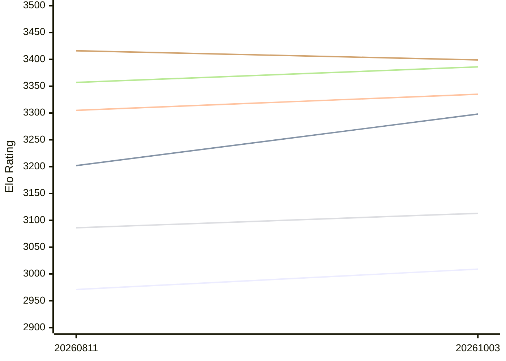
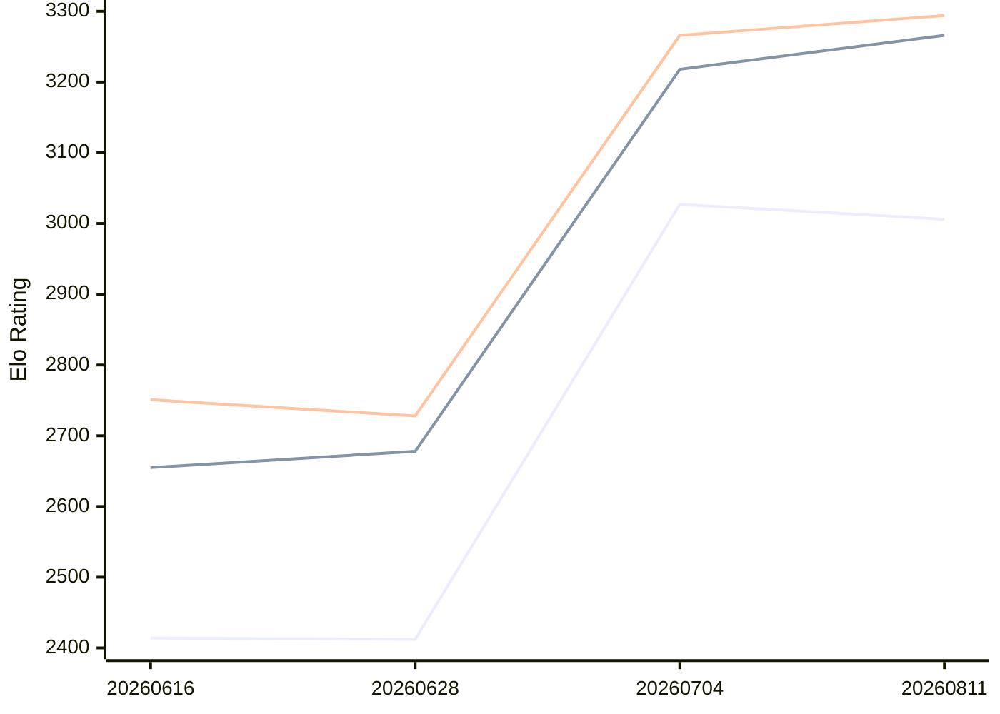

# Engine: Askaig

Author: Nguyen Van Thang

Home: https://github.com/sophiathedev/askaig

## Elo Ratings E1 (Ultra 7 265T (1.50 GHz) - E-Core)

| Version | Published | STC 8.0+0.08s  | LTC 60.0+0.60s | VLTC 2m24s+1.12s | Comment |
| --- | --- | --- | --- | --- | --- |
| 20261003 | 2026-10-03 | 3009(+38) | 3298(+96) | 3335(+30) |  |
| 20260811 | 2026-08-11 | 2971 | 3202 | 3305 |  |
 | | | cElo (∆ prev) | cElo (∆ prev) | cElo (∆ prev) | 

## Elo Ratings P1 (Ultra 7 265T (1.50 GHz) - P-Core)

| Version | Published | STC 8.0+0.08s  | LTC 60.0+0.60s | VLTC 2m24s+1.12s | Comment |
| --- | --- | --- | --- | --- | --- |
| 20261003 | 2026-10-03 | 3113(+27) | 3386(+29) | 3399(-17) |  |
| 20260811 | 2026-08-11 | 3086 | 3357 | 3416 |  |
 | | | cElo (∆ prev) | cElo (∆ prev) | cElo (∆ prev) | 

## Elo Ratings T1 (i5-7500T 2.70GHz)

| Version | Published | STC 8.0+0.08s  | LTC 60.0+0.60s | VLTC 2m24s+1.12s | Comment |
| --- | --- | --- | --- | --- | --- |
| 20260811 | 2026-08-11 | 3006(-21) | 3266(+48) | 3294(+28) |  |
| 20260704 | 2026-07-04 | 3027(+615) | 3218(+540) | 3266(+538) |  |
| 20260628 | 2026-06-28 | 2412(-2) | 2678(+23) | 2728(-23) |  |
| 20260616 | 2026-06-16 | 2414 | 2655 | 2751 |  |
 | | | cElo (∆ prev) | cElo (∆ prev) | cElo (∆ prev) | 

<a href="https://github.com/computer-chess-index/cci/issues/new?template=submit-version.yml&title=[VERSION]+Askaig+<version>&body=###%20Engine%20name%0AAskaig%0A%0A###%20Version%0A20260811" target="_blank">Submit new version</a>

 Test Conditions:

GUI/CLI: <a href=https://github.com/cutechess/cutechess target="_blank">Cute-Chess</a> 
Elo Calculation: <a href=https://www.remi-coulom.fr/Bayesian-Elo/ target="_blank">Bayesian-Elo</a> 
CPU for P1: Intel(R) Core(TM) Ultra 7 265T (1.50 GHz) - P-Core 
CPU for E1: Intel(R) Core(TM) Ultra 7 265T (1.50 GHz) - E-Core 
CPU for T1: Intel(R) Core(TM) i5-7500T 2.70GHz 
Opening book: 8_moves_v3 
\* STC: 8.0+0.08s, LTC: 60.0+0.60s, VLTC: 2m24s+1.12s

 Lists:
Ratings: <a href=https://github.com/computer-chess-index/cci/blob/main/lists/CCIRatings.csv target="_blank">Complete list</a>

Generated: 2026-10-19 04:36:01

## Ratings Verlauf E1 / P1

## Ratings Verlauf T1

## Detailed Evaluation Results

| Version | Time Control | Variant | Elo  | Range +/- | Matches | Score | Average Opponent Elo | Draws |
| --- | --- |--- | --- | --- | --- | --- | --- | --- |
| 20261003 | VLTC (2m24s+1.12s) | P1 | 3399 | 42 | 172 | 53% | 3375 | 43% |
|  |  | E1 | 3335 | 42 | 172 | 50% | 3332 | 42% |
|  | LTC (60.0+0.60s) | P1 | 3386 | 45 | 132 | 50% | 3382 | 55% |
|  |  | E1 | 3298 | 32 | 296 | 52% | 3279 | 44% |
|  | STC (8.0+0.08s) | P1 | 3113 | 45 | 144 | 50% | 3110 | 45% |
|  |  | E1 | 3009 | 42 | 184 | 51% | 3005 | 34% |
| --- | --- |--- | --- | --- | --- | --- | --- | --- |
| 20260811 | VLTC (2m24s+1.12s) | T1 | 3294 | 29 | 338 | 49% | 3299 | 54% |
|  |  | P1 | 3416 | 39 | 188 | 50% | 3417 | 51% |
|  |  | E1 | 3305 | 33 | 255 | 49% | 3313 | 54% |
|  | LTC (60.0+0.60s) | T1 | 3266 | 28 | 376 | 48% | 3278 | 49% |
|  |  | P1 | 3357 | 37 | 212 | 48% | 3378 | 44% |
|  |  | E1 | 3202 | 31 | 312 | 47% | 3224 | 43% |
|  | STC (8.0+0.08s) | T1 | 3006 | 27 | 428 | 51% | 2992 | 36% |
|  |  | P1 | 3086 | 37 | 232 | 54% | 3048 | 37% |
|  |  | E1 | 2971 | 33 | 288 | 49% | 2969 | 35% |
| --- | --- |--- | --- | --- | --- | --- | --- | --- |
| 20260704 | VLTC (2m24s+1.12s) | T1 | 3266 | 31 | 312 | 54% | 3229 | 50% |
|  | LTC (60.0+0.60s) | T1 | 3218 | 30 | 320 | 53% | 3190 | 52% |
|  | STC (8.0+0.08s) | T1 | 3027 | 32 | 312 | 53% | 2997 | 36% |
| --- | --- |--- | --- | --- | --- | --- | --- | --- |
| 20260628 | VLTC (2m24s+1.12s) | T1 | 2728 | 46 | 148 | 51% | 2718 | 35% |
|  | LTC (60.0+0.60s) | T1 | 2678 | 53 | 116 | 49% | 2688 | 31% |
|  | STC (8.0+0.08s) | T1 | 2412 | 53 | 116 | 50% | 2411 | 31% |
| --- | --- |--- | --- | --- | --- | --- | --- | --- |
| 20260616 | VLTC (2m24s+1.12s) | T1 | 2751 | 47 | 144 | 51% | 2739 | 36% |
|  | LTC (60.0+0.60s) | T1 | 2655 | 47 | 148 | 46% | 2689 | 34% |
|  | STC (8.0+0.08s) | T1 | 2414 | 41 | 196 | 44% | 2473 | 30% |