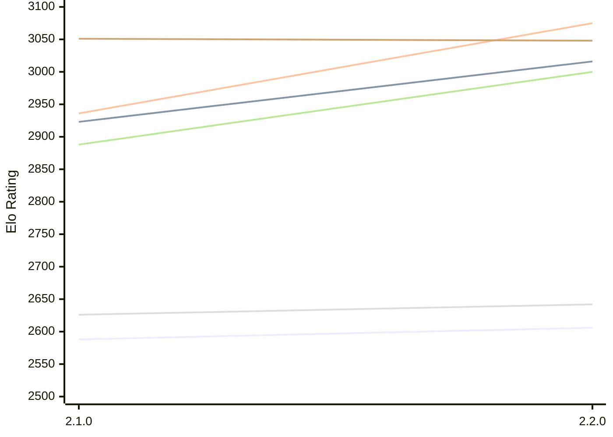
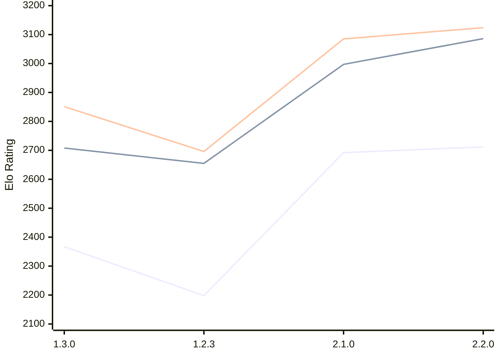

# Engine: Aspen

Author: A. Theofanis

Home: https://github.com/ATheofanis/aspen-chess

## Elo Ratings E1 (Ultra 7 265T (1.50 GHz) - E-Core)

| Version | Published | STC 8.0+0.08s  | LTC 60.0+0.60s | VLTC 2m24s+1.12s | Comment |
| --- | --- | --- | --- | --- | --- |
| 2.2.0 | 2026-05-22 | 2606(+18) | 3016(+93) | 3075(+139) |  |
| 2.1.0 | 2026-05-21 | 2588 | 2923 | 2936 |  |
 | | | cElo (∆ prev) | cElo (∆ prev) | cElo (∆ prev) | 

## Elo Ratings P1 (Ultra 7 265T (1.50 GHz) - P-Core)

| Version | Published | STC 8.0+0.08s  | LTC 60.0+0.60s | VLTC 2m24s+1.12s | Comment |
| --- | --- | --- | --- | --- | --- |
| 2.2.0 | 2026-05-22 | 2642(+16) | 3000(+112) | 3048(-3) |  |
| 2.1.0 | 2026-05-21 | 2626 | 2888 | 3051 |  |
 | | | cElo (∆ prev) | cElo (∆ prev) | cElo (∆ prev) | 

## Elo Ratings T1 (i5-7500T 2.70GHz)

| Version | Published | STC 8.0+0.08s  | LTC 60.0+0.60s | VLTC 2m24s+1.12s | Comment |
| --- | --- | --- | --- | --- | --- |
| 2.2.0 | 2026-05-22 | 2712(+20) | 3086(+89) | 3124(+39) |  |
| 2.1.0 | 2026-05-21 | 2692(+325) | 2997(+289) | 3085(+234) |  |
| 1.3.0 | 2026-05-20 | 2367(+169) | 2708(+53) | 2851(+155) |  |
| 1.2.3 | 2026-05-20 | 2198 | 2655 | 2696 |  |
 | | | cElo (∆ prev) | cElo (∆ prev) | cElo (∆ prev) | 

<a href="https://github.com/computer-chess-index/cci/issues/new?template=submit-version.yml&title=[VERSION]+Aspen+<version>&body=###%20Engine%20name%0AAspen%0A%0A###%20Version%0A2.2.0" target="_blank">Submit new version</a>

 Test Conditions:

GUI/CLI: <a href=https://github.com/cutechess/cutechess target="_blank">Cute-Chess</a> 
Elo Calculation: <a href=https://www.remi-coulom.fr/Bayesian-Elo/ target="_blank">Bayesian-Elo</a> 
CPU for P1: Intel(R) Core(TM) Ultra 7 265T (1.50 GHz) - P-Core 
CPU for E1: Intel(R) Core(TM) Ultra 7 265T (1.50 GHz) - E-Core 
CPU for T1: Intel(R) Core(TM) i5-7500T 2.70GHz 
Opening book: 8_moves_v3 
\* STC: 8.0+0.08s, LTC: 60.0+0.60s, VLTC: 2m24s+1.12s

 Lists:
Ratings: <a href=https://github.com/computer-chess-index/cci/blob/main/lists/CCIRatings.csv target="_blank">Complete list</a>

Generated: 2026-11-14 05:36:04

## Ratings Verlauf E1 / P1

## Ratings Verlauf T1

## Detailed Evaluation Results

| Version | Time Control | Variant | Elo  | Range +/- | Matches | Score | Average Opponent Elo | Draws |
| --- | --- |--- | --- | --- | --- | --- | --- | --- |
| 2.2.0 | VLTC (2m24s+1.12s) | T1 | 3124 | 31 | 278 | 49% | 3129 | 56% |
|  |  | P1 | 3048 | 35 | 234 | 49% | 3058 | 48% |
|  |  | E1 | 3075 | 29 | 356 | 51% | 3039 | 47% |
|  | LTC (60.0+0.60s) | T1 | 3086 | 31 | 278 | 49% | 3092 | 59% |
|  |  | P1 | 3000 | 31 | 320 | 46% | 3020 | 47% |
|  |  | E1 | 3016 | 25 | 472 | 55% | 2957 | 48% |
|  | STC (8.0+0.08s) | T1 | 2712 | 29 | 374 | 51% | 2709 | 40% |
|  |  | P1 | 2642 | 36 | 250 | 47% | 2672 | 37% |
|  |  | E1 | 2606 | 29 | 398 | 46% | 2626 | 34% |
| --- | --- |--- | --- | --- | --- | --- | --- | --- |
| 2.1.0 | VLTC (2m24s+1.12s) | T1 | 3085 | 31 | 318 | 52% | 3071 | 45% |
|  |  | P1 | 3051 | 99 | 36 | 50% | 2946 | 39% |
|  |  | E1 | 2936 | 79 | 54 | 54% | 2913 | 37% |
|  | LTC (60.0+0.60s) | T1 | 2997 | 28 | 382 | 51% | 2989 | 47% |
|  |  | P1 | 2888 | 94 | 36 | 51% | 2881 | 36% |
|  |  | E1 | 2923 | 76 | 56 | 46% | 2985 | 41% |
|  | STC (8.0+0.08s) | T1 | 2692 | 32 | 304 | 54% | 2654 | 38% |
|  |  | P1 | 2626 | 90 | 40 | 43% | 2685 | 35% |
|  |  | E1 | 2588 | 77 | 58 | 50% | 2543 | 31% |
| --- | --- |--- | --- | --- | --- | --- | --- | --- |
| 1.3.0 | VLTC (2m24s+1.12s) | T1 | 2851 | 59 | 92 | 54% | 2812 | 33% |
|  | LTC (60.0+0.60s) | T1 | 2708 | 48 | 140 | 53% | 2678 | 32% |
|  | STC (8.0+0.08s) | T1 | 2367 | 47 | 158 | 45% | 2417 | 24% |
| --- | --- |--- | --- | --- | --- | --- | --- | --- |
| 1.2.3 | VLTC (2m24s+1.12s) | T1 | 2696 | 111 | 28 | 55% | 2642 | 18% |
|  | LTC (60.0+0.60s) | T1 | 2655 | 101 | 36 | 67% | 2499 | 22% |
|  | STC (8.0+0.08s) | T1 | 2198 | 84 | 48 | 50% | 2203 | 25% |