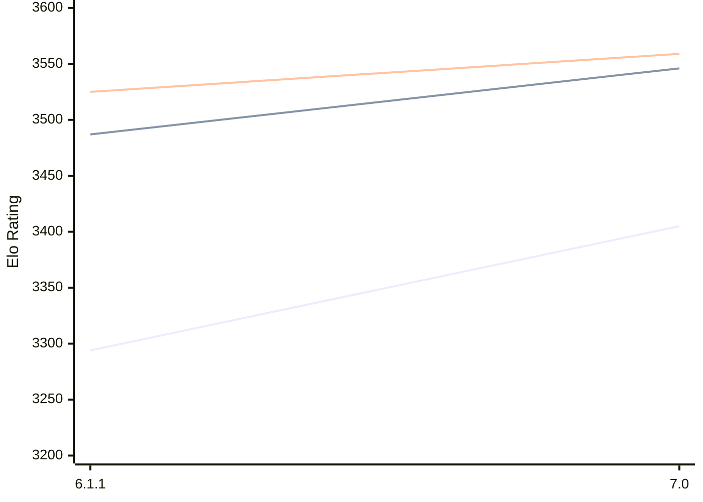

# Engine: Astra

Author: Semih Özalp

Home: https://github.com/h1me01/Astra

## Elo Ratings E1 (Ultra 7 265T (1.50 GHz) - E-Core)

| Version | Published | STC 8.0+0.08s  | LTC 60.0+0.60s | VLTC 2m24s+1.12s | Comment |
| --- | --- | --- | --- | --- | --- |
| 7.0 | 2026-05-26 | 3317 | 3557 | 3607 |  |
 | | | cElo (∆ prev) | cElo (∆ prev) | cElo (∆ prev) | 

## Elo Ratings P1 (Ultra 7 265T (1.50 GHz) - P-Core)

| Version | Published | STC 8.0+0.08s  | LTC 60.0+0.60s | VLTC 2m24s+1.12s | Comment |
| --- | --- | --- | --- | --- | --- |
| 7.0 | 2026-05-26 | 3545 | 3713 | 3789 |  |
 | | | cElo (∆ prev) | cElo (∆ prev) | cElo (∆ prev) | 

## Elo Ratings T1 (i5-7500T 2.70GHz)

| Version | Published | STC 8.0+0.08s  | LTC 60.0+0.60s | VLTC 2m24s+1.12s | Comment |
| --- | --- | --- | --- | --- | --- |
| 7.0 | 2026-05-26 | 3405(+111) | 3546(+59) | 3559(+34) |  |
| 6.1.1 | 2025-07-21 | 3294 | 3487 | 3525 |  |
 | | | cElo (∆ prev) | cElo (∆ prev) | cElo (∆ prev) | 

<a href="https://github.com/computer-chess-index/cci/issues/new?template=submit-version.yml&title=[VERSION]+Astra+<version>&body=###%20Engine%20name%0AAstra%0A%0A###%20Version%0A7.0" target="_blank">Submit new version</a>

 Test Conditions:

GUI/CLI: <a href=https://github.com/cutechess/cutechess target="_blank">Cute-Chess</a> 
Elo Calculation: <a href=https://www.remi-coulom.fr/Bayesian-Elo/ target="_blank">Bayesian-Elo</a> 
CPU for P1: Intel(R) Core(TM) Ultra 7 265T (1.50 GHz) - P-Core 
CPU for E1: Intel(R) Core(TM) Ultra 7 265T (1.50 GHz) - E-Core 
CPU for T1: Intel(R) Core(TM) i5-7500T 2.70GHz 
Opening book: 8_moves_v3 
\* STC: 8.0+0.08s, LTC: 60.0+0.60s, VLTC: 2m24s+1.12s

 Lists:
Ratings: <a href=https://github.com/computer-chess-index/cci/blob/main/lists/CCIRatings.csv target="_blank">Complete list</a>

Generated: 2026-10-16 04:36:10

## Ratings Verlauf T1

## Detailed Evaluation Results

| Version | Time Control | Variant | Elo  | Range +/- | Matches | Score | Average Opponent Elo | Draws |
| --- | --- |--- | --- | --- | --- | --- | --- | --- |
| 7.0 | VLTC (2m24s+1.12s) | E1 | 3607 | 37 | 200 | 59% | 3433 | 68% |
|  |  | T1 | 3559 | 27 | 312 | 49% | 3567 | 89% |
|  |  | P1 | 3789 | 51 | 96 | 54% | 3692 | 78% |
|  | LTC (60.0+0.60s) | T1 | 3546 | 28 | 294 | 50% | 3545 | 86% |
|  |  | P1 | 3713 | 45 | 134 | 60% | 3599 | 69% |
|  |  | E1 | 3557 | 39 | 192 | 63% | 3302 | 63% |
|  | STC (8.0+0.08s) | T1 | 3405 | 25 | 398 | 51% | 3401 | 75% |
|  |  | P1 | 3545 | 34 | 208 | 51% | 3538 | 73% |
|  |  | E1 | 3317 | 30 | 296 | 45% | 3353 | 66% |
| --- | --- |--- | --- | --- | --- | --- | --- | --- |
| 6.1.1 | VLTC (2m24s+1.12s) | T1 | 3525 | 23 | 420 | 52% | 3509 | 87% |
|  | LTC (60.0+0.60s) | T1 | 3487 | 25 | 400 | 51% | 3475 | 81% |
|  | STC (8.0+0.08s) | T1 | 3294 | 23 | 514 | 51% | 3278 | 67% |