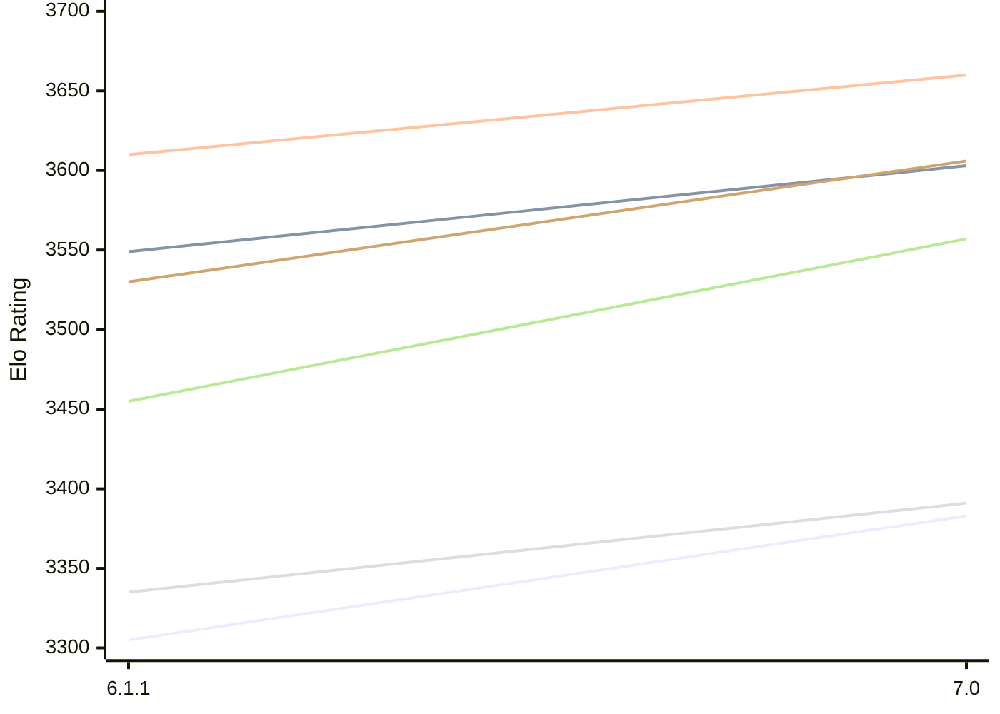
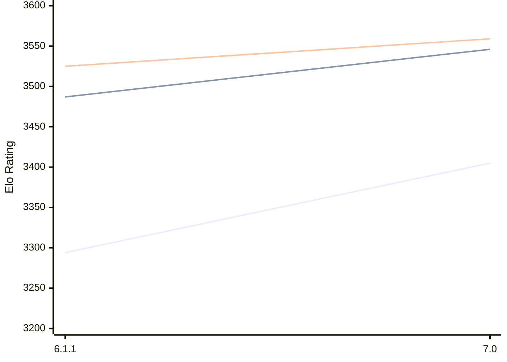

# Engine: Astra

Author: Semih Özalp

Home: https://github.com/h1me01/Astra

## Elo Ratings E1 (Ultra 7 265T (1.50 GHz) - E-Core)

| Version | Published | STC 8.0+0.08s  | LTC 60.0+0.60s | VLTC 2m24s+1.12s | Comment |
| --- | --- | --- | --- | --- | --- |
| 7.0 | 2026-05-26 | 3383(+78) | 3603(+54) | 3660(+50) |  |
| 6.1.1 | 2025-07-21 | 3305 | 3549 | 3610 |  |
 | | | cElo (∆ prev) | cElo (∆ prev) | cElo (∆ prev) | 

## Elo Ratings P1 (Ultra 7 265T (1.50 GHz) - P-Core)

| Version | Published | STC 8.0+0.08s  | LTC 60.0+0.60s | VLTC 2m24s+1.12s | Comment |
| --- | --- | --- | --- | --- | --- |
| 7.0 | 2026-05-26 | 3391(+56) | 3557(+102) | 3606(+76) |  |
| 6.1.1 | 2025-07-21 | 3335 | 3455 | 3530 |  |
 | | | cElo (∆ prev) | cElo (∆ prev) | cElo (∆ prev) | 

## Elo Ratings T1 (i5-7500T 2.70GHz)

| Version | Published | STC 8.0+0.08s  | LTC 60.0+0.60s | VLTC 2m24s+1.12s | Comment |
| --- | --- | --- | --- | --- | --- |
| 7.0 | 2026-05-26 | 3405(+111) | 3546(+59) | 3559(+34) |  |
| 6.1.1 | 2025-07-21 | 3294 | 3487 | 3525 |  |
 | | | cElo (∆ prev) | cElo (∆ prev) | cElo (∆ prev) | 

<a href="https://github.com/computer-chess-index/cci/issues/new?template=submit-version.yml&title=[VERSION]+Astra+<version>&body=###%20Engine%20name%0AAstra%0A%0A###%20Version%0A7.0" target="_blank">Submit new version</a>

 Test Conditions:

GUI/CLI: <a href=https://github.com/cutechess/cutechess target="_blank">Cute-Chess</a> 
Elo Calculation: <a href=https://www.remi-coulom.fr/Bayesian-Elo/ target="_blank">Bayesian-Elo</a> 
CPU for P1: Intel(R) Core(TM) Ultra 7 265T (1.50 GHz) - P-Core 
CPU for E1: Intel(R) Core(TM) Ultra 7 265T (1.50 GHz) - E-Core 
CPU for T1: Intel(R) Core(TM) i5-7500T 2.70GHz 
Opening book: 8_moves_v3 
\* STC: 8.0+0.08s, LTC: 60.0+0.60s, VLTC: 2m24s+1.12s

 Lists:
Ratings: <a href=https://github.com/computer-chess-index/cci/blob/main/lists/CCIRatings.csv target="_blank">Complete list</a>

Generated: 2026-11-24 05:36:11

## Ratings Verlauf E1 / P1

## Ratings Verlauf T1

## Detailed Evaluation Results

| Version | Time Control | Variant | Elo  | Range +/- | Matches | Score | Average Opponent Elo | Draws |
| --- | --- |--- | --- | --- | --- | --- | --- | --- |
| 7.0 | VLTC (2m24s+1.12s) | T1 | 3559 | 27 | 312 | 49% | 3567 | 89% |
|  |  | P1 | 3606 | 34 | 204 | 50% | 3579 | 82% |
|  |  | E1 | 3660 | 30 | 284 | 57% | 3534 | 73% |
|  | LTC (60.0+0.60s) | T1 | 3546 | 28 | 294 | 50% | 3545 | 86% |
|  |  | P1 | 3557 | 38 | 174 | 58% | 3471 | 72% |
|  |  | E1 | 3603 | 30 | 296 | 58% | 3443 | 71% |
|  | STC (8.0+0.08s) | T1 | 3405 | 25 | 398 | 51% | 3401 | 75% |
|  |  | P1 | 3391 | 30 | 268 | 51% | 3387 | 75% |
|  |  | E1 | 3383 | 23 | 496 | 48% | 3398 | 67% |
| --- | --- |--- | --- | --- | --- | --- | --- | --- |
| 6.1.1 | VLTC (2m24s+1.12s) | P1 | 3530 | 130 | 20 | 75% | 3236 | 50% |
|  |  | E1 | 3610 | 59 | 80 | 56% | 3490 | 65% |
|  |  | T1 | 3525 | 23 | 420 | 52% | 3509 | 87% |
|  | LTC (60.0+0.60s) | E1 | 3549 | 58 | 82 | 57% | 3449 | 62% |
|  |  | T1 | 3487 | 25 | 400 | 51% | 3475 | 81% |
|  |  | P1 | 3455 | 99 | 36 | 75% | 3195 | 44% |
|  | STC (8.0+0.08s) | E1 | 3305 | 52 | 106 | 51% | 3220 | 58% |
|  |  | T1 | 3294 | 23 | 514 | 51% | 3278 | 67% |
|  |  | P1 | 3335 | 75 | 48 | 55% | 3274 | 60% |