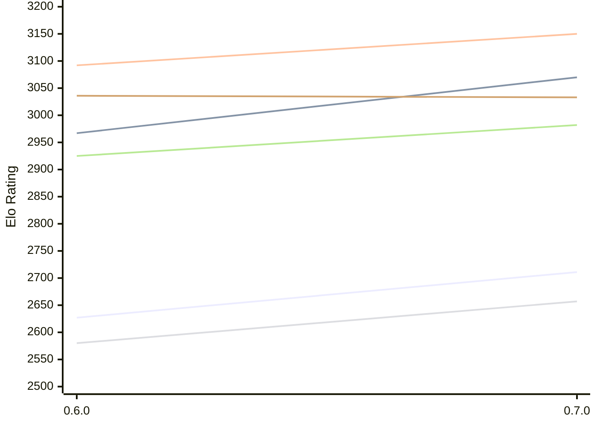
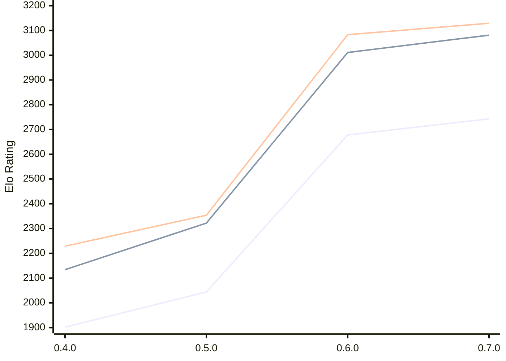

# Engine: AteNika

Author: Yevhenii Sekhin

Home: https://github.com/LesterEvSe/AteNika

## Elo Ratings E1 (Ultra 7 265T (1.50 GHz) - E-Core)

| Version | Published | STC 8.0+0.08s  | LTC 60.0+0.60s | VLTC 2m24s+1.12s | Comment |
| --- | --- | --- | --- | --- | --- |
| 0.7.0 | 2026-09-20 | 2711(+84) | 3070(+103) | 3150(+58) |  |
| 0.6.0 | 2026-09-13 | 2627 | 2967 | 3092 |  |
 | | | cElo (∆ prev) | cElo (∆ prev) | cElo (∆ prev) | 

## Elo Ratings P1 (Ultra 7 265T (1.50 GHz) - P-Core)

| Version | Published | STC 8.0+0.08s  | LTC 60.0+0.60s | VLTC 2m24s+1.12s | Comment |
| --- | --- | --- | --- | --- | --- |
| 0.7.0 | 2026-09-20 | 2657(+77) | 2982(+57) | 3033(-3) |  |
| 0.6.0 | 2026-09-13 | 2580 | 2925 | 3036 |  |
 | | | cElo (∆ prev) | cElo (∆ prev) | cElo (∆ prev) | 

## Elo Ratings T1 (i5-7500T 2.70GHz)

| Version | Published | STC 8.0+0.08s  | LTC 60.0+0.60s | VLTC 2m24s+1.12s | Comment |
| --- | --- | --- | --- | --- | --- |
| 0.7.0 | 2026-09-20 | 2743(+65) | 3081(+70) | 3129(+46) |  |
| 0.6.0 | 2026-09-13 | 2678(+634) | 3011(+689) | 3083(+729) |  |
| 0.5.0 | 2026-09-02 | 2044(+142) | 2322(+188) | 2354(+125) |  |
| 0.4.0 | 2026-08-30 | 1902 | 2134 | 2229 |  |
 | | | cElo (∆ prev) | cElo (∆ prev) | cElo (∆ prev) | 

<a href="https://github.com/computer-chess-index/cci/issues/new?template=submit-version.yml&title=[VERSION]+AteNika+<version>&body=###%20Engine%20name%0AAteNika%0A%0A###%20Version%0A0.7.0" target="_blank">Submit new version</a>

 Test Conditions:

GUI/CLI: <a href=https://github.com/cutechess/cutechess target="_blank">Cute-Chess</a> 
Elo Calculation: <a href=https://www.remi-coulom.fr/Bayesian-Elo/ target="_blank">Bayesian-Elo</a> 
CPU for P1: Intel(R) Core(TM) Ultra 7 265T (1.50 GHz) - P-Core 
CPU for E1: Intel(R) Core(TM) Ultra 7 265T (1.50 GHz) - E-Core 
CPU for T1: Intel(R) Core(TM) i5-7500T 2.70GHz 
Opening book: 8_moves_v3 
\* STC: 8.0+0.08s, LTC: 60.0+0.60s, VLTC: 2m24s+1.12s

 Lists:
Ratings: <a href=https://github.com/computer-chess-index/cci/blob/main/lists/CCIRatings.csv target="_blank">Complete list</a>

Generated: 2026-11-19 05:36:13

## Ratings Verlauf E1 / P1

## Ratings Verlauf T1

## Detailed Evaluation Results

| Version | Time Control | Variant | Elo  | Range +/- | Matches | Score | Average Opponent Elo | Draws |
| --- | --- |--- | --- | --- | --- | --- | --- | --- |
| 0.7.0 | VLTC (2m24s+1.12s) | T1 | 3129 | 45 | 134 | 46% | 3166 | 60% |
|  |  | P1 | 3033 | 50 | 104 | 49% | 3044 | 63% |
|  |  | E1 | 3150 | 30 | 292 | 52% | 3136 | 59% |
|  | LTC (60.0+0.60s) | P1 | 2982 | 39 | 178 | 48% | 3000 | 55% |
|  |  | E1 | 3070 | 29 | 312 | 52% | 3055 | 58% |
|  |  | T1 | 3081 | 42 | 158 | 52% | 3063 | 55% |
|  | STC (8.0+0.08s) | P1 | 2657 | 40 | 182 | 51% | 2649 | 46% |
|  |  | E1 | 2711 | 44 | 162 | 49% | 2720 | 40% |
|  |  | T1 | 2743 | 51 | 116 | 53% | 2716 | 39% |
| --- | --- |--- | --- | --- | --- | --- | --- | --- |
| 0.6.0 | VLTC (2m24s+1.12s) | T1 | 3083 | 36 | 230 | 55% | 3033 | 48% |
|  |  | P1 | 3036 | 51 | 108 | 46% | 3069 | 56% |
|  |  | E1 | 3092 | 33 | 244 | 49% | 3094 | 60% |
|  | LTC (60.0+0.60s) | T1 | 3011 | 36 | 222 | 53% | 2978 | 52% |
|  |  | P1 | 2925 | 41 | 172 | 48% | 2942 | 49% |
|  |  | E1 | 2967 | 33 | 262 | 48% | 2988 | 55% |
|  | STC (8.0+0.08s) | T1 | 2678 | 45 | 158 | 53% | 2643 | 37% |
|  |  | P1 | 2580 | 46 | 158 | 45% | 2641 | 32% |
|  |  | E1 | 2627 | 37 | 224 | 48% | 2641 | 40% |
| --- | --- |--- | --- | --- | --- | --- | --- | --- |
| 0.5.0 | VLTC (2m24s+1.12s) | T1 | 2354 | 36 | 262 | 50% | 2357 | 26% |
|  | LTC (60.0+0.60s) | T1 | 2322 | 42 | 202 | 52% | 2303 | 21% |
|  | STC (8.0+0.08s) | T1 | 2044 | 36 | 270 | 49% | 2061 | 21% |
| --- | --- |--- | --- | --- | --- | --- | --- | --- |
| 0.4.0 | VLTC (2m24s+1.12s) | T1 | 2229 | 38 | 248 | 48% | 2252 | 23% |
|  | LTC (60.0+0.60s) | T1 | 2134 | 40 | 230 | 50% | 2138 | 15% |
|  | STC (8.0+0.08s) | T1 | 1902 | 38 | 248 | 50% | 1901 | 16% |