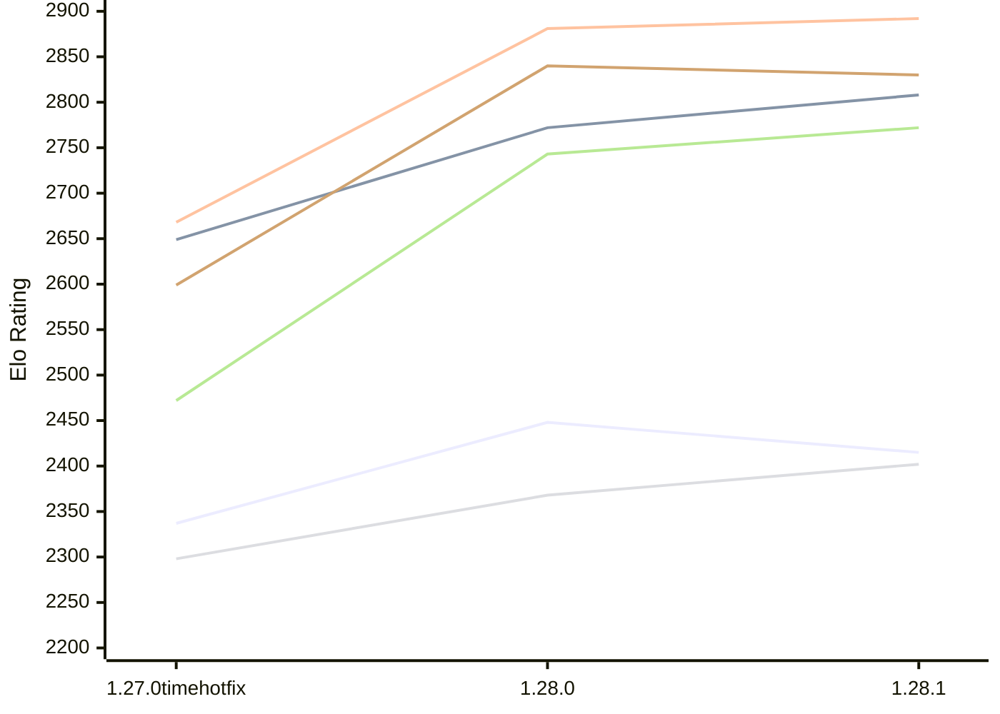
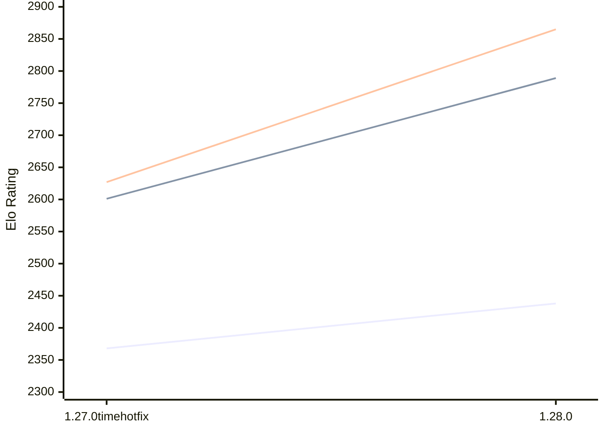

# Engine: Aurora

Author: Winston Cai

Home: https://github.com/kjljixx/Aurora-Chess-Engine

## Elo Ratings E1 (Ultra 7 265T (1.50 GHz) - E-Core)

| Version | Published | STC 8.0+0.08s  | LTC 60.0+0.60s | VLTC 2m24s+1.12s | Comment |
| --- | --- | --- | --- | --- | --- |
| 1.28.1 | 2026-10-25 | 2415(-33) | 2808(+36) | 2892(+11) |  |
| 1.28.0 | 2026-09-21 | 2448(+111) | 2772(+123) | 2881(+213) |  |
| 1.27.0timehotfix | 2026-05-28 | 2337 | 2649 | 2668 |  |
 | | | cElo (∆ prev) | cElo (∆ prev) | cElo (∆ prev) | 

## Elo Ratings P1 (Ultra 7 265T (1.50 GHz) - P-Core)

| Version | Published | STC 8.0+0.08s  | LTC 60.0+0.60s | VLTC 2m24s+1.12s | Comment |
| --- | --- | --- | --- | --- | --- |
| 1.28.1 | 2026-10-25 | 2402(+34) | 2772(+29) | 2830(-10) |  |
| 1.28.0 | 2026-09-21 | 2368(+70) | 2743(+271) | 2840(+241) |  |
| 1.27.0timehotfix | 2026-05-28 | 2298 | 2472 | 2599 |  |
 | | | cElo (∆ prev) | cElo (∆ prev) | cElo (∆ prev) | 

## Elo Ratings T1 (i5-7500T 2.70GHz)

| Version | Published | STC 8.0+0.08s  | LTC 60.0+0.60s | VLTC 2m24s+1.12s | Comment |
| --- | --- | --- | --- | --- | --- |
| 1.28.0 | 2026-09-21 | 2438(+70) | 2789(+188) | 2865(+238) |  |
| 1.27.0timehotfix | 2026-05-28 | 2368 | 2601 | 2627 |  |
 | | | cElo (∆ prev) | cElo (∆ prev) | cElo (∆ prev) | 

<a href="https://github.com/computer-chess-index/cci/issues/new?template=submit-version.yml&title=[VERSION]+Aurora+<version>&body=###%20Engine%20name%0AAurora%0A%0A###%20Version%0A1.28.0" target="_blank">Submit new version</a>

 Test Conditions:

GUI/CLI: <a href=https://github.com/cutechess/cutechess target="_blank">Cute-Chess</a> 
Elo Calculation: <a href=https://www.remi-coulom.fr/Bayesian-Elo/ target="_blank">Bayesian-Elo</a> 
CPU for P1: Intel(R) Core(TM) Ultra 7 265T (1.50 GHz) - P-Core 
CPU for E1: Intel(R) Core(TM) Ultra 7 265T (1.50 GHz) - E-Core 
CPU for T1: Intel(R) Core(TM) i5-7500T 2.70GHz 
Opening book: 8_moves_v3 
\* STC: 8.0+0.08s, LTC: 60.0+0.60s, VLTC: 2m24s+1.12s

 Lists:
Ratings: <a href=https://github.com/computer-chess-index/cci/blob/main/lists/CCIRatings.csv target="_blank">Complete list</a>

Generated: 2026-11-22 05:36:13

## Ratings Verlauf E1 / P1

## Ratings Verlauf T1

## Detailed Evaluation Results

| Version | Time Control | Variant | Elo  | Range +/- | Matches | Score | Average Opponent Elo | Draws |
| --- | --- |--- | --- | --- | --- | --- | --- | --- |
| 1.28.1 | VLTC (2m24s+1.12s) | P1 | 2830 | 37 | 218 | 49% | 2839 | 40% |
|  |  | E1 | 2892 | 32 | 292 | 50% | 2897 | 42% |
|  | LTC (60.0+0.60s) | P1 | 2772 | 37 | 252 | 47% | 2805 | 30% |
|  |  | E1 | 2808 | 31 | 334 | 48% | 2823 | 34% |
|  | STC (8.0+0.08s) | P1 | 2402 | 42 | 192 | 47% | 2427 | 25% |
|  |  | E1 | 2415 | 35 | 280 | 51% | 2406 | 26% |
| --- | --- |--- | --- | --- | --- | --- | --- | --- |
| 1.28.0 | VLTC (2m24s+1.12s) | T1 | 2865 | 41 | 188 | 54% | 2824 | 37% |
|  |  | P1 | 2840 | 41 | 172 | 48% | 2858 | 43% |
|  |  | E1 | 2881 | 31 | 342 | 53% | 2853 | 35% |
|  | LTC (60.0+0.60s) | T1 | 2789 | 34 | 280 | 56% | 2738 | 38% |
|  |  | P1 | 2743 | 38 | 224 | 54% | 2670 | 37% |
|  |  | E1 | 2772 | 36 | 248 | 49% | 2777 | 37% |
|  | STC (8.0+0.08s) | T1 | 2438 | 39 | 234 | 49% | 2452 | 23% |
|  |  | P1 | 2368 | 42 | 208 | 46% | 2423 | 22% |
|  |  | E1 | 2448 | 42 | 212 | 50% | 2446 | 18% |
| --- | --- |--- | --- | --- | --- | --- | --- | --- |
| 1.27.0timehotfix | VLTC (2m24s+1.12s) | T1 | 2627 | 28 | 408 | 48% | 2642 | 32% |
|  |  | P1 | 2599 | 33 | 296 | 44% | 2664 | 36% |
|  |  | E1 | 2668 | 36 | 248 | 47% | 2700 | 33% |
|  | LTC (60.0+0.60s) | T1 | 2601 | 28 | 434 | 51% | 2593 | 29% |
|  |  | P1 | 2472 | 42 | 206 | 53% | 2448 | 24% |
|  |  | E1 | 2649 | 37 | 252 | 53% | 2581 | 31% |
|  | STC (8.0+0.08s) | P1 | 2298 | 44 | 192 | 45% | 2363 | 24% |
|  |  | E1 | 2337 | 39 | 236 | 49% | 2345 | 20% |
|  |  | T1 | 2368 | 28 | 448 | 49% | 2381 | 22% |