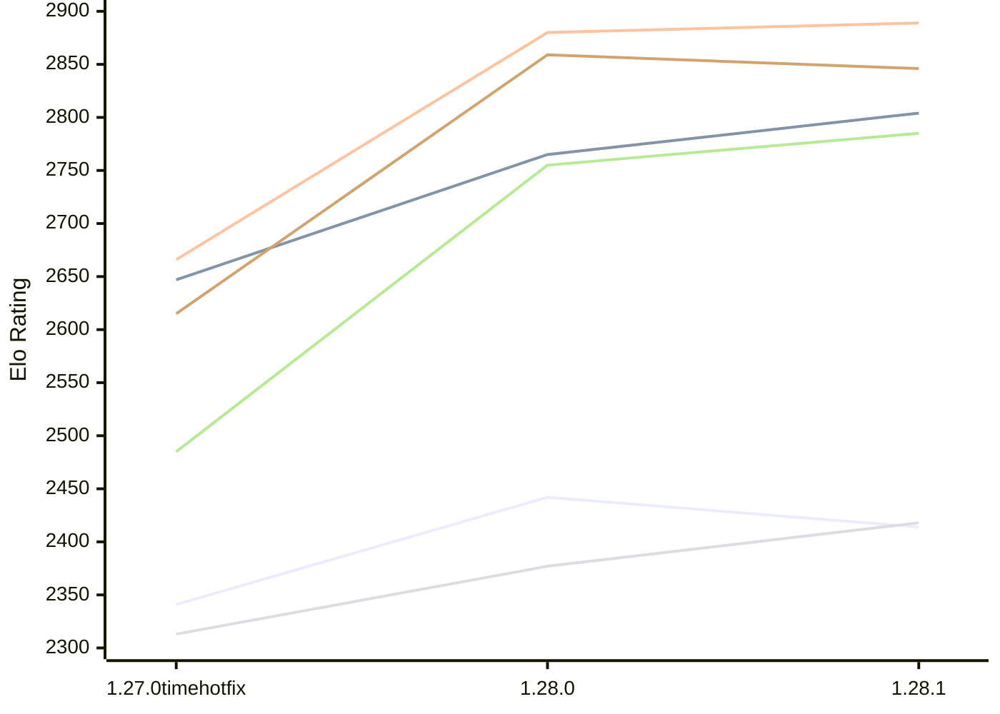
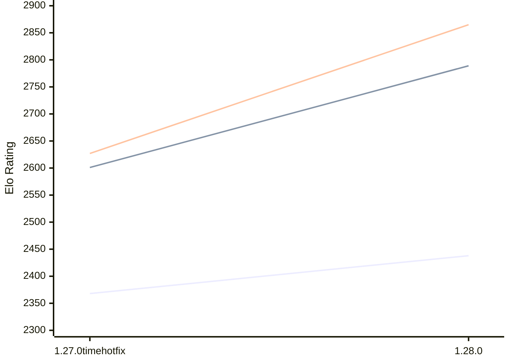

# Engine: Aurora

Author: Winston Cai

Home: https://github.com/kjljixx/Aurora-Chess-Engine

## Elo Ratings E1 (Ultra 7 265T (1.50 GHz) - E-Core)

| Version | Published | STC 8.0+0.08s  | LTC 60.0+0.60s | VLTC 2m24s+1.12s | Comment |
| --- | --- | --- | --- | --- | --- |
| 1.28.1 | 2026-10-25 | 2414(-28) | 2804(+39) | 2889(+9) |  |
| 1.28.0 | 2026-09-21 | 2442(+101) | 2765(+118) | 2880(+214) |  |
| 1.27.0timehotfix | 2026-05-28 | 2341 | 2647 | 2666 |  |
 | | | cElo (∆ prev) | cElo (∆ prev) | cElo (∆ prev) | 

## Elo Ratings P1 (Ultra 7 265T (1.50 GHz) - P-Core)

| Version | Published | STC 8.0+0.08s  | LTC 60.0+0.60s | VLTC 2m24s+1.12s | Comment |
| --- | --- | --- | --- | --- | --- |
| 1.28.1 | 2026-10-25 | 2418(+41) | 2785(+30) | 2846(-13) |  |
| 1.28.0 | 2026-09-21 | 2377(+64) | 2755(+270) | 2859(+244) |  |
| 1.27.0timehotfix | 2026-05-28 | 2313 | 2485 | 2615 |  |
 | | | cElo (∆ prev) | cElo (∆ prev) | cElo (∆ prev) | 

## Elo Ratings T1 (i5-7500T 2.70GHz)

| Version | Published | STC 8.0+0.08s  | LTC 60.0+0.60s | VLTC 2m24s+1.12s | Comment |
| --- | --- | --- | --- | --- | --- |
| 1.28.0 | 2026-09-21 | 2438(+70) | 2789(+188) | 2865(+238) |  |
| 1.27.0timehotfix | 2026-05-28 | 2368 | 2601 | 2627 |  |
 | | | cElo (∆ prev) | cElo (∆ prev) | cElo (∆ prev) | 

<a href="https://github.com/computer-chess-index/cci/issues/new?template=submit-version.yml&title=[VERSION]+Aurora+<version>&body=###%20Engine%20name%0AAurora%0A%0A###%20Version%0A1.28.0" target="_blank">Submit new version</a>

 Test Conditions:

GUI/CLI: <a href=https://github.com/cutechess/cutechess target="_blank">Cute-Chess</a> 
Elo Calculation: <a href=https://www.remi-coulom.fr/Bayesian-Elo/ target="_blank">Bayesian-Elo</a> 
CPU for P1: Intel(R) Core(TM) Ultra 7 265T (1.50 GHz) - P-Core 
CPU for E1: Intel(R) Core(TM) Ultra 7 265T (1.50 GHz) - E-Core 
CPU for T1: Intel(R) Core(TM) i5-7500T 2.70GHz 
Opening book: 8_moves_v3 
\* STC: 8.0+0.08s, LTC: 60.0+0.60s, VLTC: 2m24s+1.12s

 Lists:
Ratings: <a href=https://github.com/computer-chess-index/cci/blob/main/lists/CCIRatings.csv target="_blank">Complete list</a>

Generated: 2026-11-26 05:36:20

## Ratings Verlauf E1 / P1

## Ratings Verlauf T1

## Detailed Evaluation Results

| Version | Time Control | Variant | Elo  | Range +/- | Matches | Score | Average Opponent Elo | Draws |
| --- | --- |--- | --- | --- | --- | --- | --- | --- |
| 1.28.1 | VLTC (2m24s+1.12s) | P1 | 2846 | 36 | 230 | 49% | 2857 | 41% |
|  |  | E1 | 2889 | 31 | 316 | 50% | 2892 | 42% |
|  | LTC (60.0+0.60s) | P1 | 2785 | 35 | 272 | 47% | 2820 | 31% |
|  |  | E1 | 2804 | 31 | 342 | 48% | 2819 | 33% |
|  | STC (8.0+0.08s) | P1 | 2418 | 41 | 204 | 48% | 2442 | 25% |
|  |  | E1 | 2414 | 33 | 312 | 51% | 2410 | 25% |
| --- | --- |--- | --- | --- | --- | --- | --- | --- |
| 1.28.0 | VLTC (2m24s+1.12s) | T1 | 2865 | 41 | 188 | 54% | 2824 | 37% |
|  |  | P1 | 2859 | 41 | 172 | 48% | 2877 | 43% |
|  |  | E1 | 2880 | 30 | 354 | 53% | 2850 | 34% |
|  | LTC (60.0+0.60s) | T1 | 2789 | 34 | 280 | 56% | 2738 | 38% |
|  |  | P1 | 2755 | 36 | 246 | 54% | 2691 | 36% |
|  |  | E1 | 2765 | 34 | 268 | 49% | 2774 | 37% |
|  | STC (8.0+0.08s) | T1 | 2438 | 39 | 234 | 49% | 2452 | 23% |
|  |  | P1 | 2377 | 42 | 212 | 45% | 2437 | 23% |
|  |  | E1 | 2442 | 40 | 228 | 50% | 2449 | 18% |
| --- | --- |--- | --- | --- | --- | --- | --- | --- |
| 1.27.0timehotfix | VLTC (2m24s+1.12s) | E1 | 2666 | 36 | 248 | 47% | 2699 | 33% |
|  |  | T1 | 2627 | 28 | 408 | 48% | 2642 | 32% |
|  |  | P1 | 2615 | 33 | 296 | 44% | 2681 | 36% |
|  | LTC (60.0+0.60s) | E1 | 2647 | 37 | 252 | 53% | 2581 | 31% |
|  |  | T1 | 2601 | 28 | 434 | 51% | 2593 | 29% |
|  |  | P1 | 2485 | 42 | 206 | 53% | 2461 | 24% |
|  | STC (8.0+0.08s) | T1 | 2368 | 28 | 448 | 49% | 2381 | 22% |
|  |  | P1 | 2313 | 44 | 192 | 45% | 2376 | 24% |
|  |  | E1 | 2341 | 39 | 236 | 49% | 2348 | 20% |