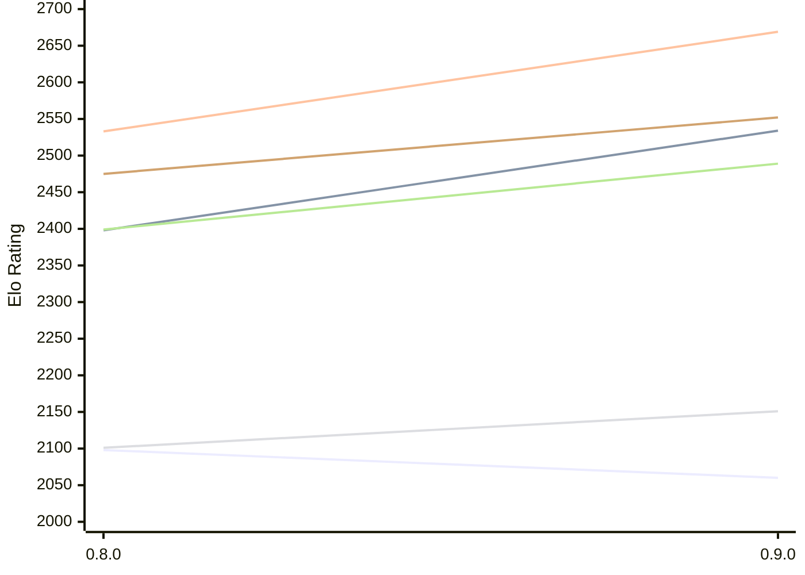

# Engine: Barbarossa

Author: Nicu Ionita

Home: https://github.com/nionita/Barbarossa

## Elo Ratings E1 (Ultra 7 265T (1.50 GHz) - E-Core)

| Version | Published | STC 8.0+0.08s  | LTC 60.0+0.60s | VLTC 2m24s+1.12s | Comment |
| --- | --- | --- | --- | --- | --- |
| 0.9.0 | 2026-11-23 | 2060(-38) | 2534(+136) | 2669(+136) |  |
| 0.8.0 | 2026-10-18 | 2098 | 2398 | 2533 |  |
 | | | cElo (∆ prev) | cElo (∆ prev) | cElo (∆ prev) | 

## Elo Ratings P1 (Ultra 7 265T (1.50 GHz) - P-Core)

| Version | Published | STC 8.0+0.08s  | LTC 60.0+0.60s | VLTC 2m24s+1.12s | Comment |
| --- | --- | --- | --- | --- | --- |
| 0.9.0 | 2026-11-23 | 2151(+50) | 2489(+90) | 2552(+77) |  |
| 0.8.0 | 2026-10-18 | 2101 | 2399 | 2475 |  |
 | | | cElo (∆ prev) | cElo (∆ prev) | cElo (∆ prev) | 

## Elo Ratings T1 (i5-7500T 2.70GHz)

| Version | Published | STC 8.0+0.08s  | LTC 60.0+0.60s | VLTC 2m24s+1.12s | Comment |
| --- | --- | --- | --- | --- | --- |
| 0.8.0 | 2026-10-18 | 2101 | 2399 | 2475 |  |
 | | | cElo (∆ prev) | cElo (∆ prev) | cElo (∆ prev) | 

<a href="https://github.com/computer-chess-index/cci/issues/new?template=submit-version.yml&title=[VERSION]+Barbarossa+<version>&body=###%20Engine%20name%0ABarbarossa%0A%0A###%20Version%0A0.9.0" target="_blank">Submit new version</a>

 Test Conditions:

GUI/CLI: <a href=https://github.com/cutechess/cutechess target="_blank">Cute-Chess</a> 
Elo Calculation: <a href=https://www.remi-coulom.fr/Bayesian-Elo/ target="_blank">Bayesian-Elo</a> 
CPU for P1: Intel(R) Core(TM) Ultra 7 265T (1.50 GHz) - P-Core 
CPU for E1: Intel(R) Core(TM) Ultra 7 265T (1.50 GHz) - E-Core 
CPU for T1: Intel(R) Core(TM) i5-7500T 2.70GHz 
Opening book: 8_moves_v3 
\* STC: 8.0+0.08s, LTC: 60.0+0.60s, VLTC: 2m24s+1.12s

 Lists:
Ratings: <a href=https://github.com/computer-chess-index/cci/blob/main/lists/CCIRatings.csv target="_blank">Complete list</a>

Generated: 2026-11-27 05:36:23

## Ratings Verlauf E1 / P1

## Detailed Evaluation Results

| Version | Time Control | Variant | Elo  | Range +/- | Matches | Score | Average Opponent Elo | Draws |
| --- | --- |--- | --- | --- | --- | --- | --- | --- |
| 0.9.0 | VLTC (2m24s+1.12s) | P1 | 2552 | 97 | 32 | 48% | 2566 | 34% |
|  |  | E1 | 2669 | 62 | 86 | 54% | 2635 | 29% |
|  | LTC (60.0+0.60s) | P1 | 2489 | 74 | 64 | 55% | 2437 | 22% |
|  |  | E1 | 2534 | 60 | 94 | 55% | 2484 | 26% |
|  | STC (8.0+0.08s) | P1 | 2151 | 71 | 72 | 47% | 2183 | 15% |
|  |  | E1 | 2060 | 62 | 88 | 44% | 2113 | 27% |
| --- | --- |--- | --- | --- | --- | --- | --- | --- |
| 0.8.0 | VLTC (2m24s+1.12s) | E1 | 2533 | 38 | 304 | 65% | 2225 | 18% |
|  |  | P1 | 2475 | 52 | 144 | 61% | 2179 | 27% |
|  | LTC (60.0+0.60s) | E1 | 2398 | 45 | 252 | 70% | 1872 | 15% |
|  |  | P1 | 2399 | 48 | 180 | 61% | 2129 | 21% |
|  | STC (8.0+0.08s) | P1 | 2101 | 51 | 166 | 63% | 1824 | 23% |
|  |  | E1 | 2098 | 38 | 290 | 53% | 2010 | 22% |