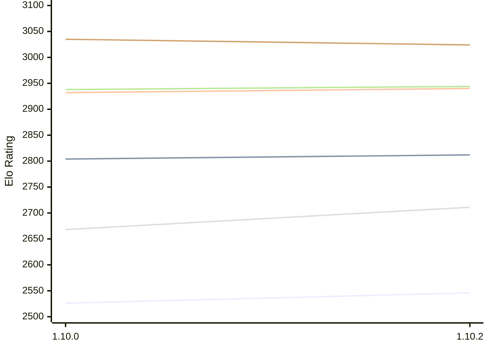
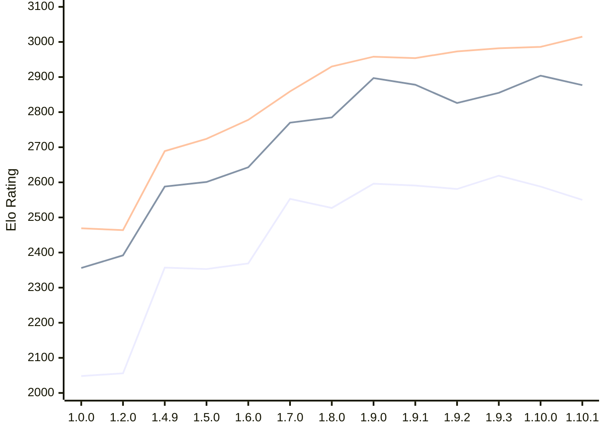

# Engine: Basilisk

Author: Miloslav Macůrek

Home: https://github.com/maelic13/basilisk

## Elo Ratings E1 (Ultra 7 265T (1.50 GHz) - E-Core)

| Version | Published | STC 8.0+0.08s  | LTC 60.0+0.60s | VLTC 2m24s+1.12s | Comment |
| --- | --- | --- | --- | --- | --- |
| 1.10.2 | 2026-10-08 | 2546(+20) | 2812(+8) | 2940(+8) |  |
| 1.10.0 | 2026-09-10 | 2526 | 2804 | 2932 |  |
 | | | cElo (∆ prev) | cElo (∆ prev) | cElo (∆ prev) | 

## Elo Ratings P1 (Ultra 7 265T (1.50 GHz) - P-Core)

| Version | Published | STC 8.0+0.08s  | LTC 60.0+0.60s | VLTC 2m24s+1.12s | Comment |
| --- | --- | --- | --- | --- | --- |
| 1.10.2 | 2026-10-08 | 2711(+43) | 2944(+6) | 3024(-11) |  |
| 1.10.0 | 2026-09-10 | 2668 | 2938 | 3035 |  |
 | | | cElo (∆ prev) | cElo (∆ prev) | cElo (∆ prev) | 

## Elo Ratings T1 (i5-7500T 2.70GHz)

| Version | Published | STC 8.0+0.08s  | LTC 60.0+0.60s | VLTC 2m24s+1.12s | Comment |
| --- | --- | --- | --- | --- | --- |
| 1.10.1 | 2026-09-27 | 2550(-38) | 2877(-27) | 3015(+29) |  |
| 1.10.0 | 2026-09-10 | 2588(-31) | 2904(+49) | 2986(+4) |  |
| 1.9.3 | 2026-08-02 | 2619(+38) | 2855(+29) | 2982(+9) |  |
| 1.9.2 | 2026-08-01 | 2581(-10) | 2826(-52) | 2973(+19) |  |
| 1.9.1 | 2026-07-24 | 2591(-5) | 2878(-19) | 2954(-4) |  |
| 1.9.0 | 2026-07-18 | 2596(+69) | 2897(+112) | 2958(+28) |  |
| 1.8.0 | 2026-07-08 | 2527(-26) | 2785(+15) | 2930(+71) |  |
| 1.7.0 | 2026-06-29 | 2553(+184) | 2770(+127) | 2859(+81) |  |
| 1.6.0 | 2026-06-20 | 2369(+16) | 2643(+42) | 2778(+54) |  |
| 1.5.0 | 2026-06-10 | 2353(-4) | 2601(+13) | 2724(+35) |  |
| 1.4.9 | 2026-05-29 | 2357(+301) | 2588(+196) | 2689(+225) |  |
| 1.2.0 | 2026-05-21 | 2056(+8) | 2392(+36) | 2464(-5) |  |
| 1.0.0 | 2026-05-20 | 2048 | 2356 | 2469 |  |
 | | | cElo (∆ prev) | cElo (∆ prev) | cElo (∆ prev) | 

<a href="https://github.com/computer-chess-index/cci/issues/new?template=submit-version.yml&title=[VERSION]+Basilisk+<version>&body=###%20Engine%20name%0ABasilisk%0A%0A###%20Version%0A1.10.1" target="_blank">Submit new version</a>

 Test Conditions:

GUI/CLI: <a href=https://github.com/cutechess/cutechess target="_blank">Cute-Chess</a> 
Elo Calculation: <a href=https://www.remi-coulom.fr/Bayesian-Elo/ target="_blank">Bayesian-Elo</a> 
CPU for P1: Intel(R) Core(TM) Ultra 7 265T (1.50 GHz) - P-Core 
CPU for E1: Intel(R) Core(TM) Ultra 7 265T (1.50 GHz) - E-Core 
CPU for T1: Intel(R) Core(TM) i5-7500T 2.70GHz 
Opening book: 8_moves_v3 
\* STC: 8.0+0.08s, LTC: 60.0+0.60s, VLTC: 2m24s+1.12s

 Lists:
Ratings: <a href=https://github.com/computer-chess-index/cci/blob/main/lists/CCIRatings.csv target="_blank">Complete list</a>

Generated: 2026-10-15 04:36:22

## Ratings Verlauf E1 / P1

## Ratings Verlauf T1

## Detailed Evaluation Results

| Version | Time Control | Variant | Elo  | Range +/- | Matches | Score | Average Opponent Elo | Draws |
| --- | --- |--- | --- | --- | --- | --- | --- | --- |
| 1.10.2 | VLTC (2m24s+1.12s) | P1 | 3024 | 54 | 104 | 51% | 3016 | 37% |
|  |  | E1 | 2940 | 48 | 126 | 51% | 2934 | 48% |
|  | LTC (60.0+0.60s) | P1 | 2944 | 51 | 126 | 46% | 2982 | 29% |
|  |  | E1 | 2812 | 41 | 190 | 53% | 2790 | 36% |
|  | STC (8.0+0.08s) | E1 | 2546 | 50 | 134 | 52% | 2529 | 25% |
|  |  | P1 | 2711 | 54 | 112 | 46% | 2753 | 32% |
| --- | --- |--- | --- | --- | --- | --- | --- | --- |
| 1.10.1 | VLTC (2m24s+1.12s) | T1 | 3015 | 39 | 210 | 56% | 2965 | 38% |
|  | LTC (60.0+0.60s) | T1 | 2877 | 40 | 194 | 50% | 2878 | 35% |
|  | STC (8.0+0.08s) | T1 | 2550 | 47 | 148 | 50% | 2553 | 30% |
| --- | --- |--- | --- | --- | --- | --- | --- | --- |
| 1.10.0 | VLTC (2m24s+1.12s) | T1 | 2986 | 35 | 254 | 54% | 2955 | 37% |
|  |  | P1 | 3035 | 42 | 172 | 50% | 3035 | 42% |
|  |  | E1 | 2932 | 35 | 262 | 48% | 2955 | 33% |
|  | LTC (60.0+0.60s) | P1 | 2938 | 39 | 212 | 48% | 2955 | 33% |
|  |  | E1 | 2804 | 32 | 310 | 46% | 2840 | 34% |
|  |  | T1 | 2904 | 35 | 252 | 52% | 2888 | 39% |
|  | STC (8.0+0.08s) | P1 | 2668 | 43 | 180 | 49% | 2684 | 29% |
|  |  | E1 | 2526 | 37 | 258 | 49% | 2539 | 23% |
|  |  | T1 | 2588 | 30 | 354 | 47% | 2619 | 32% |
| --- | --- |--- | --- | --- | --- | --- | --- | --- |
| 1.9.3 | VLTC (2m24s+1.12s) | T1 | 2982 | 32 | 306 | 50% | 2985 | 41% |
|  | LTC (60.0+0.60s) | T1 | 2855 | 30 | 348 | 48% | 2878 | 37% |
|  | STC (8.0+0.08s) | T1 | 2619 | 33 | 308 | 50% | 2616 | 29% |
| --- | --- |--- | --- | --- | --- | --- | --- | --- |
| 1.9.2 | VLTC (2m24s+1.12s) | T1 | 2973 | 36 | 252 | 52% | 2954 | 35% |
|  | LTC (60.0+0.60s) | T1 | 2826 | 37 | 232 | 52% | 2805 | 36% |
|  | STC (8.0+0.08s) | T1 | 2581 | 38 | 232 | 50% | 2585 | 31% |
| --- | --- |--- | --- | --- | --- | --- | --- | --- |
| 1.9.1 | VLTC (2m24s+1.12s) | T1 | 2954 | 35 | 258 | 50% | 2957 | 37% |
|  | LTC (60.0+0.60s) | T1 | 2878 | 36 | 236 | 51% | 2867 | 39% |
|  | STC (8.0+0.08s) | T1 | 2591 | 36 | 252 | 49% | 2599 | 28% |
| --- | --- |--- | --- | --- | --- | --- | --- | --- |
| 1.9.0 | VLTC (2m24s+1.12s) | T1 | 2958 | 36 | 238 | 50% | 2962 | 39% |
|  | LTC (60.0+0.60s) | T1 | 2897 | 37 | 230 | 50% | 2903 | 39% |
|  | STC (8.0+0.08s) | T1 | 2596 | 34 | 286 | 53% | 2564 | 30% |
| --- | --- |--- | --- | --- | --- | --- | --- | --- |
| 1.8.0 | VLTC (2m24s+1.12s) | T1 | 2930 | 45 | 148 | 51% | 2925 | 41% |
|  | LTC (60.0+0.60s) | T1 | 2785 | 43 | 172 | 50% | 2788 | 32% |
|  | STC (8.0+0.08s) | T1 | 2527 | 44 | 168 | 51% | 2522 | 33% |
| --- | --- |--- | --- | --- | --- | --- | --- | --- |
| 1.7.0 | VLTC (2m24s+1.12s) | T1 | 2859 | 45 | 148 | 48% | 2878 | 43% |
|  | LTC (60.0+0.60s) | T1 | 2770 | 45 | 156 | 48% | 2788 | 33% |
|  | STC (8.0+0.08s) | T1 | 2553 | 45 | 170 | 51% | 2539 | 26% |
| --- | --- |--- | --- | --- | --- | --- | --- | --- |
| 1.6.0 | VLTC (2m24s+1.12s) | T1 | 2778 | 48 | 132 | 53% | 2757 | 37% |
|  | LTC (60.0+0.60s) | T1 | 2643 | 55 | 112 | 48% | 2658 | 29% |
|  | STC (8.0+0.08s) | T1 | 2369 | 50 | 126 | 52% | 2357 | 38% |
| --- | --- |--- | --- | --- | --- | --- | --- | --- |
| 1.5.0 | VLTC (2m24s+1.12s) | T1 | 2724 | 34 | 284 | 52% | 2705 | 31% |
|  | LTC (60.0+0.60s) | T1 | 2601 | 36 | 258 | 50% | 2599 | 25% |
|  | STC (8.0+0.08s) | T1 | 2353 | 36 | 278 | 51% | 2345 | 21% |
| --- | --- |--- | --- | --- | --- | --- | --- | --- |
| 1.4.9 | VLTC (2m24s+1.12s) | T1 | 2689 | 58 | 100 | 51% | 2681 | 26% |
|  | LTC (60.0+0.60s) | T1 | 2588 | 57 | 102 | 49% | 2601 | 25% |
|  | STC (8.0+0.08s) | T1 | 2357 | 64 | 86 | 53% | 2327 | 22% |
| --- | --- |--- | --- | --- | --- | --- | --- | --- |
| 1.2.0 | VLTC (2m24s+1.12s) | T1 | 2464 | 37 | 246 | 51% | 2456 | 27% |
|  | LTC (60.0+0.60s) | T1 | 2392 | 37 | 244 | 51% | 2381 | 25% |
|  | STC (8.0+0.08s) | T1 | 2056 | 39 | 236 | 51% | 2047 | 17% |
| --- | --- |--- | --- | --- | --- | --- | --- | --- |
| 1.0.0 | VLTC (2m24s+1.12s) | T1 | 2469 | 48 | 154 | 49% | 2476 | 19% |
|  | LTC (60.0+0.60s) | T1 | 2356 | 45 | 180 | 56% | 2275 | 21% |
|  | STC (8.0+0.08s) | T1 | 2048 | 50 | 152 | 57% | 1960 | 19% |