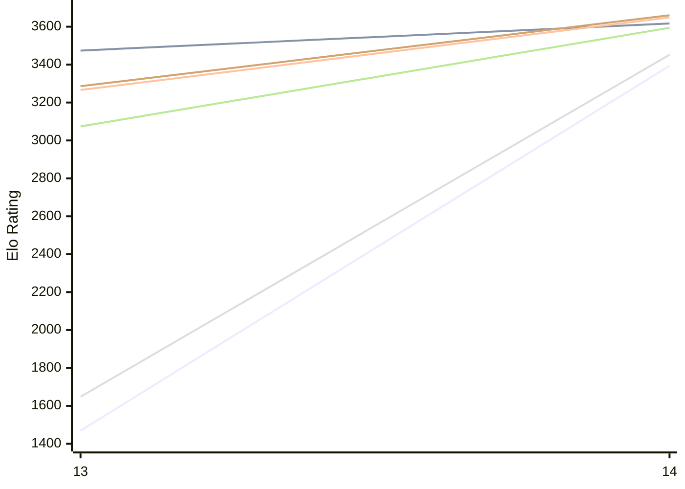
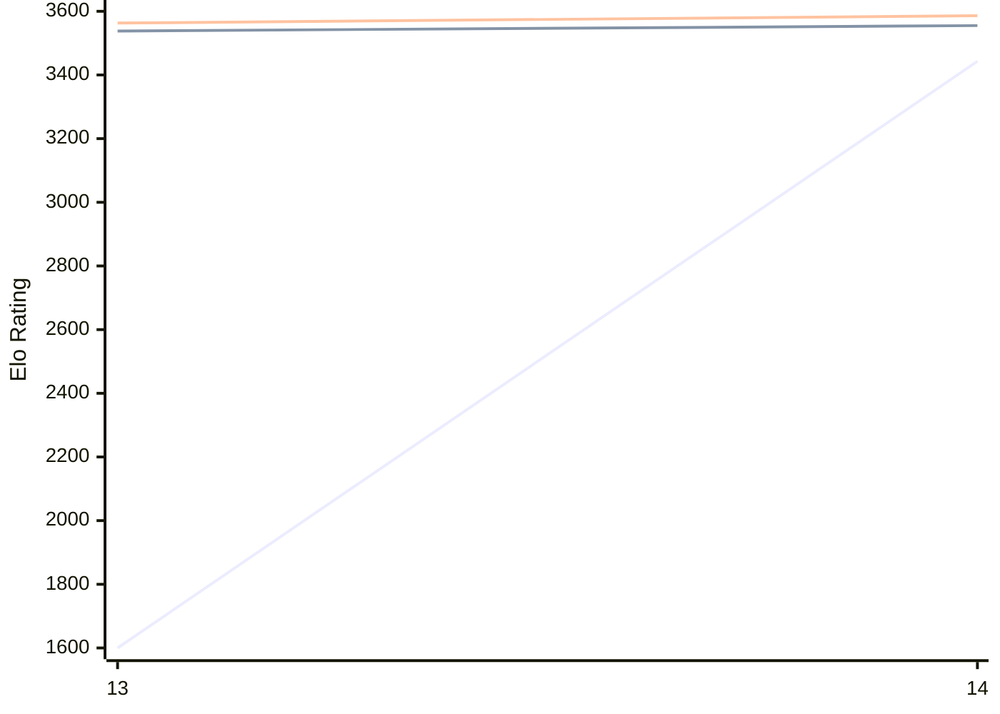

# Engine: Berserk

Author: Jay Honnold

Home: https://github.com/jhonnold/berserk

## Elo Ratings E1 (Ultra 7 265T (1.50 GHz) - E-Core)

| Version | Published | STC 8.0+0.08s  | LTC 60.0+0.60s | VLTC 2m24s+1.12s | Comment |
| --- | --- | --- | --- | --- | --- |
| 14 | 2026-05-24 | 3394(+1925) | 3617(+143) | 3649(+383) |  |
| 13 | 2024-03-31 | 1469 | 3474 | 3266 |  |
 | | | cElo (∆ prev) | cElo (∆ prev) | cElo (∆ prev) | 

## Elo Ratings P1 (Ultra 7 265T (1.50 GHz) - P-Core)

| Version | Published | STC 8.0+0.08s  | LTC 60.0+0.60s | VLTC 2m24s+1.12s | Comment |
| --- | --- | --- | --- | --- | --- |
| 14 | 2026-05-24 | 3452(+1804) | 3594(+520) | 3660(+374) |  |
| 13 | 2024-03-31 | 1648 | 3074 | 3286 |  |
 | | | cElo (∆ prev) | cElo (∆ prev) | cElo (∆ prev) | 

## Elo Ratings T1 (i5-7500T 2.70GHz)

| Version | Published | STC 8.0+0.08s  | LTC 60.0+0.60s | VLTC 2m24s+1.12s | Comment |
| --- | --- | --- | --- | --- | --- |
| 14 | 2026-05-24 | 3443(+1843) | 3555(+17) | 3586(+23) |  |
| 13 | 2024-03-31 | 1600 | 3538 | 3563 |  |
 | | | cElo (∆ prev) | cElo (∆ prev) | cElo (∆ prev) | 

<a href="https://github.com/computer-chess-index/cci/issues/new?template=submit-version.yml&title=[VERSION]+Berserk+<version>&body=###%20Engine%20name%0ABerserk%0A%0A###%20Version%0A14" target="_blank">Submit new version</a>

 Test Conditions:

GUI/CLI: <a href=https://github.com/cutechess/cutechess target="_blank">Cute-Chess</a> 
Elo Calculation: <a href=https://www.remi-coulom.fr/Bayesian-Elo/ target="_blank">Bayesian-Elo</a> 
CPU for P1: Intel(R) Core(TM) Ultra 7 265T (1.50 GHz) - P-Core 
CPU for E1: Intel(R) Core(TM) Ultra 7 265T (1.50 GHz) - E-Core 
CPU for T1: Intel(R) Core(TM) i5-7500T 2.70GHz 
Opening book: 8_moves_v3 
\* STC: 8.0+0.08s, LTC: 60.0+0.60s, VLTC: 2m24s+1.12s

 Lists:
Ratings: <a href=https://github.com/computer-chess-index/cci/blob/main/lists/CCIRatings.csv target="_blank">Complete list</a>

Generated: 2026-11-13 05:36:20

## Ratings Verlauf E1 / P1

## Ratings Verlauf T1

## Detailed Evaluation Results

| Version | Time Control | Variant | Elo  | Range +/- | Matches | Score | Average Opponent Elo | Draws |
| --- | --- |--- | --- | --- | --- | --- | --- | --- |
| 14 | VLTC (2m24s+1.12s) | P1 | 3660 | 40 | 140 | 51% | 3653 | 94% |
|  |  | E1 | 3649 | 32 | 226 | 50% | 3646 | 86% |
|  |  | T1 | 3586 | 29 | 268 | 51% | 3582 | 93% |
|  | LTC (60.0+0.60s) | E1 | 3617 | 32 | 232 | 51% | 3610 | 83% |
|  |  | T1 | 3555 | 29 | 264 | 50% | 3556 | 91% |
|  |  | P1 | 3594 | 37 | 172 | 49% | 3602 | 81% |
|  | STC (8.0+0.08s) | E1 | 3394 | 25 | 394 | 47% | 3414 | 70% |
|  |  | T1 | 3443 | 24 | 426 | 53% | 3372 | 76% |
|  |  | P1 | 3452 | 33 | 216 | 48% | 3464 | 78% |
| --- | --- |--- | --- | --- | --- | --- | --- | --- |
| 13 | VLTC (2m24s+1.12s) | E1 | 3266 | 242 | 8 | 94% | 2846 | 13% |
|  |  | T1 | 3563 | 13 | 1458 | 53% | 3488 | 84% |
|  |  | P1 | 3286 | 167 | 12 | 83% | 2963 | 33% |
|  | LTC (60.0+0.60s) | E1 | 3474 | 237 | 12 | 96% | 2942 | 8% |
|  |  | T1 | 3538 | 12 | 1740 | 51% | 3534 | 87% |
|  |  | P1 | 3074 | 187 | 10 | 85% | 2773 | 30% |
|  | STC (8.0+0.08s) | T1 | 1600 | 15 | 1932 | 53% | 1558 | 10% |
|  |  | P1 | 1648 | 157 | 28 | 11% | 2256 | 7% |
|  |  | E1 | 1469 | 77 | 68 | 56% | 1374 | 15% |