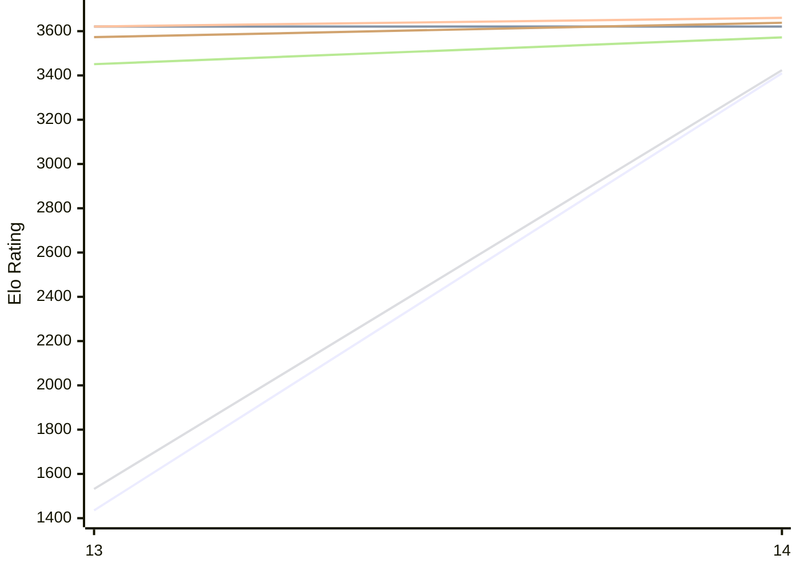
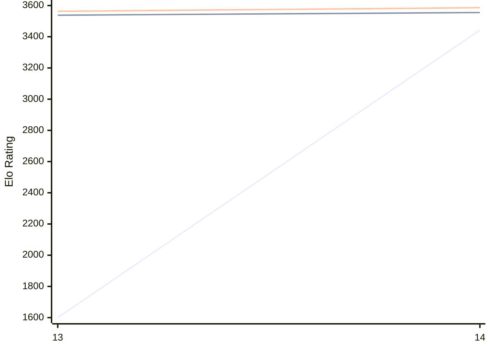

# Engine: Berserk

Author: Jay Honnold

Home: https://github.com/jhonnold/berserk

## Elo Ratings E1 (Ultra 7 265T (1.50 GHz) - E-Core)

| Version | Published | STC 8.0+0.08s  | LTC 60.0+0.60s | VLTC 2m24s+1.12s | Comment |
| --- | --- | --- | --- | --- | --- |
| 14 | 2026-05-24 | 3410(+1975) | 3621(0) | 3660(+39) |  |
| 13 | 2024-03-31 | 1435 | 3621 | 3621 |  |
 | | | cElo (∆ prev) | cElo (∆ prev) | cElo (∆ prev) | 

## Elo Ratings P1 (Ultra 7 265T (1.50 GHz) - P-Core)

| Version | Published | STC 8.0+0.08s  | LTC 60.0+0.60s | VLTC 2m24s+1.12s | Comment |
| --- | --- | --- | --- | --- | --- |
| 14 | 2026-05-24 | 3424(+1892) | 3572(+121) | 3638(+65) |  |
| 13 | 2024-03-31 | 1532 | 3451 | 3573 |  |
 | | | cElo (∆ prev) | cElo (∆ prev) | cElo (∆ prev) | 

## Elo Ratings T1 (i5-7500T 2.70GHz)

| Version | Published | STC 8.0+0.08s  | LTC 60.0+0.60s | VLTC 2m24s+1.12s | Comment |
| --- | --- | --- | --- | --- | --- |
| 14 | 2026-05-24 | 3443(+1843) | 3555(+17) | 3586(+23) |  |
| 13 | 2024-03-31 | 1600 | 3538 | 3563 |  |
 | | | cElo (∆ prev) | cElo (∆ prev) | cElo (∆ prev) | 

<a href="https://github.com/computer-chess-index/cci/issues/new?template=submit-version.yml&title=[VERSION]+Berserk+<version>&body=###%20Engine%20name%0ABerserk%0A%0A###%20Version%0A14" target="_blank">Submit new version</a>

 Test Conditions:

GUI/CLI: <a href=https://github.com/cutechess/cutechess target="_blank">Cute-Chess</a> 
Elo Calculation: <a href=https://www.remi-coulom.fr/Bayesian-Elo/ target="_blank">Bayesian-Elo</a> 
CPU for P1: Intel(R) Core(TM) Ultra 7 265T (1.50 GHz) - P-Core 
CPU for E1: Intel(R) Core(TM) Ultra 7 265T (1.50 GHz) - E-Core 
CPU for T1: Intel(R) Core(TM) i5-7500T 2.70GHz 
Opening book: 8_moves_v3 
\* STC: 8.0+0.08s, LTC: 60.0+0.60s, VLTC: 2m24s+1.12s

 Lists:
Ratings: <a href=https://github.com/computer-chess-index/cci/blob/main/lists/CCIRatings.csv target="_blank">Complete list</a>

Generated: 2026-11-28 05:36:31

## Ratings Verlauf E1 / P1

## Ratings Verlauf T1

## Detailed Evaluation Results

| Version | Time Control | Variant | Elo  | Range +/- | Matches | Score | Average Opponent Elo | Draws |
| --- | --- |--- | --- | --- | --- | --- | --- | --- |
| 14 | VLTC (2m24s+1.12s) | E1 | 3660 | 30 | 256 | 50% | 3659 | 86% |
|  |  | T1 | 3586 | 29 | 268 | 51% | 3582 | 93% |
|  |  | P1 | 3638 | 38 | 152 | 51% | 3630 | 94% |
|  | LTC (60.0+0.60s) | T1 | 3555 | 29 | 264 | 50% | 3556 | 91% |
|  |  | P1 | 3572 | 35 | 192 | 48% | 3582 | 82% |
|  |  | E1 | 3621 | 28 | 288 | 50% | 3622 | 84% |
|  | STC (8.0+0.08s) | T1 | 3443 | 24 | 426 | 53% | 3372 | 76% |
|  |  | P1 | 3424 | 31 | 254 | 48% | 3440 | 77% |
|  |  | E1 | 3410 | 24 | 454 | 48% | 3426 | 71% |
| --- | --- |--- | --- | --- | --- | --- | --- | --- |
| 13 | VLTC (2m24s+1.12s) | P1 | 3573 | 107 | 28 | 73% | 3295 | 54% |
|  |  | E1 | 3621 | 57 | 84 | 62% | 3491 | 67% |
|  |  | T1 | 3563 | 13 | 1458 | 53% | 3488 | 84% |
|  | LTC (60.0+0.60s) | E1 | 3621 | 66 | 64 | 62% | 3476 | 64% |
|  |  | T1 | 3538 | 12 | 1740 | 51% | 3534 | 87% |
|  |  | P1 | 3451 | 102 | 34 | 75% | 3187 | 44% |
|  | STC (8.0+0.08s) | E1 | 1435 | 51 | 152 | 52% | 1403 | 13% |
|  |  | T1 | 1600 | 15 | 1932 | 53% | 1558 | 10% |
|  |  | P1 | 1532 | 62 | 116 | 39% | 1752 | 14% |