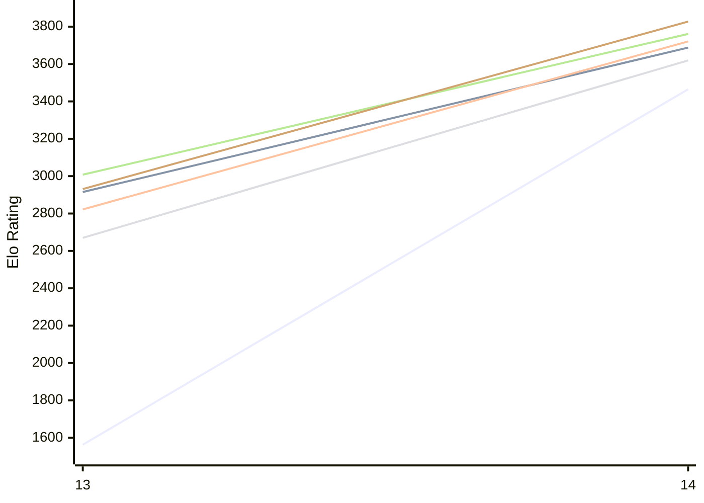
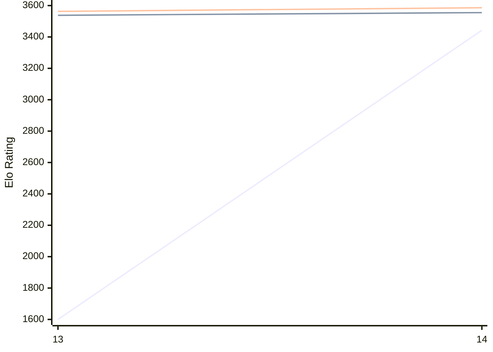

# Engine: Berserk

Author: Jay Honnold

Home: https://github.com/jhonnold/berserk

## Elo Ratings E1 (Ultra 7 265T (1.50 GHz) - E-Core)

| Version | Published | STC 8.0+0.08s  | LTC 60.0+0.60s | VLTC 2m24s+1.12s | Comment |
| --- | --- | --- | --- | --- | --- |
| 14 | 2026-05-24 | 3465(+1902) | 3688(+773) | 3721(+899) |  |
| 13 | 2024-03-31 | 1563 | 2915 | 2822 |  |
 | | | cElo (∆ prev) | cElo (∆ prev) | cElo (∆ prev) | 

## Elo Ratings P1 (Ultra 7 265T (1.50 GHz) - P-Core)

| Version | Published | STC 8.0+0.08s  | LTC 60.0+0.60s | VLTC 2m24s+1.12s | Comment |
| --- | --- | --- | --- | --- | --- |
| 14 | 2026-05-24 | 3619(+949) | 3761(+753) | 3827(+896) |  |
| 13 | 2024-03-31 | 2670 | 3008 | 2931 |  |
 | | | cElo (∆ prev) | cElo (∆ prev) | cElo (∆ prev) | 

## Elo Ratings T1 (i5-7500T 2.70GHz)

| Version | Published | STC 8.0+0.08s  | LTC 60.0+0.60s | VLTC 2m24s+1.12s | Comment |
| --- | --- | --- | --- | --- | --- |
| 14 | 2026-05-24 | 3443(+1843) | 3555(+17) | 3586(+23) |  |
| 13 | 2024-03-31 | 1600 | 3538 | 3563 |  |
 | | | cElo (∆ prev) | cElo (∆ prev) | cElo (∆ prev) | 

<a href="https://github.com/computer-chess-index/cci/issues/new?template=submit-version.yml&title=[VERSION]+Berserk+<version>&body=###%20Engine%20name%0ABerserk%0A%0A###%20Version%0A14" target="_blank">Submit new version</a>

 Test Conditions:

GUI/CLI: <a href=https://github.com/cutechess/cutechess target="_blank">Cute-Chess</a> 
Elo Calculation: <a href=https://www.remi-coulom.fr/Bayesian-Elo/ target="_blank">Bayesian-Elo</a> 
CPU for P1: Intel(R) Core(TM) Ultra 7 265T (1.50 GHz) - P-Core 
CPU for E1: Intel(R) Core(TM) Ultra 7 265T (1.50 GHz) - E-Core 
CPU for T1: Intel(R) Core(TM) i5-7500T 2.70GHz 
Opening book: 8_moves_v3 
\* STC: 8.0+0.08s, LTC: 60.0+0.60s, VLTC: 2m24s+1.12s

 Lists:
Ratings: <a href=https://github.com/computer-chess-index/cci/blob/main/lists/CCIRatings.csv target="_blank">Complete list</a>

Generated: 2026-11-12 05:36:16

## Ratings Verlauf E1 / P1

## Ratings Verlauf T1

## Detailed Evaluation Results

| Version | Time Control | Variant | Elo  | Range +/- | Matches | Score | Average Opponent Elo | Draws |
| --- | --- |--- | --- | --- | --- | --- | --- | --- |
| 14 | VLTC (2m24s+1.12s) | E1 | 3721 | 32 | 226 | 50% | 3718 | 86% |
|  |  | T1 | 3586 | 29 | 268 | 51% | 3582 | 93% |
|  |  | P1 | 3827 | 40 | 140 | 51% | 3819 | 94% |
|  | LTC (60.0+0.60s) | T1 | 3555 | 29 | 264 | 50% | 3556 | 91% |
|  |  | P1 | 3761 | 37 | 172 | 49% | 3769 | 81% |
|  |  | E1 | 3688 | 32 | 232 | 51% | 3681 | 83% |
|  | STC (8.0+0.08s) | T1 | 3443 | 24 | 426 | 53% | 3372 | 76% |
|  |  | P1 | 3619 | 33 | 216 | 48% | 3632 | 78% |
|  |  | E1 | 3465 | 25 | 394 | 47% | 3486 | 70% |
| --- | --- |--- | --- | --- | --- | --- | --- | --- |
| 13 | VLTC (2m24s+1.12s) | E1 | 2822 | 229 | 4 | 88% | 2615 | 25% |
|  |  | P1 | 2931 | 170 | 8 | 75% | 2749 | 50% |
|  |  | T1 | 3563 | 13 | 1458 | 53% | 3488 | 84% |
|  | LTC (60.0+0.60s) | E1 | 2915 | 246 | 4 | 88% | 2681 | 25% |
|  |  | T1 | 3538 | 12 | 1740 | 51% | 3534 | 87% |
|  |  | P1 | 3008 | 331 | 2 | 100% | 2743 | 0% |
|  | STC (8.0+0.08s) | E1 | 1563 | 138 | 28 | 75% | 1207 | 7% |
|  |  | T1 | 1600 | 15 | 1932 | 53% | 1558 | 10% |
|  |  | P1 | 2670 | 262 | 4 | 0% | 2985 | 0% |