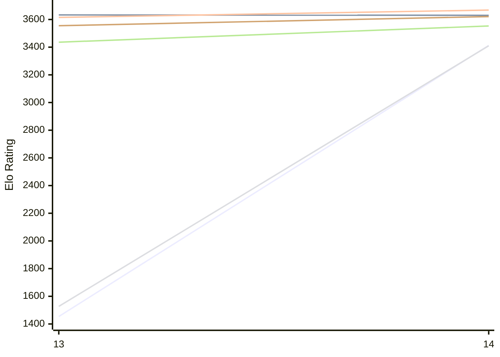
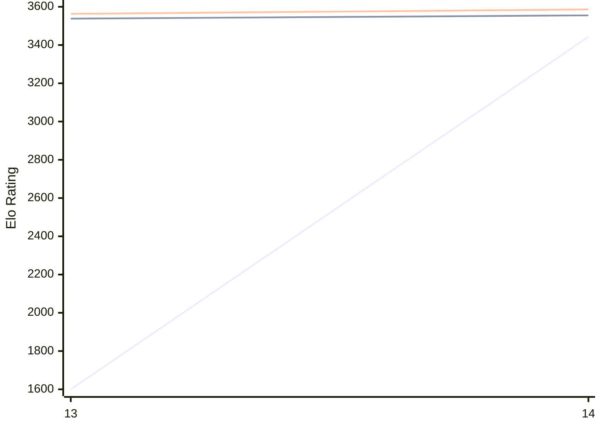

# Engine: Berserk

Author: Jay Honnold

Home: https://github.com/jhonnold/berserk

## Elo Ratings E1 (Ultra 7 265T (1.50 GHz) - E-Core)

| Version | Published | STC 8.0+0.08s  | LTC 60.0+0.60s | VLTC 2m24s+1.12s | Comment |
| --- | --- | --- | --- | --- | --- |
| 14 | 2026-05-24 | 3413(+1959) | 3630(-3) | 3668(+53) |  |
| 13 | 2024-03-31 | 1454 | 3633 | 3615 |  |
 | | | cElo (∆ prev) | cElo (∆ prev) | cElo (∆ prev) | 

## Elo Ratings P1 (Ultra 7 265T (1.50 GHz) - P-Core)

| Version | Published | STC 8.0+0.08s  | LTC 60.0+0.60s | VLTC 2m24s+1.12s | Comment |
| --- | --- | --- | --- | --- | --- |
| 14 | 2026-05-24 | 3410(+1883) | 3553(+117) | 3621(+66) |  |
| 13 | 2024-03-31 | 1527 | 3436 | 3555 |  |
 | | | cElo (∆ prev) | cElo (∆ prev) | cElo (∆ prev) | 

## Elo Ratings T1 (i5-7500T 2.70GHz)

| Version | Published | STC 8.0+0.08s  | LTC 60.0+0.60s | VLTC 2m24s+1.12s | Comment |
| --- | --- | --- | --- | --- | --- |
| 14 | 2026-05-24 | 3443(+1843) | 3555(+17) | 3586(+23) |  |
| 13 | 2024-03-31 | 1600 | 3538 | 3563 |  |
 | | | cElo (∆ prev) | cElo (∆ prev) | cElo (∆ prev) | 

<a href="https://github.com/computer-chess-index/cci/issues/new?template=submit-version.yml&title=[VERSION]+Berserk+<version>&body=###%20Engine%20name%0ABerserk%0A%0A###%20Version%0A14" target="_blank">Submit new version</a>

 Test Conditions:

GUI/CLI: <a href=https://github.com/cutechess/cutechess target="_blank">Cute-Chess</a> 
Elo Calculation: <a href=https://www.remi-coulom.fr/Bayesian-Elo/ target="_blank">Bayesian-Elo</a> 
CPU for P1: Intel(R) Core(TM) Ultra 7 265T (1.50 GHz) - P-Core 
CPU for E1: Intel(R) Core(TM) Ultra 7 265T (1.50 GHz) - E-Core 
CPU for T1: Intel(R) Core(TM) i5-7500T 2.70GHz 
Opening book: 8_moves_v3 
\* STC: 8.0+0.08s, LTC: 60.0+0.60s, VLTC: 2m24s+1.12s

 Lists:
Ratings: <a href=https://github.com/computer-chess-index/cci/blob/main/lists/CCIRatings.csv target="_blank">Complete list</a>

Generated: 2026-11-21 05:36:25

## Ratings Verlauf E1 / P1

## Ratings Verlauf T1

## Detailed Evaluation Results

| Version | Time Control | Variant | Elo  | Range +/- | Matches | Score | Average Opponent Elo | Draws |
| --- | --- |--- | --- | --- | --- | --- | --- | --- |
| 14 | VLTC (2m24s+1.12s) | E1 | 3668 | 31 | 246 | 51% | 3664 | 86% |
|  |  | T1 | 3586 | 29 | 268 | 51% | 3582 | 93% |
|  |  | P1 | 3621 | 39 | 144 | 51% | 3614 | 94% |
|  | LTC (60.0+0.60s) | E1 | 3630 | 29 | 268 | 50% | 3629 | 84% |
|  |  | T1 | 3555 | 29 | 264 | 50% | 3556 | 91% |
|  |  | P1 | 3553 | 35 | 188 | 48% | 3564 | 82% |
|  | STC (8.0+0.08s) | E1 | 3413 | 24 | 434 | 47% | 3430 | 71% |
|  |  | T1 | 3443 | 24 | 426 | 53% | 3372 | 76% |
|  |  | P1 | 3410 | 33 | 220 | 48% | 3425 | 78% |
| --- | --- |--- | --- | --- | --- | --- | --- | --- |
| 13 | VLTC (2m24s+1.12s) | E1 | 3615 | 70 | 60 | 65% | 3448 | 60% |
|  |  | T1 | 3563 | 13 | 1458 | 53% | 3488 | 84% |
|  |  | P1 | 3555 | 106 | 28 | 73% | 3278 | 54% |
|  | LTC (60.0+0.60s) | T1 | 3538 | 12 | 1740 | 51% | 3534 | 87% |
|  |  | P1 | 3436 | 102 | 34 | 75% | 3171 | 44% |
|  |  | E1 | 3633 | 72 | 56 | 64% | 3461 | 61% |
|  | STC (8.0+0.08s) | T1 | 1600 | 15 | 1932 | 53% | 1558 | 10% |
|  |  | P1 | 1527 | 62 | 116 | 39% | 1743 | 14% |
|  |  | E1 | 1454 | 55 | 128 | 54% | 1391 | 15% |