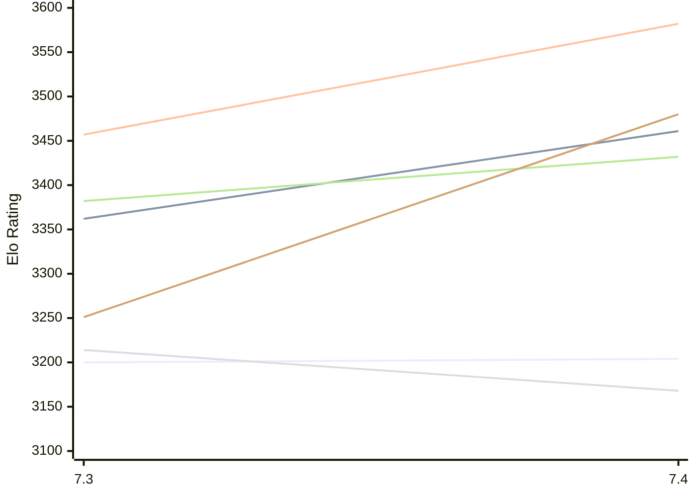

# Engine: Booot

Author: Alex Morozov

Home: https://github.com/booot76/Booot-chess-engine

## Elo Ratings E1 (Ultra 7 265T (1.50 GHz) - E-Core)

| Version | Published | STC 8.0+0.08s  | LTC 60.0+0.60s | VLTC 2m24s+1.12s | Comment |
| --- | --- | --- | --- | --- | --- |
| 7.4 | 2025-02-25 | 3204(+4) | 3461(+99) | 3582(+125) |  |
| 7.3 | 2024-01-28 | 3200 | 3362 | 3457 |  |
 | | | cElo (∆ prev) | cElo (∆ prev) | cElo (∆ prev) | 

## Elo Ratings P1 (Ultra 7 265T (1.50 GHz) - P-Core)

| Version | Published | STC 8.0+0.08s  | LTC 60.0+0.60s | VLTC 2m24s+1.12s | Comment |
| --- | --- | --- | --- | --- | --- |
| 7.4 | 2025-02-25 | 3168(-46) | 3432(+50) | 3480(+229) |  |
| 7.3 | 2024-01-28 | 3214 | 3382 | 3251 |  |
 | | | cElo (∆ prev) | cElo (∆ prev) | cElo (∆ prev) | 

## Elo Ratings T1 (i5-7500T 2.70GHz)

| Version | Published | STC 8.0+0.08s  | LTC 60.0+0.60s | VLTC 2m24s+1.12s | Comment |
| --- | --- | --- | --- | --- | --- |
| 7.4 | 2025-02-25 | 3241 | 3456 | 3499 |  |
 | | | cElo (∆ prev) | cElo (∆ prev) | cElo (∆ prev) | 

<a href="https://github.com/computer-chess-index/cci/issues/new?template=submit-version.yml&title=[VERSION]+Booot+<version>&body=###%20Engine%20name%0ABooot%0A%0A###%20Version%0A7.4" target="_blank">Submit new version</a>

 Test Conditions:

GUI/CLI: <a href=https://github.com/cutechess/cutechess target="_blank">Cute-Chess</a> 
Elo Calculation: <a href=https://www.remi-coulom.fr/Bayesian-Elo/ target="_blank">Bayesian-Elo</a> 
CPU for P1: Intel(R) Core(TM) Ultra 7 265T (1.50 GHz) - P-Core 
CPU for E1: Intel(R) Core(TM) Ultra 7 265T (1.50 GHz) - E-Core 
CPU for T1: Intel(R) Core(TM) i5-7500T 2.70GHz 
Opening book: 8_moves_v3 
\* STC: 8.0+0.08s, LTC: 60.0+0.60s, VLTC: 2m24s+1.12s

 Lists:
Ratings: <a href=https://github.com/computer-chess-index/cci/blob/main/lists/CCIRatings.csv target="_blank">Complete list</a>

Generated: 2026-11-16 05:36:32

## Ratings Verlauf E1 / P1

## Detailed Evaluation Results

| Version | Time Control | Variant | Elo  | Range +/- | Matches | Score | Average Opponent Elo | Draws |
| --- | --- |--- | --- | --- | --- | --- | --- | --- |
| 7.4 | VLTC (2m24s+1.12s) | T1 | 3499 | 23 | 460 | 51% | 3486 | 80% |
|  |  | P1 | 3480 | 38 | 174 | 54% | 3409 | 78% |
|  |  | E1 | 3582 | 32 | 254 | 53% | 3530 | 74% |
|  | LTC (60.0+0.60s) | T1 | 3456 | 21 | 572 | 50% | 3445 | 76% |
|  |  | P1 | 3432 | 39 | 160 | 52% | 3380 | 77% |
|  |  | E1 | 3461 | 28 | 334 | 55% | 3383 | 72% |
|  | STC (8.0+0.08s) | T1 | 3241 | 19 | 750 | 50% | 3237 | 58% |
|  |  | P1 | 3168 | 33 | 248 | 48% | 3181 | 61% |
|  |  | E1 | 3204 | 26 | 370 | 47% | 3221 | 66% |
| --- | --- |--- | --- | --- | --- | --- | --- | --- |
| 7.3 | VLTC (2m24s+1.12s) | P1 | 3251 | 143 | 16 | 78% | 2982 | 44% |
|  |  | E1 | 3457 | 100 | 34 | 69% | 3185 | 44% |
|  | LTC (60.0+0.60s) | P1 | 3382 | 145 | 16 | 75% | 3102 | 50% |
|  |  | E1 | 3362 | 97 | 30 | 57% | 3283 | 53% |
|  | STC (8.0+0.08s) | P1 | 3214 | 124 | 24 | 69% | 2988 | 29% |
|  |  | E1 | 3200 | 81 | 46 | 54% | 3160 | 48% |