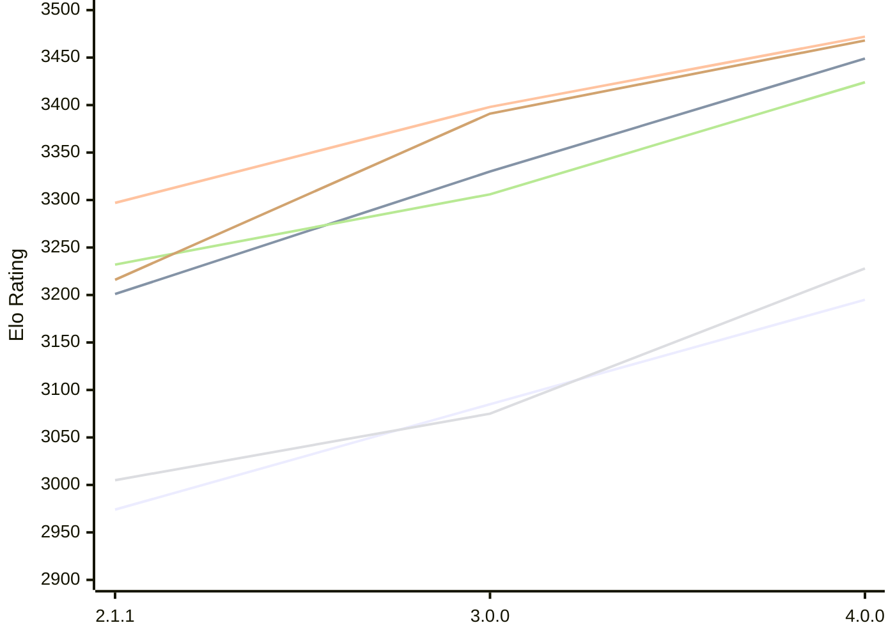
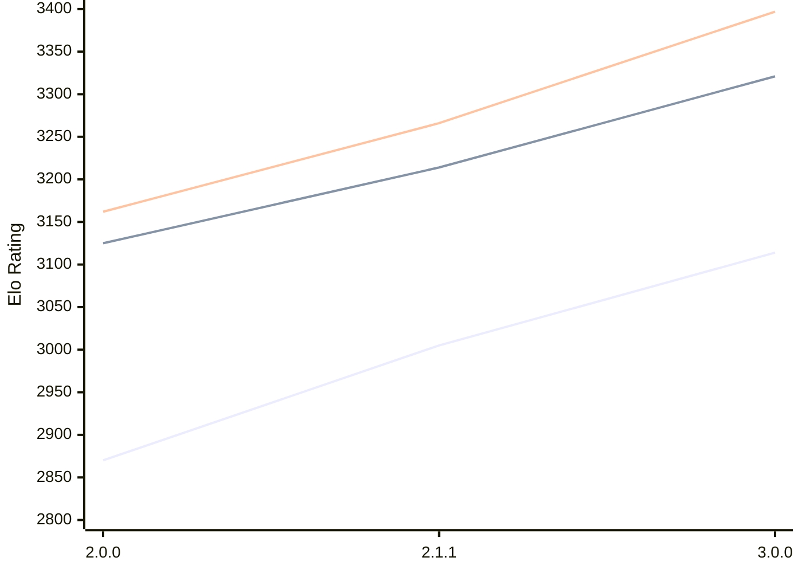

# Engine: Bread

Author: 

Home: https://github.com/Nonlinear2/Bread-Engine

## Elo Ratings E1 (Ultra 7 265T (1.50 GHz) - E-Core)

| Version | Published | STC 8.0+0.08s  | LTC 60.0+0.60s | VLTC 2m24s+1.12s | Comment |
| --- | --- | --- | --- | --- | --- |
| 4.0.0 | 2026-07-29 | 3195(+110) | 3449(+119) | 3472(+74) |  |
| 3.0.0 | 2026-03-15 | 3085(+111) | 3330(+129) | 3398(+101) |  |
| 2.1.1 | 2025-12-22 | 2974 | 3201 | 3297 |  |
 | | | cElo (∆ prev) | cElo (∆ prev) | cElo (∆ prev) | 

## Elo Ratings P1 (Ultra 7 265T (1.50 GHz) - P-Core)

| Version | Published | STC 8.0+0.08s  | LTC 60.0+0.60s | VLTC 2m24s+1.12s | Comment |
| --- | --- | --- | --- | --- | --- |
| 4.0.0 | 2026-07-29 | 3228(+153) | 3424(+118) | 3468(+77) |  |
| 3.0.0 | 2026-03-15 | 3075(+70) | 3306(+74) | 3391(+175) |  |
| 2.1.1 | 2025-12-22 | 3005 | 3232 | 3216 |  |
 | | | cElo (∆ prev) | cElo (∆ prev) | cElo (∆ prev) | 

## Elo Ratings T1 (i5-7500T 2.70GHz)

| Version | Published | STC 8.0+0.08s  | LTC 60.0+0.60s | VLTC 2m24s+1.12s | Comment |
| --- | --- | --- | --- | --- | --- |
| 3.0.0 | 2026-03-15 | 3114(+109) | 3321(+107) | 3397(+131) |  |
| 2.1.1 | 2025-12-22 | 3005(+135) | 3214(+89) | 3266(+104) |  |
| 2.0.0 | 2025-10-18 | 2870 | 3125 | 3162 |  |
 | | | cElo (∆ prev) | cElo (∆ prev) | cElo (∆ prev) | 

<a href="https://github.com/computer-chess-index/cci/issues/new?template=submit-version.yml&title=[VERSION]+Bread+<version>&body=###%20Engine%20name%0ABread%0A%0A###%20Version%0A3.0.0" target="_blank">Submit new version</a>

 Test Conditions:

GUI/CLI: <a href=https://github.com/cutechess/cutechess target="_blank">Cute-Chess</a> 
Elo Calculation: <a href=https://www.remi-coulom.fr/Bayesian-Elo/ target="_blank">Bayesian-Elo</a> 
CPU for P1: Intel(R) Core(TM) Ultra 7 265T (1.50 GHz) - P-Core 
CPU for E1: Intel(R) Core(TM) Ultra 7 265T (1.50 GHz) - E-Core 
CPU for T1: Intel(R) Core(TM) i5-7500T 2.70GHz 
Opening book: 8_moves_v3 
\* STC: 8.0+0.08s, LTC: 60.0+0.60s, VLTC: 2m24s+1.12s

 Lists:
Ratings: <a href=https://github.com/computer-chess-index/cci/blob/main/lists/CCIRatings.csv target="_blank">Complete list</a>

Generated: 2026-11-26 05:36:43

## Ratings Verlauf E1 / P1

## Ratings Verlauf T1

## Detailed Evaluation Results

| Version | Time Control | Variant | Elo  | Range +/- | Matches | Score | Average Opponent Elo | Draws |
| --- | --- |--- | --- | --- | --- | --- | --- | --- |
| 4.0.0 | VLTC (2m24s+1.12s) | P1 | 3468 | 61 | 60 | 56% | 3430 | 88% |
|  |  | E1 | 3472 | 43 | 132 | 53% | 3449 | 74% |
|  | LTC (60.0+0.60s) | P1 | 3424 | 78 | 40 | 56% | 3378 | 73% |
|  |  | E1 | 3449 | 35 | 204 | 52% | 3436 | 67% |
|  | STC (8.0+0.08s) | E1 | 3195 | 34 | 232 | 50% | 3194 | 55% |
|  |  | P1 | 3228 | 50 | 104 | 50% | 3225 | 61% |
| --- | --- |--- | --- | --- | --- | --- | --- | --- |
| 3.0.0 | VLTC (2m24s+1.12s) | P1 | 3391 | 34 | 214 | 52% | 3360 | 73% |
|  |  | E1 | 3398 | 26 | 420 | 56% | 3314 | 60% |
|  |  | T1 | 3397 | 22 | 500 | 50% | 3399 | 75% |
|  | LTC (60.0+0.60s) | P1 | 3306 | 31 | 284 | 52% | 3278 | 63% |
|  |  | E1 | 3330 | 25 | 434 | 56% | 3245 | 60% |
|  |  | T1 | 3321 | 24 | 436 | 51% | 3314 | 72% |
|  | STC (8.0+0.08s) | P1 | 3075 | 31 | 280 | 47% | 3102 | 58% |
|  |  | E1 | 3085 | 26 | 416 | 47% | 3109 | 55% |
|  |  | T1 | 3114 | 22 | 588 | 50% | 3112 | 57% |
| --- | --- |--- | --- | --- | --- | --- | --- | --- |
| 2.1.1 | VLTC (2m24s+1.12s) | T1 | 3266 | 30 | 294 | 50% | 3263 | 61% |
|  |  | P1 | 3216 | 68 | 68 | 65% | 3050 | 49% |
|  |  | E1 | 3297 | 60 | 91 | 60% | 3094 | 47% |
|  | LTC (60.0+0.60s) | T1 | 3214 | 28 | 348 | 50% | 3204 | 55% |
|  |  | P1 | 3232 | 75 | 52 | 59% | 3146 | 48% |
|  |  | E1 | 3201 | 60 | 80 | 54% | 3143 | 55% |
|  | STC (8.0+0.08s) | T1 | 3005 | 28 | 364 | 52% | 2989 | 47% |
|  |  | P1 | 3005 | 65 | 76 | 56% | 2950 | 41% |
|  |  | E1 | 2974 | 59 | 94 | 57% | 2817 | 46% |
| --- | --- |--- | --- | --- | --- | --- | --- | --- |
| 2.0.0 | VLTC (2m24s+1.12s) | T1 | 3162 | 37 | 208 | 57% | 3055 | 55% |
|  | LTC (60.0+0.60s) | T1 | 3125 | 40 | 188 | 56% | 3042 | 53% |
|  | STC (8.0+0.08s) | T1 | 2870 | 38 | 208 | 51% | 2839 | 44% |