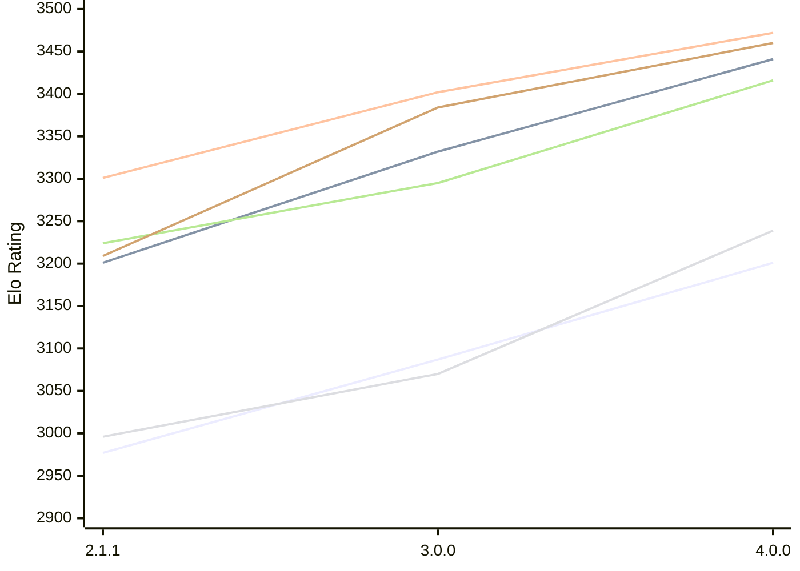
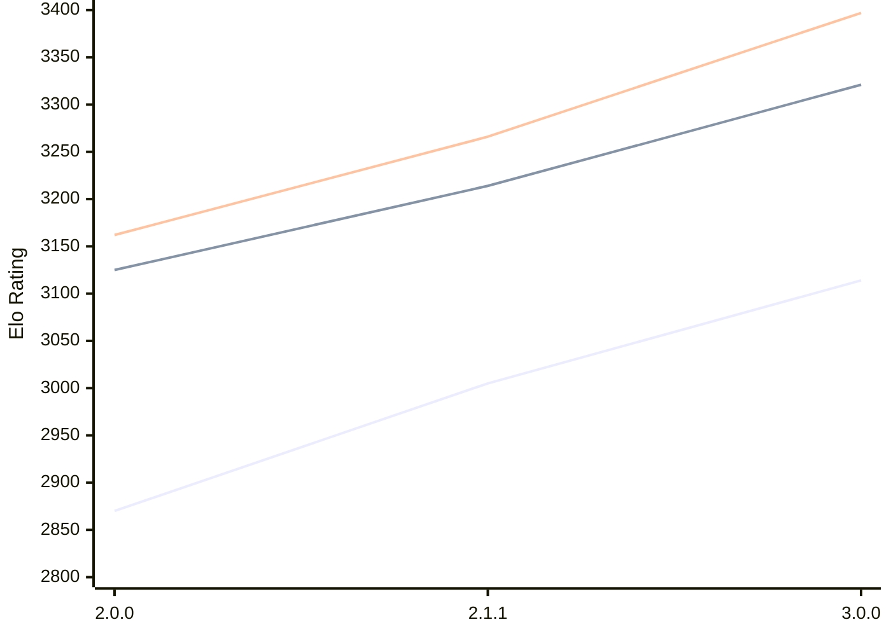

# Engine: Bread

Author: 

Home: https://github.com/Nonlinear2/Bread-Engine

## Elo Ratings E1 (Ultra 7 265T (1.50 GHz) - E-Core)

| Version | Published | STC 8.0+0.08s  | LTC 60.0+0.60s | VLTC 2m24s+1.12s | Comment |
| --- | --- | --- | --- | --- | --- |
| 4.0.0 | 2026-07-29 | 3201(+114) | 3441(+109) | 3472(+70) |  |
| 3.0.0 | 2026-03-15 | 3087(+110) | 3332(+131) | 3402(+101) |  |
| 2.1.1 | 2025-12-22 | 2977 | 3201 | 3301 |  |
 | | | cElo (∆ prev) | cElo (∆ prev) | cElo (∆ prev) | 

## Elo Ratings P1 (Ultra 7 265T (1.50 GHz) - P-Core)

| Version | Published | STC 8.0+0.08s  | LTC 60.0+0.60s | VLTC 2m24s+1.12s | Comment |
| --- | --- | --- | --- | --- | --- |
| 4.0.0 | 2026-07-29 | 3239(+169) | 3416(+121) | 3460(+76) |  |
| 3.0.0 | 2026-03-15 | 3070(+74) | 3295(+71) | 3384(+175) |  |
| 2.1.1 | 2025-12-22 | 2996 | 3224 | 3209 |  |
 | | | cElo (∆ prev) | cElo (∆ prev) | cElo (∆ prev) | 

## Elo Ratings T1 (i5-7500T 2.70GHz)

| Version | Published | STC 8.0+0.08s  | LTC 60.0+0.60s | VLTC 2m24s+1.12s | Comment |
| --- | --- | --- | --- | --- | --- |
| 3.0.0 | 2026-03-15 | 3114(+109) | 3321(+107) | 3397(+131) |  |
| 2.1.1 | 2025-12-22 | 3005(+135) | 3214(+89) | 3266(+104) |  |
| 2.0.0 | 2025-10-18 | 2870 | 3125 | 3162 |  |
 | | | cElo (∆ prev) | cElo (∆ prev) | cElo (∆ prev) | 

<a href="https://github.com/computer-chess-index/cci/issues/new?template=submit-version.yml&title=[VERSION]+Bread+<version>&body=###%20Engine%20name%0ABread%0A%0A###%20Version%0A3.0.0" target="_blank">Submit new version</a>

 Test Conditions:

GUI/CLI: <a href=https://github.com/cutechess/cutechess target="_blank">Cute-Chess</a> 
Elo Calculation: <a href=https://www.remi-coulom.fr/Bayesian-Elo/ target="_blank">Bayesian-Elo</a> 
CPU for P1: Intel(R) Core(TM) Ultra 7 265T (1.50 GHz) - P-Core 
CPU for E1: Intel(R) Core(TM) Ultra 7 265T (1.50 GHz) - E-Core 
CPU for T1: Intel(R) Core(TM) i5-7500T 2.70GHz 
Opening book: 8_moves_v3 
\* STC: 8.0+0.08s, LTC: 60.0+0.60s, VLTC: 2m24s+1.12s

 Lists:
Ratings: <a href=https://github.com/computer-chess-index/cci/blob/main/lists/CCIRatings.csv target="_blank">Complete list</a>

Generated: 2026-11-24 05:36:36

## Ratings Verlauf E1 / P1

## Ratings Verlauf T1

## Detailed Evaluation Results

| Version | Time Control | Variant | Elo  | Range +/- | Matches | Score | Average Opponent Elo | Draws |
| --- | --- |--- | --- | --- | --- | --- | --- | --- |
| 4.0.0 | VLTC (2m24s+1.12s) | E1 | 3472 | 44 | 128 | 53% | 3452 | 74% |
|  |  | P1 | 3460 | 64 | 56 | 56% | 3421 | 88% |
|  | LTC (60.0+0.60s) | E1 | 3441 | 38 | 176 | 50% | 3438 | 70% |
|  |  | P1 | 3416 | 83 | 36 | 57% | 3366 | 69% |
|  | STC (8.0+0.08s) | P1 | 3239 | 68 | 58 | 54% | 3208 | 57% |
|  |  | E1 | 3201 | 35 | 228 | 50% | 3195 | 55% |
| --- | --- |--- | --- | --- | --- | --- | --- | --- |
| 3.0.0 | VLTC (2m24s+1.12s) | E1 | 3402 | 26 | 420 | 56% | 3317 | 60% |
|  |  | T1 | 3397 | 22 | 500 | 50% | 3399 | 75% |
|  |  | P1 | 3384 | 34 | 214 | 52% | 3353 | 73% |
|  | LTC (60.0+0.60s) | E1 | 3332 | 25 | 430 | 56% | 3247 | 60% |
|  |  | T1 | 3321 | 24 | 436 | 51% | 3314 | 72% |
|  |  | P1 | 3295 | 31 | 276 | 52% | 3270 | 64% |
|  | STC (8.0+0.08s) | E1 | 3087 | 26 | 408 | 47% | 3112 | 55% |
|  |  | T1 | 3114 | 22 | 588 | 50% | 3112 | 57% |
|  |  | P1 | 3070 | 31 | 276 | 47% | 3094 | 57% |
| --- | --- |--- | --- | --- | --- | --- | --- | --- |
| 2.1.1 | VLTC (2m24s+1.12s) | T1 | 3266 | 30 | 294 | 50% | 3263 | 61% |
|  |  | P1 | 3209 | 68 | 68 | 65% | 3042 | 49% |
|  |  | E1 | 3301 | 60 | 91 | 60% | 3097 | 47% |
|  | LTC (60.0+0.60s) | T1 | 3214 | 28 | 348 | 50% | 3204 | 55% |
|  |  | P1 | 3224 | 75 | 52 | 59% | 3137 | 48% |
|  |  | E1 | 3201 | 60 | 80 | 54% | 3144 | 55% |
|  | STC (8.0+0.08s) | T1 | 3005 | 28 | 364 | 52% | 2989 | 47% |
|  |  | P1 | 2996 | 65 | 76 | 56% | 2939 | 41% |
|  |  | E1 | 2977 | 59 | 94 | 57% | 2819 | 46% |
| --- | --- |--- | --- | --- | --- | --- | --- | --- |
| 2.0.0 | VLTC (2m24s+1.12s) | T1 | 3162 | 37 | 208 | 57% | 3055 | 55% |
|  | LTC (60.0+0.60s) | T1 | 3125 | 40 | 188 | 56% | 3042 | 53% |
|  | STC (8.0+0.08s) | T1 | 2870 | 38 | 208 | 51% | 2839 | 44% |