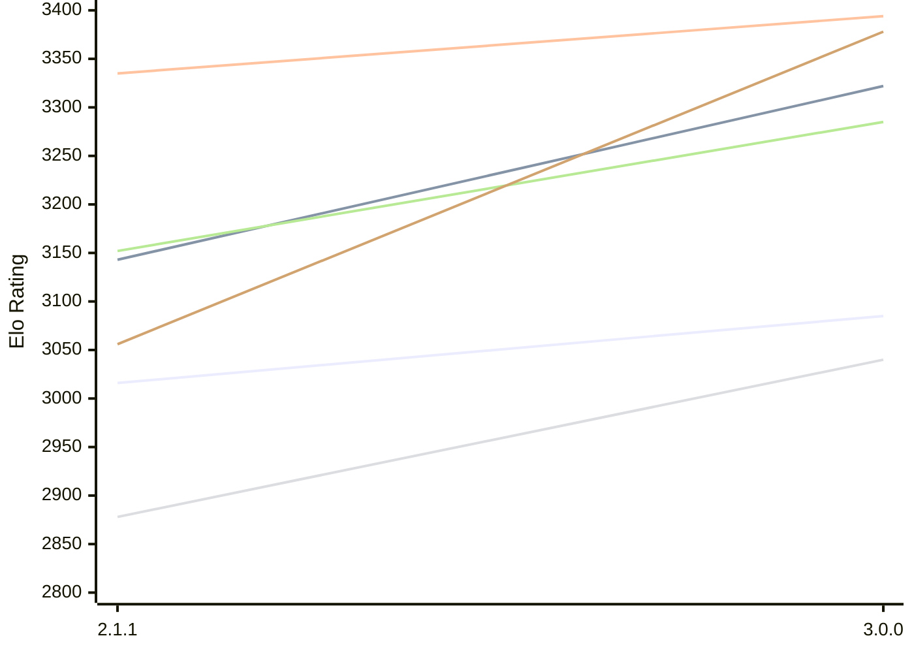
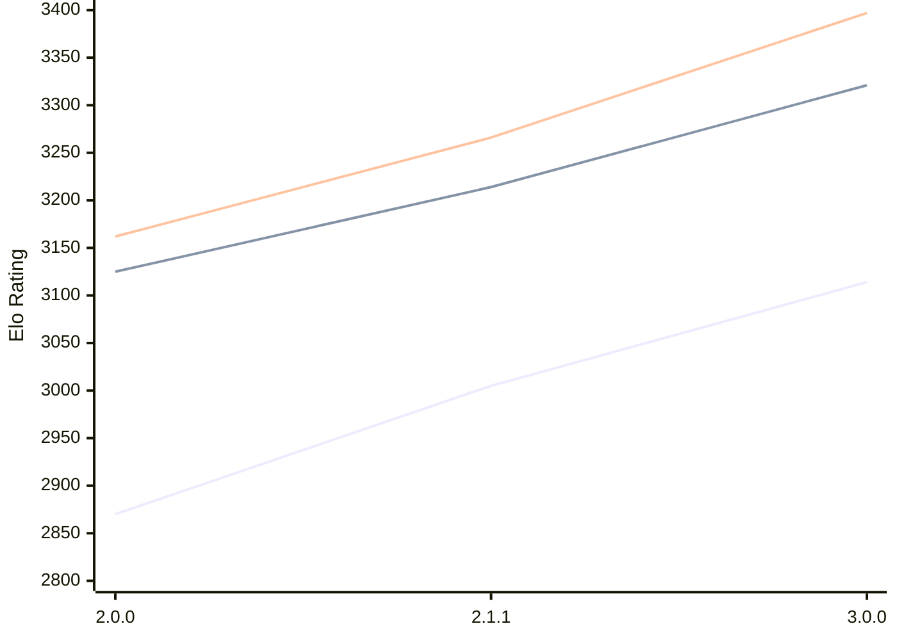

# Engine: Bread

Author: 

Home: https://github.com/Nonlinear2/Bread-Engine

## Elo Ratings E1 (Ultra 7 265T (1.50 GHz) - E-Core)

| Version | Published | STC 8.0+0.08s  | LTC 60.0+0.60s | VLTC 2m24s+1.12s | Comment |
| --- | --- | --- | --- | --- | --- |
| 3.0.0 | 2026-03-15 | 3085(+69) | 3322(+179) | 3394(+59) |  |
| 2.1.1 | 2025-12-22 | 3016 | 3143 | 3335 |  |
 | | | cElo (∆ prev) | cElo (∆ prev) | cElo (∆ prev) | 

## Elo Ratings P1 (Ultra 7 265T (1.50 GHz) - P-Core)

| Version | Published | STC 8.0+0.08s  | LTC 60.0+0.60s | VLTC 2m24s+1.12s | Comment |
| --- | --- | --- | --- | --- | --- |
| 3.0.0 | 2026-03-15 | 3040(+162) | 3285(+133) | 3378(+322) |  |
| 2.1.1 | 2025-12-22 | 2878 | 3152 | 3056 |  |
 | | | cElo (∆ prev) | cElo (∆ prev) | cElo (∆ prev) | 

## Elo Ratings T1 (i5-7500T 2.70GHz)

| Version | Published | STC 8.0+0.08s  | LTC 60.0+0.60s | VLTC 2m24s+1.12s | Comment |
| --- | --- | --- | --- | --- | --- |
| 3.0.0 | 2026-03-15 | 3114(+109) | 3321(+107) | 3397(+131) |  |
| 2.1.1 | 2025-12-22 | 3005(+135) | 3214(+89) | 3266(+104) |  |
| 2.0.0 | 2025-10-18 | 2870 | 3125 | 3162 |  |
 | | | cElo (∆ prev) | cElo (∆ prev) | cElo (∆ prev) | 

<a href="https://github.com/computer-chess-index/cci/issues/new?template=submit-version.yml&title=[VERSION]+Bread+<version>&body=###%20Engine%20name%0ABread%0A%0A###%20Version%0A3.0.0" target="_blank">Submit new version</a>

 Test Conditions:

GUI/CLI: <a href=https://github.com/cutechess/cutechess target="_blank">Cute-Chess</a> 
Elo Calculation: <a href=https://www.remi-coulom.fr/Bayesian-Elo/ target="_blank">Bayesian-Elo</a> 
CPU for P1: Intel(R) Core(TM) Ultra 7 265T (1.50 GHz) - P-Core 
CPU for E1: Intel(R) Core(TM) Ultra 7 265T (1.50 GHz) - E-Core 
CPU for T1: Intel(R) Core(TM) i5-7500T 2.70GHz 
Opening book: 8_moves_v3 
\* STC: 8.0+0.08s, LTC: 60.0+0.60s, VLTC: 2m24s+1.12s

 Lists:
Ratings: <a href=https://github.com/computer-chess-index/cci/blob/main/lists/CCIRatings.csv target="_blank">Complete list</a>

Generated: 2026-11-14 05:36:30

## Ratings Verlauf E1 / P1

## Ratings Verlauf T1

## Detailed Evaluation Results

| Version | Time Control | Variant | Elo  | Range +/- | Matches | Score | Average Opponent Elo | Draws |
| --- | --- |--- | --- | --- | --- | --- | --- | --- |
| 3.0.0 | VLTC (2m24s+1.12s) | T1 | 3397 | 22 | 500 | 50% | 3399 | 75% |
|  |  | P1 | 3378 | 35 | 210 | 52% | 3341 | 73% |
|  |  | E1 | 3394 | 27 | 396 | 56% | 3303 | 60% |
|  | LTC (60.0+0.60s) | T1 | 3321 | 24 | 436 | 51% | 3314 | 72% |
|  |  | P1 | 3285 | 32 | 260 | 52% | 3256 | 64% |
|  |  | E1 | 3322 | 27 | 386 | 56% | 3228 | 60% |
|  | STC (8.0+0.08s) | T1 | 3114 | 22 | 588 | 50% | 3112 | 57% |
|  |  | P1 | 3040 | 33 | 256 | 47% | 3063 | 57% |
|  |  | E1 | 3085 | 27 | 388 | 47% | 3106 | 55% |
| --- | --- |--- | --- | --- | --- | --- | --- | --- |
| 2.1.1 | VLTC (2m24s+1.12s) | E1 | 3335 | 101 | 43 | 78% | 2847 | 35% |
|  |  | T1 | 3266 | 30 | 294 | 50% | 3263 | 61% |
|  |  | P1 | 3056 | 139 | 20 | 80% | 2766 | 30% |
|  | LTC (60.0+0.60s) | E1 | 3143 | 99 | 36 | 49% | 3092 | 36% |
|  |  | T1 | 3214 | 28 | 348 | 50% | 3204 | 55% |
|  |  | P1 | 3152 | 126 | 20 | 68% | 2979 | 35% |
|  | STC (8.0+0.08s) | E1 | 3016 | 89 | 52 | 66% | 2691 | 33% |
|  |  | T1 | 3005 | 28 | 364 | 52% | 2989 | 47% |
|  |  | P1 | 2878 | 124 | 24 | 54% | 2835 | 25% |
| --- | --- |--- | --- | --- | --- | --- | --- | --- |
| 2.0.0 | VLTC (2m24s+1.12s) | T1 | 3162 | 37 | 208 | 57% | 3055 | 55% |
|  | LTC (60.0+0.60s) | T1 | 3125 | 40 | 188 | 56% | 3042 | 53% |
|  | STC (8.0+0.08s) | T1 | 2870 | 38 | 208 | 51% | 2839 | 44% |