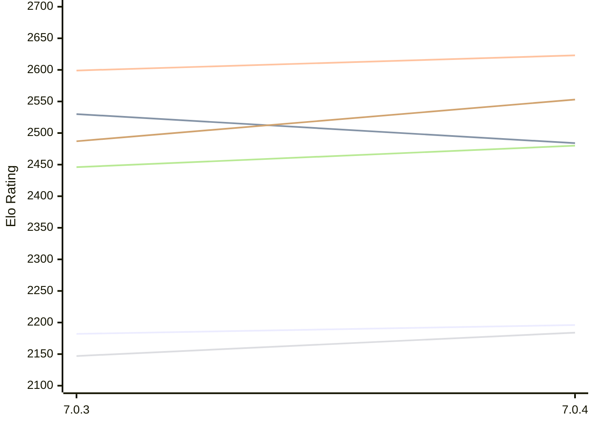

# Engine: Buster

Author: Anders Carlsson

Home: https://github.com/andersrcarlsson-stack/Buster-Chess

## Elo Ratings E1 (Ultra 7 265T (1.50 GHz) - E-Core)

| Version | Published | STC 8.0+0.08s  | LTC 60.0+0.60s | VLTC 2m24s+1.12s | Comment |
| --- | --- | --- | --- | --- | --- |
| 7.0.4 | 2026-11-05 | 2196(+14) | 2484(-46) | 2623(+24) |  |
| 7.0.3 | 2026-10-29 | 2182 | 2530 | 2599 |  |
 | | | cElo (∆ prev) | cElo (∆ prev) | cElo (∆ prev) | 

## Elo Ratings P1 (Ultra 7 265T (1.50 GHz) - P-Core)

| Version | Published | STC 8.0+0.08s  | LTC 60.0+0.60s | VLTC 2m24s+1.12s | Comment |
| --- | --- | --- | --- | --- | --- |
| 7.0.4 | 2026-11-05 | 2184(+37) | 2480(+34) | 2553(+66) |  |
| 7.0.3 | 2026-10-29 | 2147 | 2446 | 2487 |  |
 | | | cElo (∆ prev) | cElo (∆ prev) | cElo (∆ prev) | 

## Elo Ratings T1 (i5-7500T 2.70GHz)

| Version | Published | STC 8.0+0.08s  | LTC 60.0+0.60s | VLTC 2m24s+1.12s | Comment |
| --- | --- | --- | --- | --- | --- |
| 7.0.3 | 2026-10-29 | 2147 | 2446 | 2487 |  |
 | | | cElo (∆ prev) | cElo (∆ prev) | cElo (∆ prev) | 

<a href="https://github.com/computer-chess-index/cci/issues/new?template=submit-version.yml&title=[VERSION]+Buster+<version>&body=###%20Engine%20name%0ABuster%0A%0A###%20Version%0A7.0.4" target="_blank">Submit new version</a>

 Test Conditions:

GUI/CLI: <a href=https://github.com/cutechess/cutechess target="_blank">Cute-Chess</a> 
Elo Calculation: <a href=https://www.remi-coulom.fr/Bayesian-Elo/ target="_blank">Bayesian-Elo</a> 
CPU for P1: Intel(R) Core(TM) Ultra 7 265T (1.50 GHz) - P-Core 
CPU for E1: Intel(R) Core(TM) Ultra 7 265T (1.50 GHz) - E-Core 
CPU for T1: Intel(R) Core(TM) i5-7500T 2.70GHz 
Opening book: 8_moves_v3 
\* STC: 8.0+0.08s, LTC: 60.0+0.60s, VLTC: 2m24s+1.12s

 Lists:
Ratings: <a href=https://github.com/computer-chess-index/cci/blob/main/lists/CCIRatings.csv target="_blank">Complete list</a>

Generated: 2026-11-13 05:36:36

## Ratings Verlauf E1 / P1

## Detailed Evaluation Results

| Version | Time Control | Variant | Elo  | Range +/- | Matches | Score | Average Opponent Elo | Draws |
| --- | --- |--- | --- | --- | --- | --- | --- | --- |
| 7.0.4 | VLTC (2m24s+1.12s) | P1 | 2553 | 46 | 156 | 51% | 2539 | 28% |
|  |  | E1 | 2623 | 34 | 294 | 49% | 2620 | 28% |
|  | LTC (60.0+0.60s) | P1 | 2480 | 42 | 192 | 47% | 2495 | 31% |
|  |  | E1 | 2484 | 37 | 248 | 52% | 2464 | 29% |
|  | STC (8.0+0.08s) | P1 | 2184 | 46 | 156 | 48% | 2210 | 29% |
|  |  | E1 | 2196 | 37 | 256 | 51% | 2179 | 27% |
| --- | --- |--- | --- | --- | --- | --- | --- | --- |
| 7.0.3 | VLTC (2m24s+1.12s) | E1 | 2599 | 39 | 232 | 53% | 2558 | 25% |
|  |  | P1 | 2487 | 49 | 140 | 58% | 2394 | 32% |
|  | LTC (60.0+0.60s) | E1 | 2530 | 31 | 364 | 58% | 2425 | 27% |
|  |  | P1 | 2446 | 50 | 152 | 59% | 2302 | 25% |
|  | STC (8.0+0.08s) | E1 | 2182 | 42 | 214 | 55% | 2106 | 19% |
|  |  | P1 | 2147 | 48 | 164 | 58% | 2028 | 26% |