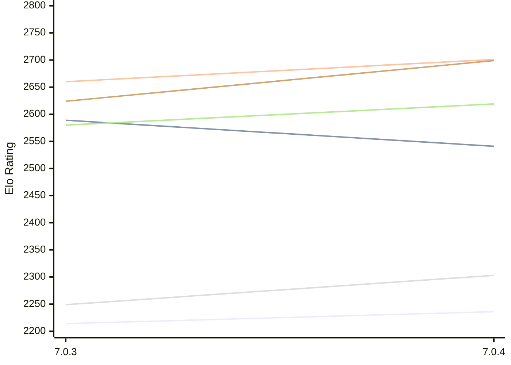

# Engine: Buster

Author: Anders Carlsson

Home: https://github.com/andersrcarlsson-stack/Buster-Chess

## Elo Ratings E1 (Ultra 7 265T (1.50 GHz) - E-Core)

| Version | Published | STC 8.0+0.08s  | LTC 60.0+0.60s | VLTC 2m24s+1.12s | Comment |
| --- | --- | --- | --- | --- | --- |
| 7.0.4 | 2026-11-05 | 2236(+22) | 2541(-48) | 2701(+41) |  |
| 7.0.3 | 2026-10-29 | 2214 | 2589 | 2660 |  |
 | | | cElo (∆ prev) | cElo (∆ prev) | cElo (∆ prev) | 

## Elo Ratings P1 (Ultra 7 265T (1.50 GHz) - P-Core)

| Version | Published | STC 8.0+0.08s  | LTC 60.0+0.60s | VLTC 2m24s+1.12s | Comment |
| --- | --- | --- | --- | --- | --- |
| 7.0.4 | 2026-11-05 | 2303(+54) | 2619(+39) | 2699(+75) |  |
| 7.0.3 | 2026-10-29 | 2249 | 2580 | 2624 |  |
 | | | cElo (∆ prev) | cElo (∆ prev) | cElo (∆ prev) | 

## Elo Ratings T1 (i5-7500T 2.70GHz)

| Version | Published | STC 8.0+0.08s  | LTC 60.0+0.60s | VLTC 2m24s+1.12s | Comment |
| --- | --- | --- | --- | --- | --- |
| 7.0.3 | 2026-10-29 | 2249 | 2580 | 2624 |  |
 | | | cElo (∆ prev) | cElo (∆ prev) | cElo (∆ prev) | 

<a href="https://github.com/computer-chess-index/cci/issues/new?template=submit-version.yml&title=[VERSION]+Buster+<version>&body=###%20Engine%20name%0ABuster%0A%0A###%20Version%0A7.0.4" target="_blank">Submit new version</a>

 Test Conditions:

GUI/CLI: <a href=https://github.com/cutechess/cutechess target="_blank">Cute-Chess</a> 
Elo Calculation: <a href=https://www.remi-coulom.fr/Bayesian-Elo/ target="_blank">Bayesian-Elo</a> 
CPU for P1: Intel(R) Core(TM) Ultra 7 265T (1.50 GHz) - P-Core 
CPU for E1: Intel(R) Core(TM) Ultra 7 265T (1.50 GHz) - E-Core 
CPU for T1: Intel(R) Core(TM) i5-7500T 2.70GHz 
Opening book: 8_moves_v3 
\* STC: 8.0+0.08s, LTC: 60.0+0.60s, VLTC: 2m24s+1.12s

 Lists:
Ratings: <a href=https://github.com/computer-chess-index/cci/blob/main/lists/CCIRatings.csv target="_blank">Complete list</a>

Generated: 2026-11-10 05:36:29

## Ratings Verlauf E1 / P1

## Detailed Evaluation Results

| Version | Time Control | Variant | Elo  | Range +/- | Matches | Score | Average Opponent Elo | Draws |
| --- | --- |--- | --- | --- | --- | --- | --- | --- |
| 7.0.4 | VLTC (2m24s+1.12s) | E1 | 2701 | 36 | 262 | 51% | 2689 | 28% |
|  |  | P1 | 2699 | 47 | 152 | 53% | 2669 | 29% |
|  | LTC (60.0+0.60s) | P1 | 2619 | 42 | 180 | 46% | 2654 | 33% |
|  |  | E1 | 2541 | 39 | 220 | 53% | 2518 | 30% |
|  | STC (8.0+0.08s) | P1 | 2303 | 50 | 132 | 49% | 2321 | 30% |
|  |  | E1 | 2236 | 38 | 236 | 50% | 2234 | 27% |
| --- | --- |--- | --- | --- | --- | --- | --- | --- |
| 7.0.3 | VLTC (2m24s+1.12s) | P1 | 2624 | 50 | 140 | 58% | 2526 | 32% |
|  |  | E1 | 2660 | 40 | 220 | 53% | 2615 | 26% |
|  | LTC (60.0+0.60s) | P1 | 2580 | 51 | 148 | 58% | 2423 | 24% |
|  |  | E1 | 2589 | 32 | 348 | 57% | 2498 | 29% |
|  | STC (8.0+0.08s) | P1 | 2249 | 50 | 156 | 58% | 2120 | 24% |
|  |  | E1 | 2214 | 42 | 208 | 54% | 2153 | 20% |