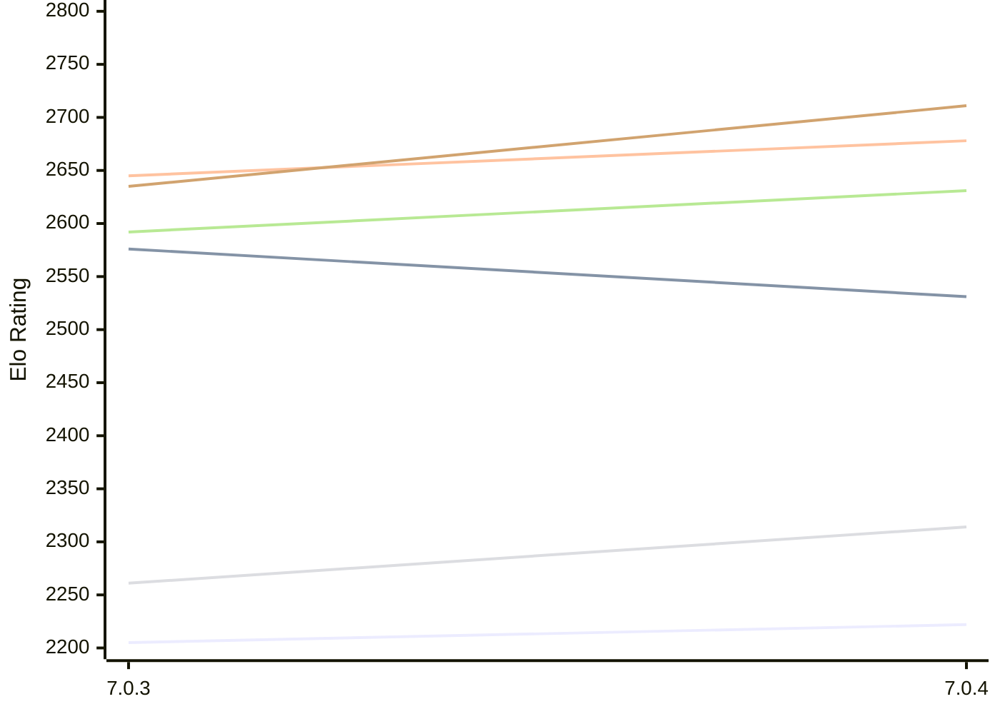

# Engine: Buster

Author: Anders Carlsson

Home: https://github.com/andersrcarlsson-stack/Buster-Chess

## Elo Ratings E1 (Ultra 7 265T (1.50 GHz) - E-Core)

| Version | Published | STC 8.0+0.08s  | LTC 60.0+0.60s | VLTC 2m24s+1.12s | Comment |
| --- | --- | --- | --- | --- | --- |
| 7.0.4 | 2026-11-05 | 2222(+17) | 2531(-45) | 2678(+33) |  |
| 7.0.3 | 2026-10-29 | 2205 | 2576 | 2645 |  |
 | | | cElo (∆ prev) | cElo (∆ prev) | cElo (∆ prev) | 

## Elo Ratings P1 (Ultra 7 265T (1.50 GHz) - P-Core)

| Version | Published | STC 8.0+0.08s  | LTC 60.0+0.60s | VLTC 2m24s+1.12s | Comment |
| --- | --- | --- | --- | --- | --- |
| 7.0.4 | 2026-11-05 | 2314(+53) | 2631(+39) | 2711(+76) |  |
| 7.0.3 | 2026-10-29 | 2261 | 2592 | 2635 |  |
 | | | cElo (∆ prev) | cElo (∆ prev) | cElo (∆ prev) | 

## Elo Ratings T1 (i5-7500T 2.70GHz)

| Version | Published | STC 8.0+0.08s  | LTC 60.0+0.60s | VLTC 2m24s+1.12s | Comment |
| --- | --- | --- | --- | --- | --- |
| 7.0.3 | 2026-10-29 | 2261 | 2592 | 2635 |  |
 | | | cElo (∆ prev) | cElo (∆ prev) | cElo (∆ prev) | 

<a href="https://github.com/computer-chess-index/cci/issues/new?template=submit-version.yml&title=[VERSION]+Buster+<version>&body=###%20Engine%20name%0ABuster%0A%0A###%20Version%0A7.0.4" target="_blank">Submit new version</a>

 Test Conditions:

GUI/CLI: <a href=https://github.com/cutechess/cutechess target="_blank">Cute-Chess</a> 
Elo Calculation: <a href=https://www.remi-coulom.fr/Bayesian-Elo/ target="_blank">Bayesian-Elo</a> 
CPU for P1: Intel(R) Core(TM) Ultra 7 265T (1.50 GHz) - P-Core 
CPU for E1: Intel(R) Core(TM) Ultra 7 265T (1.50 GHz) - E-Core 
CPU for T1: Intel(R) Core(TM) i5-7500T 2.70GHz 
Opening book: 8_moves_v3 
\* STC: 8.0+0.08s, LTC: 60.0+0.60s, VLTC: 2m24s+1.12s

 Lists:
Ratings: <a href=https://github.com/computer-chess-index/cci/blob/main/lists/CCIRatings.csv target="_blank">Complete list</a>

Generated: 2026-11-12 05:36:28

## Ratings Verlauf E1 / P1

## Detailed Evaluation Results

| Version | Time Control | Variant | Elo  | Range +/- | Matches | Score | Average Opponent Elo | Draws |
| --- | --- |--- | --- | --- | --- | --- | --- | --- |
| 7.0.4 | VLTC (2m24s+1.12s) | P1 | 2711 | 47 | 152 | 53% | 2681 | 29% |
|  |  | E1 | 2678 | 35 | 274 | 50% | 2681 | 27% |
|  | LTC (60.0+0.60s) | P1 | 2631 | 42 | 180 | 46% | 2666 | 33% |
|  |  | E1 | 2531 | 38 | 232 | 53% | 2499 | 30% |
|  | STC (8.0+0.08s) | P1 | 2314 | 47 | 152 | 49% | 2327 | 30% |
|  |  | E1 | 2222 | 37 | 240 | 50% | 2226 | 27% |
| --- | --- |--- | --- | --- | --- | --- | --- | --- |
| 7.0.3 | VLTC (2m24s+1.12s) | P1 | 2635 | 50 | 140 | 58% | 2537 | 32% |
|  |  | E1 | 2645 | 40 | 220 | 53% | 2600 | 26% |
|  | LTC (60.0+0.60s) | P1 | 2592 | 51 | 148 | 58% | 2435 | 24% |
|  |  | E1 | 2576 | 32 | 352 | 58% | 2475 | 28% |
|  | STC (8.0+0.08s) | E1 | 2205 | 42 | 208 | 54% | 2144 | 20% |
|  |  | P1 | 2261 | 49 | 160 | 58% | 2132 | 25% |