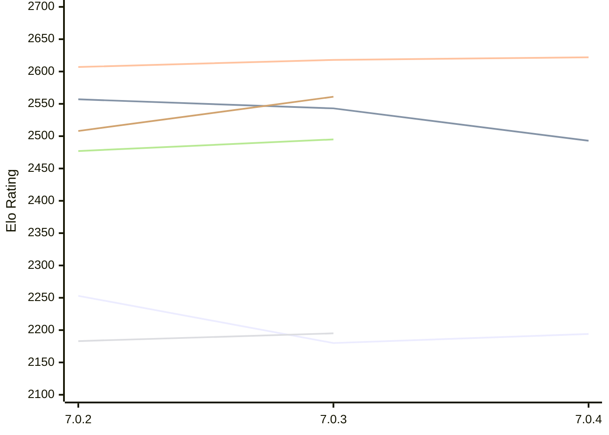

# Engine: Buster

Author: Anders Carlsson

Home: https://github.com/andersrcarlsson-stack/Buster-Chess

## Elo Ratings E1 (Ultra 7 265T (1.50 GHz) - E-Core)

| Version | Published | STC 8.0+0.08s  | LTC 60.0+0.60s | VLTC 2m24s+1.12s | Comment |
| --- | --- | --- | --- | --- | --- |
| 7.0.4 | 2026-11-05 | 2194(+14) | 2493(-50) | 2622(+4) |  |
| 7.0.3 | 2026-10-29 | 2180(-73) | 2543(-14) | 2618(+11) |  |
| 7.0.2 | 2026-09-26 | 2253 | 2557 | 2607 |  |
 | | | cElo (∆ prev) | cElo (∆ prev) | cElo (∆ prev) | 

## Elo Ratings P1 (Ultra 7 265T (1.50 GHz) - P-Core)

| Version | Published | STC 8.0+0.08s  | LTC 60.0+0.60s | VLTC 2m24s+1.12s | Comment |
| --- | --- | --- | --- | --- | --- |
| 7.0.4 | 2026-11-05 | 2195(+12) | 2495(+18) | 2561(+53) |  |
| 7.0.3 | 2026-10-29 | 2183 | 2477 | 2508 |  |
 | | | cElo (∆ prev) | cElo (∆ prev) | cElo (∆ prev) | 

## Elo Ratings T1 (i5-7500T 2.70GHz)

| Version | Published | STC 8.0+0.08s  | LTC 60.0+0.60s | VLTC 2m24s+1.12s | Comment |
| --- | --- | --- | --- | --- | --- |
| 7.0.3 | 2026-10-29 | 2183 | 2477 | 2508 |  |
 | | | cElo (∆ prev) | cElo (∆ prev) | cElo (∆ prev) | 

<a href="https://github.com/computer-chess-index/cci/issues/new?template=submit-version.yml&title=[VERSION]+Buster+<version>&body=###%20Engine%20name%0ABuster%0A%0A###%20Version%0A7.0.4" target="_blank">Submit new version</a>

 Test Conditions:

GUI/CLI: <a href=https://github.com/cutechess/cutechess target="_blank">Cute-Chess</a> 
Elo Calculation: <a href=https://www.remi-coulom.fr/Bayesian-Elo/ target="_blank">Bayesian-Elo</a> 
CPU for P1: Intel(R) Core(TM) Ultra 7 265T (1.50 GHz) - P-Core 
CPU for E1: Intel(R) Core(TM) Ultra 7 265T (1.50 GHz) - E-Core 
CPU for T1: Intel(R) Core(TM) i5-7500T 2.70GHz 
Opening book: 8_moves_v3 
\* STC: 8.0+0.08s, LTC: 60.0+0.60s, VLTC: 2m24s+1.12s

 Lists:
Ratings: <a href=https://github.com/computer-chess-index/cci/blob/main/lists/CCIRatings.csv target="_blank">Complete list</a>

Generated: 2026-11-22 05:36:34

## Ratings Verlauf E1 / P1

## Detailed Evaluation Results

| Version | Time Control | Variant | Elo  | Range +/- | Matches | Score | Average Opponent Elo | Draws |
| --- | --- |--- | --- | --- | --- | --- | --- | --- |
| 7.0.4 | VLTC (2m24s+1.12s) | P1 | 2561 | 44 | 172 | 50% | 2565 | 29% |
|  |  | E1 | 2622 | 32 | 352 | 48% | 2633 | 26% |
|  | LTC (60.0+0.60s) | P1 | 2495 | 38 | 232 | 49% | 2502 | 32% |
|  |  | E1 | 2493 | 35 | 272 | 52% | 2476 | 30% |
|  | STC (8.0+0.08s) | P1 | 2195 | 41 | 200 | 48% | 2225 | 29% |
|  |  | E1 | 2194 | 35 | 280 | 51% | 2176 | 26% |
| --- | --- |--- | --- | --- | --- | --- | --- | --- |
| 7.0.3 | VLTC (2m24s+1.12s) | P1 | 2508 | 45 | 168 | 56% | 2438 | 32% |
|  |  | E1 | 2618 | 37 | 260 | 53% | 2581 | 24% |
|  | LTC (60.0+0.60s) | P1 | 2477 | 44 | 188 | 57% | 2354 | 28% |
|  |  | E1 | 2543 | 30 | 396 | 57% | 2445 | 27% |
|  | STC (8.0+0.08s) | P1 | 2183 | 43 | 206 | 57% | 2090 | 26% |
|  |  | E1 | 2180 | 39 | 244 | 55% | 2107 | 19% |
| --- | --- |--- | --- | --- | --- | --- | --- | --- |
| 7.0.2 | VLTC (2m24s+1.12s) | E1 | 2607 | 45 | 164 | 58% | 2533 | 30% |
|  | LTC (60.0+0.60s) | E1 | 2557 | 61 | 84 | 52% | 2538 | 36% |
|  | STC (8.0+0.08s) | E1 | 2253 | 56 | 104 | 49% | 2267 | 32% |