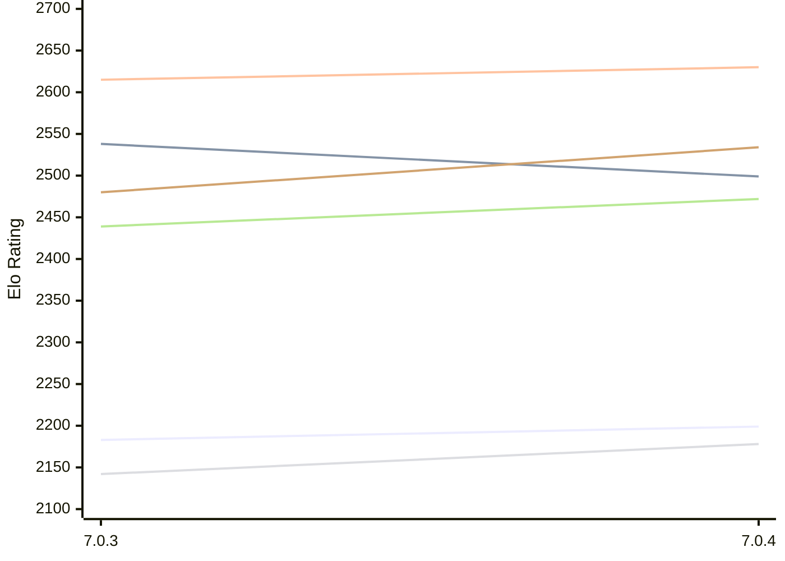

# Engine: Buster

Author: Anders Carlsson

Home: https://github.com/andersrcarlsson-stack/Buster-Chess

## Elo Ratings E1 (Ultra 7 265T (1.50 GHz) - E-Core)

| Version | Published | STC 8.0+0.08s  | LTC 60.0+0.60s | VLTC 2m24s+1.12s | Comment |
| --- | --- | --- | --- | --- | --- |
| 7.0.4 | 2026-11-05 | 2199(+16) | 2499(-39) | 2630(+15) |  |
| 7.0.3 | 2026-10-29 | 2183 | 2538 | 2615 |  |
 | | | cElo (∆ prev) | cElo (∆ prev) | cElo (∆ prev) | 

## Elo Ratings P1 (Ultra 7 265T (1.50 GHz) - P-Core)

| Version | Published | STC 8.0+0.08s  | LTC 60.0+0.60s | VLTC 2m24s+1.12s | Comment |
| --- | --- | --- | --- | --- | --- |
| 7.0.4 | 2026-11-05 | 2178(+36) | 2472(+33) | 2534(+54) |  |
| 7.0.3 | 2026-10-29 | 2142 | 2439 | 2480 |  |
 | | | cElo (∆ prev) | cElo (∆ prev) | cElo (∆ prev) | 

## Elo Ratings T1 (i5-7500T 2.70GHz)

| Version | Published | STC 8.0+0.08s  | LTC 60.0+0.60s | VLTC 2m24s+1.12s | Comment |
| --- | --- | --- | --- | --- | --- |
| 7.0.3 | 2026-10-29 | 2142 | 2439 | 2480 |  |
 | | | cElo (∆ prev) | cElo (∆ prev) | cElo (∆ prev) | 

<a href="https://github.com/computer-chess-index/cci/issues/new?template=submit-version.yml&title=[VERSION]+Buster+<version>&body=###%20Engine%20name%0ABuster%0A%0A###%20Version%0A7.0.4" target="_blank">Submit new version</a>

 Test Conditions:

GUI/CLI: <a href=https://github.com/cutechess/cutechess target="_blank">Cute-Chess</a> 
Elo Calculation: <a href=https://www.remi-coulom.fr/Bayesian-Elo/ target="_blank">Bayesian-Elo</a> 
CPU for P1: Intel(R) Core(TM) Ultra 7 265T (1.50 GHz) - P-Core 
CPU for E1: Intel(R) Core(TM) Ultra 7 265T (1.50 GHz) - E-Core 
CPU for T1: Intel(R) Core(TM) i5-7500T 2.70GHz 
Opening book: 8_moves_v3 
\* STC: 8.0+0.08s, LTC: 60.0+0.60s, VLTC: 2m24s+1.12s

 Lists:
Ratings: <a href=https://github.com/computer-chess-index/cci/blob/main/lists/CCIRatings.csv target="_blank">Complete list</a>

Generated: 2026-11-14 05:36:33

## Ratings Verlauf E1 / P1

## Detailed Evaluation Results

| Version | Time Control | Variant | Elo  | Range +/- | Matches | Score | Average Opponent Elo | Draws |
| --- | --- |--- | --- | --- | --- | --- | --- | --- |
| 7.0.4 | VLTC (2m24s+1.12s) | P1 | 2534 | 46 | 160 | 50% | 2537 | 28% |
|  |  | E1 | 2630 | 34 | 300 | 49% | 2635 | 27% |
|  | LTC (60.0+0.60s) | P1 | 2472 | 41 | 196 | 48% | 2487 | 32% |
|  |  | E1 | 2499 | 37 | 248 | 52% | 2479 | 29% |
|  | STC (8.0+0.08s) | P1 | 2178 | 46 | 156 | 48% | 2203 | 29% |
|  |  | E1 | 2199 | 36 | 260 | 51% | 2184 | 27% |
| --- | --- |--- | --- | --- | --- | --- | --- | --- |
| 7.0.3 | VLTC (2m24s+1.12s) | P1 | 2480 | 49 | 144 | 58% | 2390 | 31% |
|  |  | E1 | 2615 | 38 | 240 | 52% | 2579 | 25% |
|  | LTC (60.0+0.60s) | P1 | 2439 | 50 | 152 | 59% | 2294 | 25% |
|  |  | E1 | 2538 | 31 | 376 | 57% | 2441 | 27% |
|  | STC (8.0+0.08s) | P1 | 2142 | 46 | 176 | 57% | 2043 | 26% |
|  |  | E1 | 2183 | 41 | 222 | 55% | 2114 | 19% |