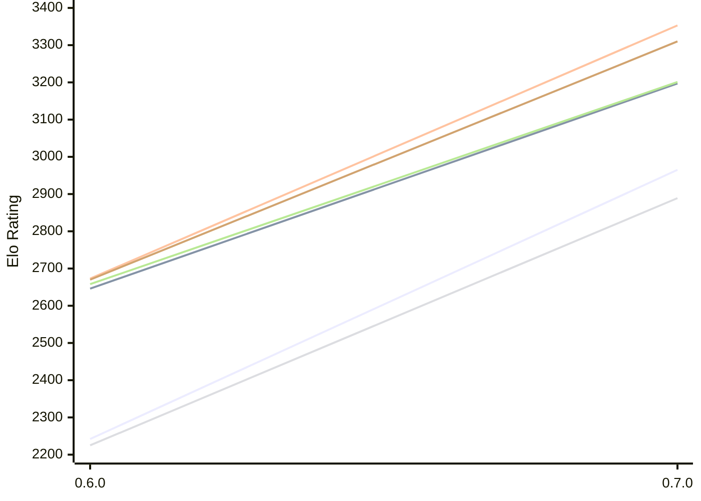

# Engine: Cadence

Author: Michael Grounds

Home: https://github.com/grounzero/cadence

## Elo Ratings E1 (Ultra 7 265T (1.50 GHz) - E-Core)

| Version | Published | STC 8.0+0.08s  | LTC 60.0+0.60s | VLTC 2m24s+1.12s | Comment |
| --- | --- | --- | --- | --- | --- |
| 0.7.0 | 2026-11-25 | 2965(+723) | 3197(+551) | 3353(+680) |  |
| 0.6.0 | 2026-11-14 | 2242 | 2646 | 2673 |  |
 | | | cElo (∆ prev) | cElo (∆ prev) | cElo (∆ prev) | 

## Elo Ratings P1 (Ultra 7 265T (1.50 GHz) - P-Core)

| Version | Published | STC 8.0+0.08s  | LTC 60.0+0.60s | VLTC 2m24s+1.12s | Comment |
| --- | --- | --- | --- | --- | --- |
| 0.7.0 | 2026-11-25 | 2889(+664) | 3201(+543) | 3310(+640) |  |
| 0.6.0 | 2026-11-14 | 2225 | 2658 | 2670 |  |
 | | | cElo (∆ prev) | cElo (∆ prev) | cElo (∆ prev) | 

## Elo Ratings T1 (i5-7500T 2.70GHz)

| Version | Published | STC 8.0+0.08s  | LTC 60.0+0.60s | VLTC 2m24s+1.12s | Comment |
| --- | --- | --- | --- | --- | --- |
| 0.6.0 | 2026-11-14 | 2225 | 2658 | 2670 |  |
 | | | cElo (∆ prev) | cElo (∆ prev) | cElo (∆ prev) | 

<a href="https://github.com/computer-chess-index/cci/issues/new?template=submit-version.yml&title=[VERSION]+Cadence+<version>&body=###%20Engine%20name%0ACadence%0A%0A###%20Version%0A0.7.0" target="_blank">Submit new version</a>

 Test Conditions:

GUI/CLI: <a href=https://github.com/cutechess/cutechess target="_blank">Cute-Chess</a> 
Elo Calculation: <a href=https://www.remi-coulom.fr/Bayesian-Elo/ target="_blank">Bayesian-Elo</a> 
CPU for P1: Intel(R) Core(TM) Ultra 7 265T (1.50 GHz) - P-Core 
CPU for E1: Intel(R) Core(TM) Ultra 7 265T (1.50 GHz) - E-Core 
CPU for T1: Intel(R) Core(TM) i5-7500T 2.70GHz 
Opening book: 8_moves_v3 
\* STC: 8.0+0.08s, LTC: 60.0+0.60s, VLTC: 2m24s+1.12s

 Lists:
Ratings: <a href=https://github.com/computer-chess-index/cci/blob/main/lists/CCIRatings.csv target="_blank">Complete list</a>

Generated: 2026-11-28 05:36:50

## Ratings Verlauf E1 / P1

## Detailed Evaluation Results

| Version | Time Control | Variant | Elo  | Range +/- | Matches | Score | Average Opponent Elo | Draws |
| --- | --- |--- | --- | --- | --- | --- | --- | --- |
| 0.7.0 | VLTC (2m24s+1.12s) | P1 | 3310 | 50 | 108 | 53% | 3267 | 61% |
|  |  | E1 | 3353 | 44 | 140 | 54% | 3298 | 63% |
|  | LTC (60.0+0.60s) | E1 | 3197 | 45 | 152 | 61% | 3092 | 51% |
|  |  | P1 | 3201 | 39 | 192 | 58% | 3121 | 54% |
|  | STC (8.0+0.08s) | E1 | 2965 | 34 | 272 | 57% | 2886 | 46% |
|  |  | P1 | 2889 | 107 | 36 | 78% | 2543 | 39% |
| --- | --- |--- | --- | --- | --- | --- | --- | --- |
| 0.6.0 | VLTC (2m24s+1.12s) | P1 | 2670 | 43 | 188 | 57% | 2599 | 26% |
|  |  | E1 | 2673 | 46 | 160 | 52% | 2657 | 26% |
|  | LTC (60.0+0.60s) | P1 | 2658 | 42 | 192 | 54% | 2612 | 28% |
|  |  | E1 | 2646 | 40 | 220 | 50% | 2645 | 24% |
|  | STC (8.0+0.08s) | P1 | 2225 | 45 | 180 | 46% | 2275 | 21% |
|  |  | E1 | 2242 | 41 | 206 | 50% | 2248 | 27% |