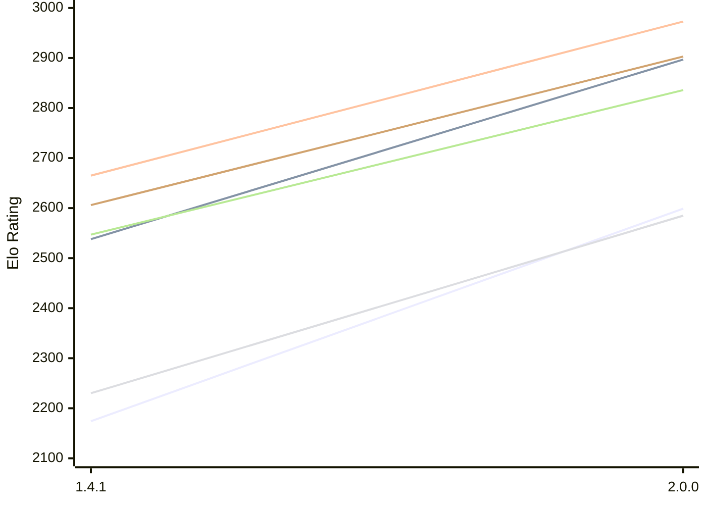
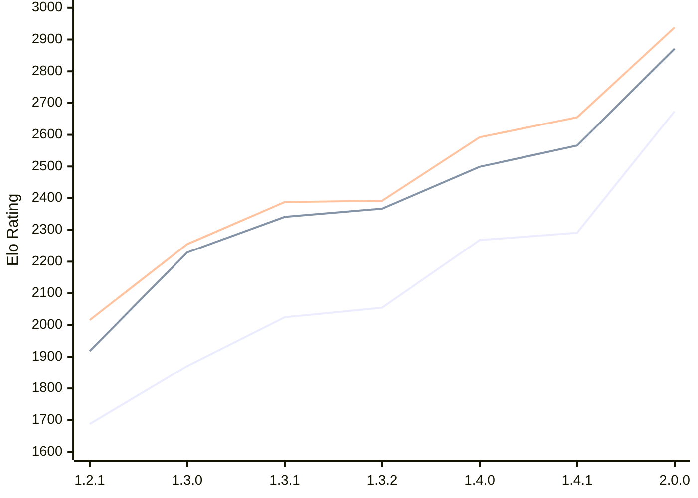

# Engine: Chal

Author: Naman Thanki

Home: https://github.com/namanthanki/chal

## Elo Ratings E1 (Ultra 7 265T (1.50 GHz) - E-Core)

| Version | Published | STC 8.0+0.08s  | LTC 60.0+0.60s | VLTC 2m24s+1.12s | Comment |
| --- | --- | --- | --- | --- | --- |
| 2.0.0 | 2026-09-08 | 2599(+425) | 2897(+359) | 2973(+308) |  |
| 1.4.1 | 2026-04-26 | 2174 | 2538 | 2665 |  |
 | | | cElo (∆ prev) | cElo (∆ prev) | cElo (∆ prev) | 

## Elo Ratings P1 (Ultra 7 265T (1.50 GHz) - P-Core)

| Version | Published | STC 8.0+0.08s  | LTC 60.0+0.60s | VLTC 2m24s+1.12s | Comment |
| --- | --- | --- | --- | --- | --- |
| 2.0.0 | 2026-09-08 | 2585(+355) | 2836(+289) | 2903(+297) |  |
| 1.4.1 | 2026-04-26 | 2230 | 2547 | 2606 |  |
 | | | cElo (∆ prev) | cElo (∆ prev) | cElo (∆ prev) | 

## Elo Ratings T1 (i5-7500T 2.70GHz)

| Version | Published | STC 8.0+0.08s  | LTC 60.0+0.60s | VLTC 2m24s+1.12s | Comment |
| --- | --- | --- | --- | --- | --- |
| 2.0.0 | 2026-09-08 | 2674(+383) | 2871(+305) | 2938(+283) |  |
| 1.4.1 | 2026-04-26 | 2291(+23) | 2566(+67) | 2655(+63) |  |
| 1.4.0 | 2026-04-01 | 2268(+213) | 2499(+132) | 2592(+200) |  |
| 1.3.2 | 2026-03-14 | 2055(+30) | 2367(+26) | 2392(+4) |  |
| 1.3.1 | 2026-03-10 | 2025(+154) | 2341(+112) | 2388(+133) |  |
| 1.3.0 | 2026-03-08 | 1871(+183) | 2229(+311) | 2255(+239) |  |
| 1.2.1 | 2026-03-07 | 1688 | 1918 | 2016 |  |
 | | | cElo (∆ prev) | cElo (∆ prev) | cElo (∆ prev) | 

<a href="https://github.com/computer-chess-index/cci/issues/new?template=submit-version.yml&title=[VERSION]+Chal+<version>&body=###%20Engine%20name%0AChal%0A%0A###%20Version%0A2.0.0" target="_blank">Submit new version</a>

 Test Conditions:

GUI/CLI: <a href=https://github.com/cutechess/cutechess target="_blank">Cute-Chess</a> 
Elo Calculation: <a href=https://www.remi-coulom.fr/Bayesian-Elo/ target="_blank">Bayesian-Elo</a> 
CPU for P1: Intel(R) Core(TM) Ultra 7 265T (1.50 GHz) - P-Core 
CPU for E1: Intel(R) Core(TM) Ultra 7 265T (1.50 GHz) - E-Core 
CPU for T1: Intel(R) Core(TM) i5-7500T 2.70GHz 
Opening book: 8_moves_v3 
\* STC: 8.0+0.08s, LTC: 60.0+0.60s, VLTC: 2m24s+1.12s

 Lists:
Ratings: <a href=https://github.com/computer-chess-index/cci/blob/main/lists/CCIRatings.csv target="_blank">Complete list</a>

Generated: 2026-11-17 05:37:04

## Ratings Verlauf E1 / P1

## Ratings Verlauf T1

## Detailed Evaluation Results

| Version | Time Control | Variant | Elo  | Range +/- | Matches | Score | Average Opponent Elo | Draws |
| --- | --- |--- | --- | --- | --- | --- | --- | --- |
| 2.0.0 | VLTC (2m24s+1.12s) | T1 | 2938 | 34 | 256 | 48% | 2950 | 43% |
|  |  | P1 | 2903 | 32 | 282 | 49% | 2912 | 49% |
|  |  | E1 | 2973 | 27 | 442 | 51% | 2954 | 39% |
|  | LTC (60.0+0.60s) | T1 | 2871 | 29 | 352 | 48% | 2890 | 43% |
|  |  | P1 | 2836 | 33 | 286 | 48% | 2858 | 40% |
|  |  | E1 | 2897 | 29 | 364 | 48% | 2917 | 45% |
|  | STC (8.0+0.08s) | P1 | 2585 | 33 | 284 | 49% | 2591 | 36% |
|  |  | E1 | 2599 | 28 | 424 | 48% | 2622 | 31% |
|  |  | T1 | 2674 | 35 | 258 | 51% | 2661 | 36% |
| --- | --- |--- | --- | --- | --- | --- | --- | --- |
| 1.4.1 | VLTC (2m24s+1.12s) | E1 | 2665 | 61 | 98 | 48% | 2669 | 19% |
|  |  | T1 | 2655 | 25 | 498 | 52% | 2638 | 34% |
|  |  | P1 | 2606 | 72 | 72 | 60% | 2354 | 32% |
|  | LTC (60.0+0.60s) | T1 | 2566 | 25 | 514 | 49% | 2573 | 33% |
|  |  | P1 | 2547 | 71 | 76 | 61% | 2435 | 29% |
|  |  | E1 | 2538 | 57 | 118 | 46% | 2610 | 22% |
|  | STC (8.0+0.08s) | T1 | 2291 | 26 | 488 | 48% | 2314 | 29% |
|  |  | P1 | 2230 | 65 | 92 | 55% | 2191 | 24% |
|  |  | E1 | 2174 | 57 | 116 | 60% | 2041 | 21% |
| --- | --- |--- | --- | --- | --- | --- | --- | --- |
| 1.4.0 | VLTC (2m24s+1.12s) | T1 | 2592 | 30 | 360 | 50% | 2589 | 33% |
|  | LTC (60.0+0.60s) | T1 | 2499 | 32 | 320 | 49% | 2504 | 31% |
|  | STC (8.0+0.08s) | T1 | 2268 | 31 | 360 | 52% | 2250 | 26% |
| --- | --- |--- | --- | --- | --- | --- | --- | --- |
| 1.3.2 | VLTC (2m24s+1.12s) | T1 | 2392 | 34 | 296 | 49% | 2402 | 28% |
|  | LTC (60.0+0.60s) | T1 | 2367 | 32 | 312 | 51% | 2361 | 33% |
|  | STC (8.0+0.08s) | T1 | 2055 | 32 | 320 | 48% | 2072 | 29% |
| --- | --- |--- | --- | --- | --- | --- | --- | --- |
| 1.3.1 | VLTC (2m24s+1.12s) | T1 | 2388 | 37 | 244 | 51% | 2375 | 27% |
|  | LTC (60.0+0.60s) | T1 | 2341 | 37 | 240 | 51% | 2333 | 29% |
|  | STC (8.0+0.08s) | T1 | 2025 | 40 | 212 | 52% | 2010 | 26% |
| --- | --- |--- | --- | --- | --- | --- | --- | --- |
| 1.3.0 | VLTC (2m24s+1.12s) | T1 | 2255 | 44 | 188 | 54% | 2219 | 21% |
|  | LTC (60.0+0.60s) | T1 | 2229 | 41 | 204 | 55% | 2186 | 27% |
|  | STC (8.0+0.08s) | T1 | 1871 | 42 | 196 | 50% | 1871 | 26% |
| --- | --- |--- | --- | --- | --- | --- | --- | --- |
| 1.2.1 | VLTC (2m24s+1.12s) | T1 | 2016 | 39 | 254 | 50% | 2025 | 15% |
|  | LTC (60.0+0.60s) | T1 | 1918 | 45 | 192 | 46% | 1989 | 16% |
|  | STC (8.0+0.08s) | T1 | 1688 | 44 | 200 | 47% | 1760 | 19% |