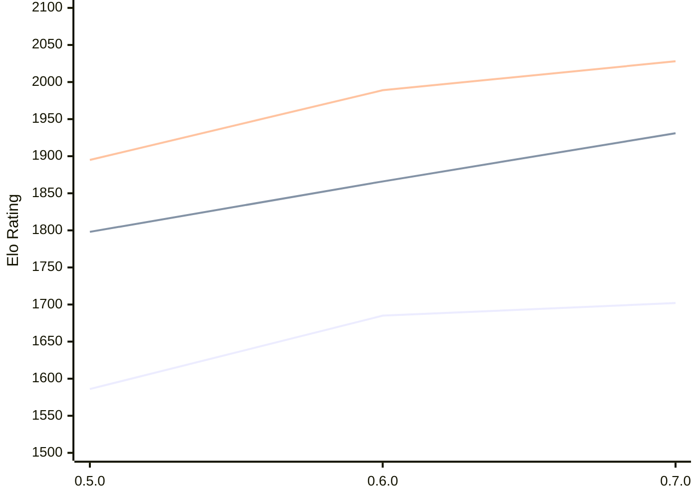

# Engine: Chess-rs

Author: Tom Cant

Home: https://github.com/tomcant/chess-rs

## Elo Ratings E1 (Ultra 7 265T (1.50 GHz) - E-Core)

| Version | Published | STC 8.0+0.08s  | LTC 60.0+0.60s | VLTC 2m24s+1.12s | Comment |
| --- | --- | --- | --- | --- | --- |
| 0.7.0 | 2025-12-31 | 1656 | 1878 | 1941 |  |
 | | | cElo (∆ prev) | cElo (∆ prev) | cElo (∆ prev) | 

## Elo Ratings P1 (Ultra 7 265T (1.50 GHz) - P-Core)

| Version | Published | STC 8.0+0.08s  | LTC 60.0+0.60s | VLTC 2m24s+1.12s | Comment |
| --- | --- | --- | --- | --- | --- |
| 0.7.0 | 2025-12-31 | 1679 | 1939 | 1998 |  |
 | | | cElo (∆ prev) | cElo (∆ prev) | cElo (∆ prev) | 

## Elo Ratings T1 (i5-7500T 2.70GHz)

| Version | Published | STC 8.0+0.08s  | LTC 60.0+0.60s | VLTC 2m24s+1.12s | Comment |
| --- | --- | --- | --- | --- | --- |
| 0.7.0 | 2025-12-31 | 1702(+17) | 1931(+65) | 2028(+39) |  |
| 0.6.0 | 2025-11-11 | 1685(+99) | 1866(+68) | 1989(+94) |  |
| 0.5.0 | 2025-11-03 | 1586 | 1798 | 1895 |  |
 | | | cElo (∆ prev) | cElo (∆ prev) | cElo (∆ prev) | 

<a href="https://github.com/computer-chess-index/cci/issues/new?template=submit-version.yml&title=[VERSION]+Chess-rs+<version>&body=###%20Engine%20name%0AChess-rs%0A%0A###%20Version%0A0.7.0" target="_blank">Submit new version</a>

 Test Conditions:

GUI/CLI: <a href=https://github.com/cutechess/cutechess target="_blank">Cute-Chess</a> 
Elo Calculation: <a href=https://www.remi-coulom.fr/Bayesian-Elo/ target="_blank">Bayesian-Elo</a> 
CPU for P1: Intel(R) Core(TM) Ultra 7 265T (1.50 GHz) - P-Core 
CPU for E1: Intel(R) Core(TM) Ultra 7 265T (1.50 GHz) - E-Core 
CPU for T1: Intel(R) Core(TM) i5-7500T 2.70GHz 
Opening book: 8_moves_v3 
\* STC: 8.0+0.08s, LTC: 60.0+0.60s, VLTC: 2m24s+1.12s

 Lists:
Ratings: <a href=https://github.com/computer-chess-index/cci/blob/main/lists/CCIRatings.csv target="_blank">Complete list</a>

Generated: 2026-10-22 04:37:05

## Ratings Verlauf T1

## Detailed Evaluation Results

| Version | Time Control | Variant | Elo  | Range +/- | Matches | Score | Average Opponent Elo | Draws |
| --- | --- |--- | --- | --- | --- | --- | --- | --- |
| 0.7.0 | VLTC (2m24s+1.12s) | T1 | 2028 | 24 | 644 | 48% | 2041 | 21% |
|  |  | P1 | 1998 | 46 | 176 | 46% | 2099 | 23% |
|  |  | E1 | 1941 | 42 | 203 | 52% | 1932 | 27% |
|  | LTC (60.0+0.60s) | T1 | 1931 | 23 | 650 | 49% | 1935 | 22% |
|  |  | P1 | 1939 | 47 | 174 | 47% | 2007 | 21% |
|  |  | E1 | 1878 | 37 | 262 | 49% | 1914 | 21% |
|  | STC (8.0+0.08s) | T1 | 1702 | 22 | 762 | 50% | 1697 | 18% |
|  |  | P1 | 1679 | 43 | 194 | 51% | 1674 | 19% |
|  |  | E1 | 1656 | 36 | 272 | 46% | 1727 | 22% |
| --- | --- |--- | --- | --- | --- | --- | --- | --- |
| 0.6.0 | VLTC (2m24s+1.12s) | T1 | 1989 | 44 | 184 | 49% | 1998 | 21% |
|  | LTC (60.0+0.60s) | T1 | 1866 | 50 | 146 | 50% | 1868 | 21% |
|  | STC (8.0+0.08s) | T1 | 1685 | 54 | 124 | 50% | 1683 | 18% |
| --- | --- |--- | --- | --- | --- | --- | --- | --- |
| 0.5.0 | VLTC (2m24s+1.12s) | T1 | 1895 | 49 | 148 | 49% | 1905 | 20% |
|  | LTC (60.0+0.60s) | T1 | 1798 | 46 | 176 | 47% | 1833 | 18% |
|  | STC (8.0+0.08s) | T1 | 1586 | 49 | 156 | 47% | 1616 | 16% |