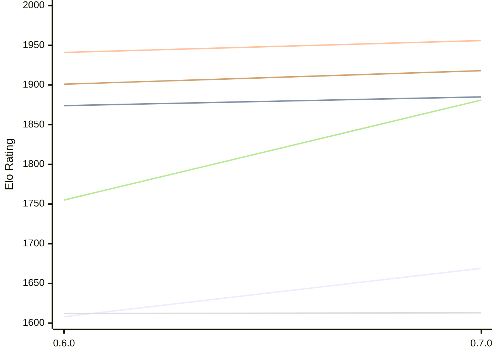
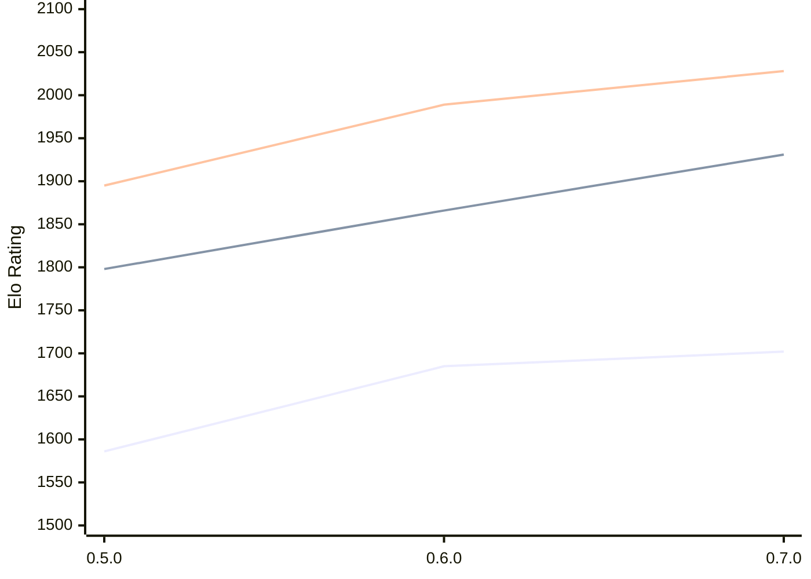

# Engine: Chess-rs

Author: Tom Cant

Home: https://github.com/tomcant/chess-rs

## Elo Ratings E1 (Ultra 7 265T (1.50 GHz) - E-Core)

| Version | Published | STC 8.0+0.08s  | LTC 60.0+0.60s | VLTC 2m24s+1.12s | Comment |
| --- | --- | --- | --- | --- | --- |
| 0.7.0 | 2025-12-31 | 1669(+61) | 1885(+11) | 1956(+15) |  |
| 0.6.0 | 2025-11-11 | 1608 | 1874 | 1941 |  |
 | | | cElo (∆ prev) | cElo (∆ prev) | cElo (∆ prev) | 

## Elo Ratings P1 (Ultra 7 265T (1.50 GHz) - P-Core)

| Version | Published | STC 8.0+0.08s  | LTC 60.0+0.60s | VLTC 2m24s+1.12s | Comment |
| --- | --- | --- | --- | --- | --- |
| 0.7.0 | 2025-12-31 | 1613(+1) | 1881(+126) | 1918(+17) |  |
| 0.6.0 | 2025-11-11 | 1612 | 1755 | 1901 |  |
 | | | cElo (∆ prev) | cElo (∆ prev) | cElo (∆ prev) | 

## Elo Ratings T1 (i5-7500T 2.70GHz)

| Version | Published | STC 8.0+0.08s  | LTC 60.0+0.60s | VLTC 2m24s+1.12s | Comment |
| --- | --- | --- | --- | --- | --- |
| 0.7.0 | 2025-12-31 | 1702(+17) | 1931(+65) | 2028(+39) |  |
| 0.6.0 | 2025-11-11 | 1685(+99) | 1866(+68) | 1989(+94) |  |
| 0.5.0 | 2025-11-03 | 1586 | 1798 | 1895 |  |
 | | | cElo (∆ prev) | cElo (∆ prev) | cElo (∆ prev) | 

<a href="https://github.com/computer-chess-index/cci/issues/new?template=submit-version.yml&title=[VERSION]+Chess-rs+<version>&body=###%20Engine%20name%0AChess-rs%0A%0A###%20Version%0A0.7.0" target="_blank">Submit new version</a>

 Test Conditions:

GUI/CLI: <a href=https://github.com/cutechess/cutechess target="_blank">Cute-Chess</a> 
Elo Calculation: <a href=https://www.remi-coulom.fr/Bayesian-Elo/ target="_blank">Bayesian-Elo</a> 
CPU for P1: Intel(R) Core(TM) Ultra 7 265T (1.50 GHz) - P-Core 
CPU for E1: Intel(R) Core(TM) Ultra 7 265T (1.50 GHz) - E-Core 
CPU for T1: Intel(R) Core(TM) i5-7500T 2.70GHz 
Opening book: 8_moves_v3 
\* STC: 8.0+0.08s, LTC: 60.0+0.60s, VLTC: 2m24s+1.12s

 Lists:
Ratings: <a href=https://github.com/computer-chess-index/cci/blob/main/lists/CCIRatings.csv target="_blank">Complete list</a>

Generated: 2026-11-20 05:37:05

## Ratings Verlauf E1 / P1

## Ratings Verlauf T1

## Detailed Evaluation Results

| Version | Time Control | Variant | Elo  | Range +/- | Matches | Score | Average Opponent Elo | Draws |
| --- | --- |--- | --- | --- | --- | --- | --- | --- |
| 0.7.0 | VLTC (2m24s+1.12s) | P1 | 1918 | 40 | 232 | 47% | 1991 | 23% |
|  |  | E1 | 1956 | 34 | 319 | 52% | 1958 | 24% |
|  |  | T1 | 2028 | 24 | 644 | 48% | 2041 | 21% |
|  | LTC (60.0+0.60s) | P1 | 1881 | 42 | 220 | 49% | 1909 | 19% |
|  |  | E1 | 1885 | 31 | 370 | 51% | 1894 | 23% |
|  |  | T1 | 1931 | 23 | 650 | 49% | 1935 | 22% |
|  | STC (8.0+0.08s) | E1 | 1669 | 31 | 374 | 50% | 1681 | 24% |
|  |  | T1 | 1702 | 22 | 762 | 50% | 1697 | 18% |
|  |  | P1 | 1613 | 37 | 260 | 49% | 1640 | 20% |
| --- | --- |--- | --- | --- | --- | --- | --- | --- |
| 0.6.0 | VLTC (2m24s+1.12s) | E1 | 1941 | 56 | 124 | 52% | 1904 | 21% |
|  |  | T1 | 1989 | 44 | 184 | 49% | 1998 | 21% |
|  |  | P1 | 1901 | 71 | 88 | 30% | 2194 | 19% |
|  | LTC (60.0+0.60s) | E1 | 1874 | 56 | 122 | 44% | 1943 | 20% |
|  |  | T1 | 1866 | 50 | 146 | 50% | 1868 | 21% |
|  |  | P1 | 1755 | 63 | 92 | 41% | 1872 | 25% |
|  | STC (8.0+0.08s) | T1 | 1685 | 54 | 124 | 50% | 1683 | 18% |
|  |  | P1 | 1612 | 71 | 90 | 32% | 1879 | 13% |
|  |  | E1 | 1608 | 51 | 148 | 50% | 1588 | 18% |
| --- | --- |--- | --- | --- | --- | --- | --- | --- |
| 0.5.0 | VLTC (2m24s+1.12s) | T1 | 1895 | 49 | 148 | 49% | 1905 | 20% |
|  | LTC (60.0+0.60s) | T1 | 1798 | 46 | 176 | 47% | 1833 | 18% |
|  | STC (8.0+0.08s) | T1 | 1586 | 49 | 156 | 47% | 1616 | 16% |