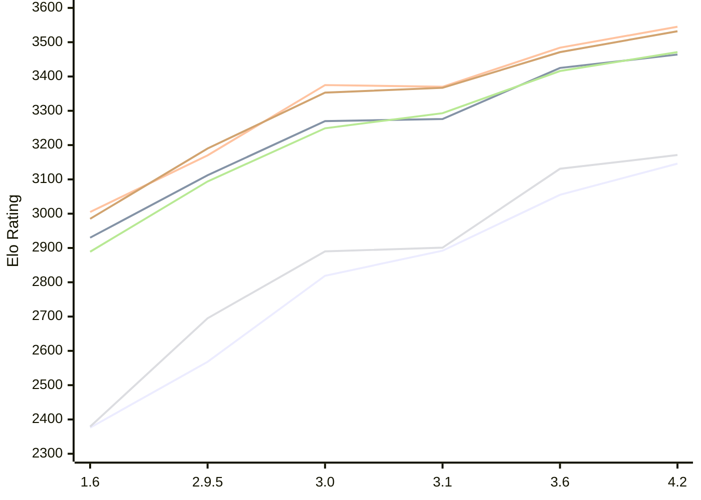

# Engine: Chessenger

Author: Dariusz Domagała

Home: https://github.com/chessengeriadoteu/chessenger

## Elo Ratings E1 (Ultra 7 265T (1.50 GHz) - E-Core)

| Version | Published | STC 8.0+0.08s  | LTC 60.0+0.60s | VLTC 2m24s+1.12s | Comment |
| --- | --- | --- | --- | --- | --- |
| 4.2 | 2026-11-12 | 3146(+91) | 3464(+39) | 3545(+61) |  |
| 3.6 | 2026-11-01 | 3055(+163) | 3425(+149) | 3484(+114) |  |
| 3.1 | 2026-10-21 | 2892(+73) | 3276(+6) | 3370(-5) |  |
| 3.0 | 2026-10-17 | 2819(+251) | 3270(+158) | 3375(+205) |  |
| 2.9.5 | 2026-10-15 | 2568(+192) | 3112(+182) | 3170(+165) |  |
| 1.6 | 2026-10-07 | 2376 | 2930 | 3005 |  |
 | | | cElo (∆ prev) | cElo (∆ prev) | cElo (∆ prev) | 

## Elo Ratings P1 (Ultra 7 265T (1.50 GHz) - P-Core)

| Version | Published | STC 8.0+0.08s  | LTC 60.0+0.60s | VLTC 2m24s+1.12s | Comment |
| --- | --- | --- | --- | --- | --- |
| 4.2 | 2026-11-12 | 3171(+40) | 3471(+55) | 3532(+61) |  |
| 3.6 | 2026-11-01 | 3131(+230) | 3416(+123) | 3471(+104) |  |
| 3.1 | 2026-10-21 | 2901(+11) | 3293(+44) | 3367(+14) |  |
| 3.0 | 2026-10-17 | 2890(+195) | 3249(+155) | 3353(+163) |  |
| 2.9.5 | 2026-10-15 | 2695(+316) | 3094(+205) | 3190(+205) |  |
| 1.6 | 2026-10-07 | 2379 | 2889 | 2985 |  |
 | | | cElo (∆ prev) | cElo (∆ prev) | cElo (∆ prev) | 

## Elo Ratings T1 (i5-7500T 2.70GHz)

| Version | Published | STC 8.0+0.08s  | LTC 60.0+0.60s | VLTC 2m24s+1.12s | Comment |
| --- | --- | --- | --- | --- | --- |
| 1.6 | 2026-10-07 | 2379 | 2889 | 2985 |  |
 | | | cElo (∆ prev) | cElo (∆ prev) | cElo (∆ prev) | 

<a href="https://github.com/computer-chess-index/cci/issues/new?template=submit-version.yml&title=[VERSION]+Chessenger+<version>&body=###%20Engine%20name%0AChessenger%0A%0A###%20Version%0A4.2" target="_blank">Submit new version</a>

 Test Conditions:

GUI/CLI: <a href=https://github.com/cutechess/cutechess target="_blank">Cute-Chess</a> 
Elo Calculation: <a href=https://www.remi-coulom.fr/Bayesian-Elo/ target="_blank">Bayesian-Elo</a> 
CPU for P1: Intel(R) Core(TM) Ultra 7 265T (1.50 GHz) - P-Core 
CPU for E1: Intel(R) Core(TM) Ultra 7 265T (1.50 GHz) - E-Core 
CPU for T1: Intel(R) Core(TM) i5-7500T 2.70GHz 
Opening book: 8_moves_v3 
\* STC: 8.0+0.08s, LTC: 60.0+0.60s, VLTC: 2m24s+1.12s

 Lists:
Ratings: <a href=https://github.com/computer-chess-index/cci/blob/main/lists/CCIRatings.csv target="_blank">Complete list</a>

Generated: 2026-11-26 05:37:26

## Ratings Verlauf E1 / P1

## Detailed Evaluation Results

| Version | Time Control | Variant | Elo  | Range +/- | Matches | Score | Average Opponent Elo | Draws |
| --- | --- |--- | --- | --- | --- | --- | --- | --- |
| 4.2 | VLTC (2m24s+1.12s) | P1 | 3532 | 55 | 76 | 52% | 3519 | 83% |
|  |  | E1 | 3545 | 35 | 194 | 51% | 3537 | 80% |
|  | LTC (60.0+0.60s) | P1 | 3471 | 41 | 140 | 54% | 3448 | 80% |
|  |  | E1 | 3464 | 37 | 176 | 50% | 3464 | 77% |
|  | STC (8.0+0.08s) | P1 | 3171 | 45 | 132 | 50% | 3171 | 59% |
|  |  | E1 | 3146 | 35 | 228 | 52% | 3129 | 53% |
| --- | --- |--- | --- | --- | --- | --- | --- | --- |
| 3.6 | VLTC (2m24s+1.12s) | P1 | 3471 | 36 | 184 | 52% | 3455 | 77% |
|  |  | E1 | 3484 | 29 | 284 | 53% | 3465 | 75% |
|  | LTC (60.0+0.60s) | P1 | 3416 | 36 | 184 | 52% | 3403 | 75% |
|  |  | E1 | 3425 | 27 | 338 | 52% | 3410 | 73% |
|  | STC (8.0+0.08s) | P1 | 3131 | 37 | 200 | 51% | 3119 | 55% |
|  |  | E1 | 3055 | 31 | 294 | 52% | 3040 | 51% |
| --- | --- |--- | --- | --- | --- | --- | --- | --- |
| 3.1 | VLTC (2m24s+1.12s) | P1 | 3367 | 29 | 300 | 54% | 3340 | 68% |
|  |  | E1 | 3370 | 29 | 306 | 52% | 3352 | 61% |
|  | LTC (60.0+0.60s) | P1 | 3293 | 34 | 232 | 50% | 3295 | 62% |
|  |  | E1 | 3276 | 34 | 224 | 50% | 3281 | 60% |
|  | STC (8.0+0.08s) | P1 | 2901 | 50 | 116 | 47% | 2930 | 47% |
|  |  | E1 | 2892 | 33 | 284 | 49% | 2896 | 36% |
| --- | --- |--- | --- | --- | --- | --- | --- | --- |
| 3.0 | VLTC (2m24s+1.12s) | E1 | 3375 | 31 | 270 | 50% | 3374 | 64% |
|  |  | P1 | 3353 | 46 | 122 | 50% | 3355 | 68% |
|  | LTC (60.0+0.60s) | E1 | 3270 | 31 | 274 | 49% | 3281 | 64% |
|  |  | P1 | 3249 | 49 | 106 | 56% | 3202 | 69% |
|  | STC (8.0+0.08s) | E1 | 2819 | 41 | 174 | 53% | 2789 | 45% |
|  |  | P1 | 2890 | 52 | 116 | 57% | 2832 | 38% |
| --- | --- |--- | --- | --- | --- | --- | --- | --- |
| 2.9.5 | VLTC (2m24s+1.12s) | P1 | 3190 | 37 | 196 | 52% | 3178 | 61% |
|  |  | E1 | 3170 | 34 | 244 | 50% | 3173 | 48% |
|  | LTC (60.0+0.60s) | P1 | 3094 | 50 | 118 | 54% | 3062 | 45% |
|  |  | E1 | 3112 | 41 | 168 | 51% | 3101 | 50% |
|  | STC (8.0+0.08s) | P1 | 2695 | 41 | 196 | 53% | 2665 | 34% |
|  |  | E1 | 2568 | 37 | 254 | 55% | 2522 | 27% |
| --- | --- |--- | --- | --- | --- | --- | --- | --- |
| 1.6 | VLTC (2m24s+1.12s) | P1 | 2985 | 50 | 130 | 55% | 2919 | 40% |
|  |  | E1 | 3005 | 43 | 168 | 55% | 2936 | 43% |
|  | LTC (60.0+0.60s) | P1 | 2889 | 57 | 116 | 63% | 2620 | 33% |
|  |  | E1 | 2930 | 40 | 218 | 57% | 2784 | 35% |
|  | STC (8.0+0.08s) | P1 | 2379 | 62 | 90 | 43% | 2444 | 24% |
|  |  | E1 | 2376 | 46 | 184 | 57% | 2255 | 23% |